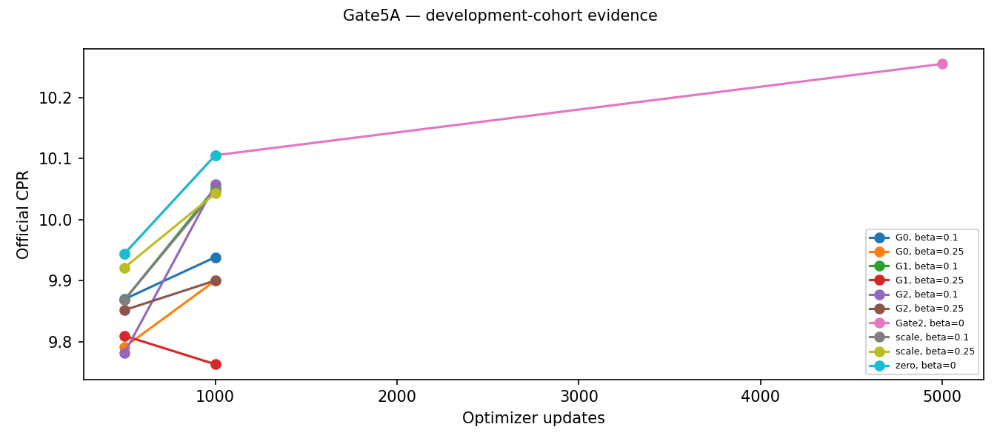
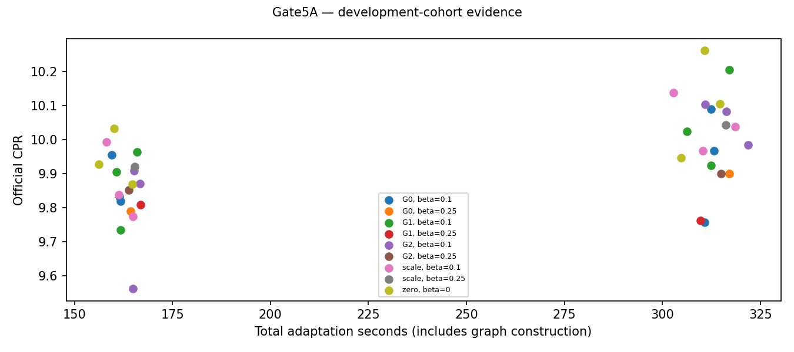
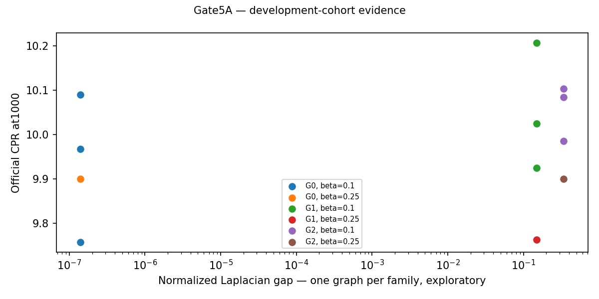
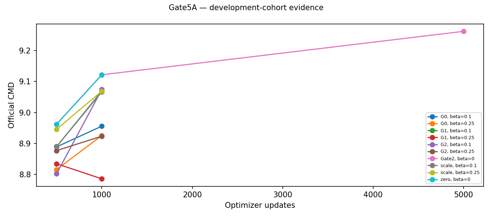
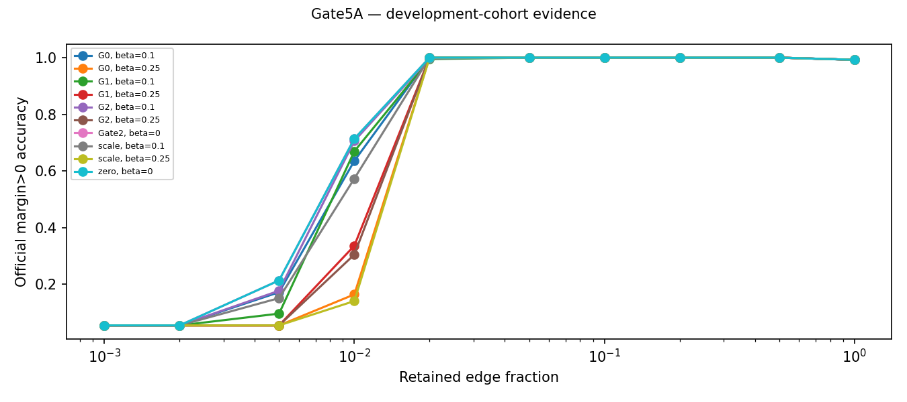
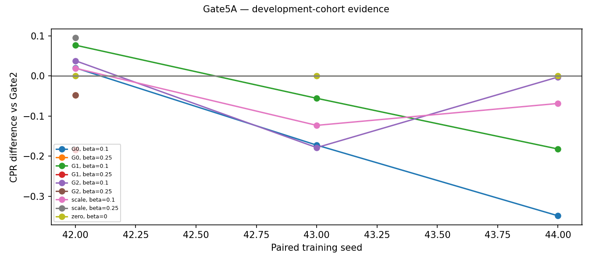

# Gate5A: Expander-coupled Matryoshka Attribution

Negative paired PhaseC result. No registered winner; PhaseD skipped.

Protocol SHA-256 `177f98a8751f408d80ac965ad9e46f67715f3c6458be03a81f48c3beded8a4e2`; implementation parent `f24406e52ee74abdf2370f832149b07ca3d552e4`. Historical Gate3 criteria remain `f200fc163bfb0e70b4790bde28ed3a6748bf9051c7d574ed7e23bda69cf0dbde`.

## Hypothesis and implementation

An auxiliary degree8 graph couples all32,491 learnable transformer-edge scores: s_effective=(1-beta)s+beta Ps. It changes score optimization, never transformer-edge eligibility. Raw scores initialize at zero; official Adam/lr.05, uniform-k, temperature.5, implicit sigmoid-top-k, live edge patching, model-weight gradient behavior and float32 remain unchanged. Only trainer-local build_mask receives effective scores. Official evaluation/export uses effective scores; raw scores and original Adam/RNG states remain in local checkpoints for exact resume. For undirected regular graphs and beta<.5 the linear map is invertible: this is reparameterization/conditioning, not an enlarged hypothesis class.

A custom symmetric linear backward uses the same fixed-degree gather/reduction as forward, P^T=P, avoiding CUDA scatter-add ordering. CPU/GPU values, gradients, finite differences, soft mass, beta0 exact trainer behavior and checkpoint continuation are tested. Graph8-neighbor indices are immutable during training. No N-square dense matrix is constructed.

## Graph construction and measured spectra

G0 is the +/-1..4 ring; G1 applies E//4=32,491 successful degree-preserving swaps; G2 is seeded NetworkX random regular. All use graph seed1701 and the identical canonical real-edge mapping across training seeds. G2 is labeled a candidate until its spectrum is measured. G0 uses analytic circulant eigenvalues; G1/G2 use sparse ARPACK and residual checks. Permutation2701 is fixed in advance and is used only for a selected G2 winner.

| family | vertices | edges | degree_min | degree_max | components | laplacian_gap | nontrivial_adjacency_magnitude | generation_seconds | spectral_seconds | neighbor_int32_bytes |
| --- | --- | --- | --- | --- | --- | --- | --- | --- | --- | --- |
| G0 | 32491 | 129964 | 8 | 8 | 1 | 0.0000 | 1.0000 | 0.0022 | 0.0015 | 1039712 |
| G1 | 32491 | 129964 | 8 | 8 | 1 | 0.1480 | 0.8520 | 0.4268 | 0.1653 | 1039712 |
| G2 | 32491 | 129964 | 8 | 8 | 1 | 0.3390 | 0.6610 | 0.6499 | 0.3546 | 1039712 |
| G2perm | 32491 | 129964 | 8 | 8 | 1 | 0.3390 | 0.6610 | 0.6499 | 0.3546 | 1039712 |

Detailed sparse memory, generation audits, eigen residuals and adjacency hashes are in graph metadata. The tiny ring gap may round to0.0000 above; the CSV/JSON retains full precision. Canonical edge identities are saved and hashed, including a compressed mapping; no score reordering occurs.

## Correctness and controls

PhaseA combines CPU graph/spectrum/gradient/official-Adam tests, full-size GPU mixing comparisons, exact beta0 GPU30-update replay, the existing official hard-mask patching oracle checks at0/.1/.5/1, then G2 beta.25 smoke30 and official frozen evaluation. Every later variant matches exact Gate2 train/dev manifests, actual row draws and uniform-k draws. The fresh zero1000 calibration must reproduce Gate2 scores bitwise. Controls use identical diagnostic cadence and precision.

## Actual held-out development results

| family | beta | seed | step | cpr | baseline_cpr | cpr_delta | relative_cpr_gain | cmd_delta | accuracy_auc_delta | time_ratio |
| --- | --- | --- | --- | --- | --- | --- | --- | --- | --- | --- |
| G0 | 0.1000 | 42 | 1000 | 9.9679 | 9.9477 | 0.0203 | 0.0020 | 0.0188 | 0.0141 | 1.0278 |
| G0 | 0.1000 | 42 | 500 | 9.8335 | 9.9275 | -0.0940 | -0.0095 | -0.0952 | 0.0078 | 1.0636 |
| G0 | 0.1000 | 43 | 1000 | 10.0899 | 10.2624 | -0.1725 | -0.0168 | -0.1726 | 0.0000 | 1.0054 |
| G0 | 0.1000 | 43 | 500 | 9.9550 | 10.0343 | -0.0793 | -0.0079 | -0.0774 | -0.0191 | 0.9920 |
| G0 | 0.1000 | 44 | 1000 | 9.7576 | 10.1065 | -0.3489 | -0.0345 | -0.3435 | -0.0522 | 0.9878 |
| G0 | 0.1000 | 44 | 500 | 9.8203 | 9.8704 | -0.0501 | -0.0051 | -0.0478 | -0.0112 | 1.0272 |
| G0 | 0.2500 | 42 | 1000 | 9.9001 | 9.9477 | -0.0476 | -0.0048 | -0.0476 | 0.0016 | 1.0407 |
| G0 | 0.2500 | 42 | 500 | 9.7909 | 9.9275 | -0.1367 | -0.0138 | -0.1377 | 0.0118 | 1.0827 |
| G1 | 0.1000 | 42 | 1000 | 10.0246 | 9.9477 | 0.0769 | 0.0077 | 0.0750 | 0.0148 | 1.0051 |
| G1 | 0.1000 | 42 | 500 | 9.9060 | 9.9275 | -0.0215 | -0.0022 | -0.0210 | -0.0033 | 1.0588 |
| G1 | 0.1000 | 43 | 1000 | 10.2068 | 10.2624 | -0.0556 | -0.0054 | -0.0546 | -0.0218 | 1.0206 |
| G1 | 0.1000 | 43 | 500 | 9.9641 | 10.0343 | -0.0702 | -0.0070 | -0.0679 | -0.0179 | 1.0328 |
| G1 | 0.1000 | 44 | 1000 | 9.9243 | 10.1065 | -0.1822 | -0.0180 | -0.1774 | -0.0490 | 0.9931 |
| G1 | 0.1000 | 44 | 500 | 9.7350 | 9.8704 | -0.1353 | -0.0137 | -0.1284 | -0.0340 | 1.0270 |
| G1 | 0.2500 | 42 | 1000 | 9.7629 | 9.9477 | -0.1848 | -0.0186 | -0.1875 | 0.0188 | 1.0165 |
| G1 | 0.2500 | 42 | 500 | 9.8098 | 9.9275 | -0.1178 | -0.0119 | -0.1190 | 0.0102 | 1.0997 |
| G2 | 0.1000 | 42 | 1000 | 9.9858 | 9.9477 | 0.0381 | 0.0038 | 0.0387 | -0.0033 | 1.0564 |
| G2 | 0.1000 | 42 | 500 | 9.8719 | 9.9275 | -0.0556 | -0.0056 | -0.0549 | -0.0031 | 1.0982 |
| G2 | 0.1000 | 43 | 1000 | 10.0837 | 10.2624 | -0.1787 | -0.0174 | -0.1790 | -0.0027 | 1.0179 |
| G2 | 0.1000 | 43 | 500 | 9.9096 | 10.0343 | -0.1247 | -0.0124 | -0.1213 | -0.0221 | 1.0277 |
| G2 | 0.1000 | 44 | 1000 | 10.1039 | 10.1065 | -0.0026 | -0.0003 | -0.0021 | -0.0100 | 0.9883 |
| G2 | 0.1000 | 44 | 500 | 9.5619 | 9.8704 | -0.3085 | -0.0313 | -0.3034 | -0.0253 | 1.0473 |
| G2 | 0.2500 | 42 | 1000 | 9.9002 | 9.9477 | -0.0475 | -0.0048 | -0.0497 | 0.0157 | 1.0338 |
| G2 | 0.2500 | 42 | 500 | 9.8517 | 9.9275 | -0.0758 | -0.0076 | -0.0767 | 0.0071 | 1.0803 |
| scale | 0.1000 | 42 | 1000 | 9.9671 | 9.9477 | 0.0194 | 0.0020 | 0.0205 | -0.0063 | 1.0184 |
| scale | 0.1000 | 42 | 500 | 9.8383 | 9.9275 | -0.0892 | -0.0090 | -0.0888 | -0.0024 | 1.0630 |
| scale | 0.1000 | 43 | 1000 | 10.1392 | 10.2624 | -0.1232 | -0.0120 | -0.1233 | -0.0027 | 0.9747 |
| scale | 0.1000 | 43 | 500 | 9.9934 | 10.0343 | -0.0408 | -0.0041 | -0.0380 | -0.0156 | 0.9837 |
| scale | 0.1000 | 44 | 1000 | 10.0379 | 10.1065 | -0.0685 | -0.0068 | -0.0618 | -0.0552 | 1.0127 |
| scale | 0.1000 | 44 | 500 | 9.7739 | 9.8704 | -0.0965 | -0.0098 | -0.0895 | -0.0347 | 1.0467 |
| scale | 0.2500 | 42 | 1000 | 10.0429 | 9.9477 | 0.0953 | 0.0096 | 0.0956 | -0.0008 | 1.0378 |
| scale | 0.2500 | 42 | 500 | 9.9213 | 9.9275 | -0.0063 | -0.0006 | -0.0078 | 0.0125 | 1.0897 |
| zero | 0.0000 | 42 | 1000 | 9.9477 | 9.9477 | 0.0000 | 0.0000 | 0.0000 | 0.0000 | 1.0000 |
| zero | 0.0000 | 42 | 500 | 9.9275 | 9.9275 | 0.0000 | 0.0000 | 0.0000 | 0.0000 | 1.0293 |
| zero | 0.0000 | 43 | 1000 | 10.2624 | 10.2624 | 0.0000 | 0.0000 | 0.0000 | 0.0000 | 1.0000 |
| zero | 0.0000 | 43 | 500 | 10.0343 | 10.0343 | 0.0000 | 0.0000 | 0.0000 | 0.0000 | 0.9960 |
| zero | 0.0000 | 44 | 1000 | 10.1065 | 10.1065 | 0.0000 | 0.0000 | 0.0000 | 0.0000 | 1.0000 |
| zero | 0.0000 | 44 | 500 | 9.8704 | 9.8704 | 0.0000 | 0.0000 | 0.0000 | 0.0000 | 1.0459 |

All PhaseB results have one seed and are exploratory. Only paired PhaseC/D comparisons can meet reproducibility gates; three seeds do not establish statistical significance. No causal spectral-gap inference from one graph instance. Lower CMD indicates closer full-model margins; a CPR gain due to margin amplification is not automatically better behavioral fidelity. Compact accuracy is official IOI margin>0, not full-vocabulary top1 accuracy.

## Registered decisions

```json
{
  "PhaseB": {
    "exploratory": true,
    "selected": [
      {
        "family": "G1",
        "beta": 0.1
      }
    ],
    "results": [
      {
        "family": "G0",
        "beta": 0.1,
        "primary_plausibility": {
          "passed": false,
          "checks": {
            "CPR_gain": false,
            "CMD_guard": true,
            "time_guard": true,
            "memory_guard": true,
            "accuracy_auc_guard": true,
            "compact_0.005": true,
            "compact_0.01": true,
            "compact_0.02": true,
            "compact_0.05": true
          }
        },
        "efficiency": {
          "passed": false,
          "checks": {
            "CPR_noninferiority": false,
            "CMD_guard": true,
            "compute_saving": true,
            "accuracy_auc_guard": false,
            "compact_0.005": false,
            "compact_0.01": false,
            "compact_0.02": true,
            "compact_0.05": true
          }
        },
        "relative_cpr_gain": 0.0020372767113463475
      },
      {
        "family": "G0",
        "beta": 0.25,
        "primary_plausibility": {
          "passed": false,
          "checks": {
            "CPR_gain": false,
            "CMD_guard": true,
            "time_guard": true,
            "memory_guard": true,
            "accuracy_auc_guard": true,
            "compact_0.005": true,
            "compact_0.01": true,
            "compact_0.02": true,
            "compact_0.05": true
          }
        },
        "efficiency": {
          "passed": false,
          "checks": {
            "CPR_noninferiority": false,
            "CMD_guard": true,
            "compute_saving": true,
            "accuracy_auc_guard": false,
            "compact_0.005": false,
            "compact_0.01": false,
            "compact_0.02": true,
            "compact_0.05": true
          }
        },
        "relative_cpr_gain": -0.0047838512916899
      },
      {
        "family": "G1",
        "beta": 0.1,
        "primary_plausibility": {
          "passed": true,
          "checks": {
            "CPR_gain": true,
            "CMD_guard": true,
            "time_guard": true,
            "memory_guard": true,
            "accuracy_auc_guard": true,
            "compact_0.005": true,
            "compact_0.01": true,
            "compact_0.02": true,
            "compact_0.05": true
          }
        },
        "efficiency": {
          "passed": false,
          "checks": {
            "CPR_noninferiority": false,
            "CMD_guard": true,
            "compute_saving": true,
            "accuracy_auc_guard": false,
            "compact_0.005": false,
            "compact_0.01": false,
            "compact_0.02": true,
            "compact_0.05": true
          }
        },
        "relative_cpr_gain": 0.007733962318239085
      },
      {
        "family": "G1",
        "beta": 0.25,
        "primary_plausibility": {
          "passed": false,
          "checks": {
            "CPR_gain": false,
            "CMD_guard": true,
            "time_guard": true,
            "memory_guard": true,
            "accuracy_auc_guard": true,
            "compact_0.005": true,
            "compact_0.01": true,
            "compact_0.02": true,
            "compact_0.05": true
          }
        },
        "efficiency": {
          "passed": false,
          "checks": {
            "CPR_noninferiority": false,
            "CMD_guard": true,
            "compute_saving": true,
            "accuracy_auc_guard": false,
            "compact_0.005": false,
            "compact_0.01": false,
            "compact_0.02": true,
            "compact_0.05": true
          }
        },
        "relative_cpr_gain": -0.018573497523991844
      },
      {
        "family": "G2",
        "beta": 0.1,
        "primary_plausibility": {
          "passed": false,
          "checks": {
            "CPR_gain": false,
            "CMD_guard": true,
            "time_guard": true,
            "memory_guard": true,
            "accuracy_auc_guard": true,
            "compact_0.005": true,
            "compact_0.01": false,
            "compact_0.02": true,
            "compact_0.05": true
          }
        },
        "efficiency": {
          "passed": false,
          "checks": {
            "CPR_noninferiority": false,
            "CMD_guard": true,
            "compute_saving": true,
            "accuracy_auc_guard": false,
            "compact_0.005": false,
            "compact_0.01": false,
            "compact_0.02": true,
            "compact_0.05": true
          }
        },
        "relative_cpr_gain": 0.003831151520696352
      },
      {
        "family": "G2",
        "beta": 0.25,
        "primary_plausibility": {
          "passed": false,
          "checks": {
            "CPR_gain": false,
            "CMD_guard": true,
            "time_guard": true,
            "memory_guard": true,
            "accuracy_auc_guard": true,
            "compact_0.005": true,
            "compact_0.01": true,
            "compact_0.02": true,
            "compact_0.05": true
          }
        },
        "efficiency": {
          "passed": false,
          "checks": {
            "CPR_noninferiority": false,
            "CMD_guard": true,
            "compute_saving": true,
            "accuracy_auc_guard": false,
            "compact_0.005": false,
            "compact_0.01": false,
            "compact_0.02": true,
            "compact_0.05": true
          }
        },
        "relative_cpr_gain": -0.004777017860048471
      }
    ],
    "stopped": false,
    "no_unregistered_sweep": true
  },
  "PhaseC": {
    "winner": null,
    "results": [
      {
        "family": "G1",
        "beta": 0.1,
        "primary_provisional": {
          "passed": false,
          "checks": {
            "CPR_gain": false,
            "CMD_guard": true,
            "time_guard": true,
            "memory_guard": true,
            "positive_seeds": false,
            "accuracy_auc_guard": true,
            "compact_0.005": false,
            "compact_0.01": false,
            "compact_0.02": true,
            "compact_0.05": true
          }
        },
        "efficiency": {
          "passed": false,
          "checks": {
            "CPR_noninferiority": false,
            "CMD_guard": true,
            "compute_saving": true,
            "accuracy_auc_guard": false,
            "compact_0.005": false,
            "compact_0.01": false,
            "compact_0.02": true,
            "compact_0.05": true
          }
        },
        "G2_topology_controls": {
          "G0": {
            "passed": true,
            "checks": {
              "relative_CPR_gain": true,
              "positive_seeds": true,
              "accuracy_auc": true,
              "compact_0.005": true,
              "compact_0.01": true,
              "compact_0.02": true,
              "compact_0.05": true
            }
          },
          "G1": {
            "passed": false,
            "checks": {
              "relative_CPR_gain": false,
              "positive_seeds": false,
              "accuracy_auc": true,
              "compact_0.005": true,
              "compact_0.01": true,
              "compact_0.02": true,
              "compact_0.05": true
            }
          },
          "scale": {
            "passed": false,
            "checks": {
              "relative_CPR_gain": false,
              "positive_seeds": true,
              "accuracy_auc": true,
              "compact_0.005": true,
              "compact_0.01": true,
              "compact_0.02": true,
              "compact_0.05": true
            }
          }
        },
        "mean_relative_cpr_gain": -0.005238844562754363
      }
    ],
    "development_only": true
  },
  "final": null
}
```

## Compute and memory

| job | adaptation_seconds | training_seconds | evaluation_seconds | stage_seconds | peak_allocated_mib | cpu_rss_mib | forward_batches | example_forwards | backward_calls | optimizer_updates |
| --- | --- | --- | --- | --- | --- | --- | --- | --- | --- | --- |
| G0_b0.1_s42 | 313.1874 | 305.5809 | 55.6558 | 366.8567 | 3913.5874 | 2873.2031 | 1464 | 7272 | 1000 | 1000 |
| G0_b0.1_s43 | 312.3842 | 304.2405 | 55.5987 | 366.0045 | 3908.4829 | 2937.6055 | 1464 | 7272 | 1000 | 1000 |
| G0_b0.1_s44 | 310.7586 | 301.9735 | 54.9658 | 363.7851 | 3902.3496 | 2958.6836 | 1464 | 7272 | 1000 | 1000 |
| G0_b0.25_s42 | 317.1102 | 308.4161 | 55.6159 | 370.6467 | 3913.5874 | 2970.1758 | 1464 | 7272 | 1000 | 1000 |
| G1_b0.1_s42 | 305.8389 | 297.2840 | 55.6788 | 359.4601 | 3913.5874 | 2957.5820 | 1464 | 7272 | 1000 | 1000 |
| G1_b0.1_s43 | 316.6648 | 308.0317 | 55.4738 | 369.8588 | 3908.4829 | 2983.0859 | 1464 | 7272 | 1000 | 1000 |
| G1_b0.1_s44 | 311.9838 | 304.1221 | 56.5413 | 366.5452 | 3902.3496 | 2897.2109 | 1464 | 7272 | 1000 | 1000 |
| G1_b0.25_s42 | 309.3043 | 300.7632 | 55.9121 | 363.1786 | 3913.5874 | 2883.8633 | 1464 | 7272 | 1000 | 1000 |
| G2_b0.1_s42 | 321.2524 | 312.7080 | 56.9987 | 376.0580 | 3913.5874 | 2936.3008 | 1464 | 7272 | 1000 | 1000 |
| G2_b0.1_s43 | 315.6139 | 307.3125 | 55.7353 | 369.4245 | 3908.4829 | 2895.3203 | 1464 | 7272 | 1000 | 1000 |
| G2_b0.1_s44 | 310.2606 | 301.8953 | 55.3751 | 363.5775 | 3902.3496 | 2928.3750 | 1464 | 7272 | 1000 | 1000 |
| G2_b0.25_s42 | 314.3597 | 305.9914 | 56.2128 | 367.7520 | 3913.5874 | 2858.8945 | 1464 | 7272 | 1000 | 1000 |
| scale_b0.1_s42 | 310.3233 | 301.5908 | 56.1142 | 363.7850 | 3911.6040 | 2985.8477 | 1464 | 7272 | 1000 | 1000 |
| scale_b0.1_s43 | 302.8639 | 294.8552 | 55.4007 | 356.3069 | 3906.7495 | 2878.0508 | 1464 | 7272 | 1000 | 1000 |
| scale_b0.1_s44 | 318.5971 | 310.6408 | 56.3288 | 372.9153 | 3900.4448 | 2950.0781 | 1464 | 7272 | 1000 | 1000 |
| scale_b0.25_s42 | 316.2438 | 307.8185 | 56.5565 | 370.8236 | 3911.6040 | 2908.8711 | 1464 | 7272 | 1000 | 1000 |
| zero_b0_s42 | 304.7271 | 296.2949 | 57.9240 | 360.6367 | 3911.3560 | 2941.8672 | 1464 | 7272 | 1000 | 1000 |
| zero_b0_s43 | 310.7120 | 302.0684 | 55.6167 | 364.2885 | 3906.5015 | 2917.3906 | 1464 | 7272 | 1000 | 1000 |
| zero_b0_s44 | 314.6063 | 304.7206 | 55.3686 | 367.2797 | 3900.1968 | 2969.2695 | 1464 | 7272 | 1000 | 1000 |
| phaseA_smoke | 43.0050 | 9.0298 | 27.7997 | 69.2426 | 3096.3228 | 2871.3398 | 295 | 3199 | 90 | 90 |

Instrumented model stages: 117.140min; real root forward batches 28,111; example-forwards 141,367; backward calls 19,090; optimizer updates 19,090.

Actual child-process timers sum to **122.210min**, including all replay/smoke, rejected candidates and evaluations. Graph construction, CPU/GPU tests, spectra and reporting are separate research work. Deployable adaptation costs additionally charge the corresponding graph generation/validation; spectra are excluded from training-overhead comparisons and reported separately. CUDA timing uses synchronized monotonic perf_counter; upstream calendar progress logs can jump on WSL. Peak allocation is PyTorch allocator usage, CPU RSS is sampled, neither is total physical device occupancy.

The matched_compute.csv comparison uses the nearest already-evaluated ordinary500/1000/5000 checkpoint by actual recorded time, reporting its timing mismatch explicitly. It is approximate, not an exactly time-matched rerun. Fresh zero1000 controls provide common instrumentation/setup; longer ordinary training timers come from Gate2. Partial500/2500 costs reconstruct measured prefix training plus fixed process/restart setup, not separately launched jobs. Every interrupted/rejected attempt remains charged.

## Stability and structural diagnostics

Retained sets use the official signed ranking and connectivity pruning. Pairwise cross-seed Jaccard is in ranking_stability.csv; a one-seed variant has no cross-seed stability estimate. Raw/effective gradient norms, variance, gradient concentration and successive rank changes are in gradient_diagnostics.csv. Structural score summaries group source/destination attention heads, MLPs and edge types; these are diagnostic, not tuning targets. Full retained edge lists and score vectors stay local.

## Limitations and recommendation

The fixed128-prompt development cohort has been reused across gates. Final5000-step modified quality is untested if an earlier gate fails. No private/public test split, full-data multi-model run, deferred ranking refinement, swaps, hard-mask continuation or leaderboard submission is performed. Preserve any negative result; do not extend beta/topology sweeps. If the registered gates fail, retain ordinary MAttr as the reference and investigate the recorded gradient/compact-accuracy tradeoffs before proposing a separately preregistered study. A development success would still require independent validation before generalization or leaderboard claims.














## Final artifact audit

Passed six CPU tests and real CUDA graph/model checks. All 4033 protected historical files are unchanged; historical Gate3 criteria SHA remains `f200fc163bfb0e70b4790bde28ed3a6748bf9051c7d574ed7e23bda69cf0dbde`. All32,491 edge identities align, degree8 graphs are simple/undirected/connected, raw checkpoint state and effective ranking export agree, and actual training rows/k draws match Gate2. Fresh beta0 calibration scores match Gate2 bitwise. No inference gradients or model forwards were used by this audit.

### Screen summary (single-seed rows are exploratory)

| family | beta | seeds | relative_CPR_change | CMD_change | accuracy_log_AUC_change | time_ratio |
| --- | --- | --- | --- | --- | --- | --- |
| G0 | 0.1000 | 3 | -0.0164 | -0.1658 | -0.0127 | 1.0070 |
| G0 | 0.2500 | 1 | -0.0048 | -0.0476 | 0.0016 | 1.0407 |
| G1 | 0.1000 | 3 | -0.0052 | -0.0523 | -0.0187 | 1.0063 |
| G1 | 0.2500 | 1 | -0.0186 | -0.1875 | 0.0188 | 1.0165 |
| G2 | 0.1000 | 3 | -0.0046 | -0.0475 | -0.0053 | 1.0209 |
| G2 | 0.2500 | 1 | -0.0048 | -0.0497 | 0.0157 | 1.0338 |
| scale | 0.1000 | 3 | -0.0056 | -0.0549 | -0.0214 | 1.0019 |
| scale | 0.2500 | 1 | 0.0096 | 0.0956 | -0.0008 | 1.0378 |
| zero | 0.0000 | 3 | 0.0000 | 0.0000 | 0.0000 | 1.0000 |

| family | beta | accuracy_delta_0.005 | accuracy_delta_0.01 | accuracy_delta_0.02 | accuracy_delta_0.05 |
| --- | --- | --- | --- | --- | --- |
| G0 | 0.1000 | -0.0417 | -0.0781 | 0.0000 | 0.0000 |
| G0 | 0.2500 | 0.0000 | 0.0156 | 0.0000 | 0.0000 |
| G1 | 0.1000 | -0.1172 | -0.0443 | -0.0052 | 0.0000 |
| G1 | 0.2500 | 0.0000 | 0.1875 | 0.0000 | 0.0000 |
| G2 | 0.1000 | -0.0365 | -0.0078 | -0.0026 | 0.0000 |
| G2 | 0.2500 | 0.0000 | 0.1562 | 0.0000 | 0.0000 |
| scale | 0.1000 | -0.0625 | -0.1406 | 0.0000 | 0.0000 |
| scale | 0.2500 | 0.0000 | -0.0078 | 0.0000 | 0.0000 |
| zero | 0.0000 | 0.0000 | 0.0000 | 0.0000 | 0.0000 |

Real root forwards 28,111; example-forwards 141,367; backwards 19,090; optimizer updates 19,090. Actual child-launch timers total 122.210min. See final_validation.json, all saved curves and local raw/effective vectors.

## Historical full-data reference (additional context)

| training_examples | validation_examples | seed | updates | CPR | CMD | accuracy_log_AUC | scope |
| --- | --- | --- | --- | --- | --- | --- | --- |
| 10000 | 10000 | 42 | 5000 | 10.5880 | 9.6008 | 0.7372 | Gate1 full official validation |
| 10000 | 128 | 42 | 5000 | 10.7255 | 9.7382 | 0.7383 | Frozen Gate1 ranking on Gate2 development cohort |

These are reused Gate1 results, with zero new model forwards or training. The full10000-validation result uses a different evaluation cohort. Neither row is the paired N128-training control; frozen Gate2 checkpoints remain the primary comparator.
