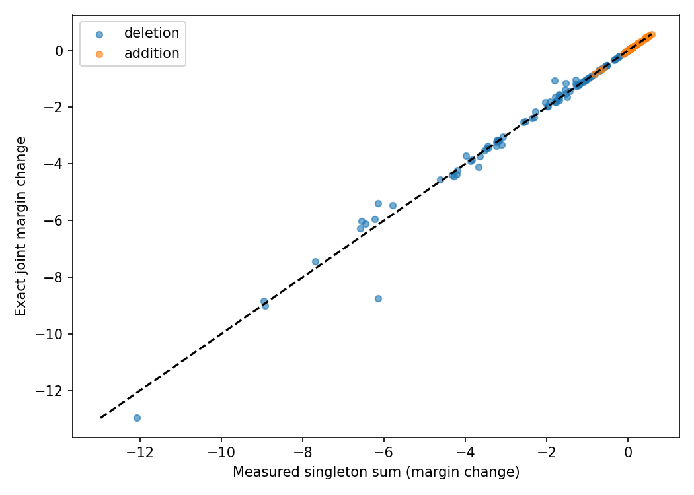
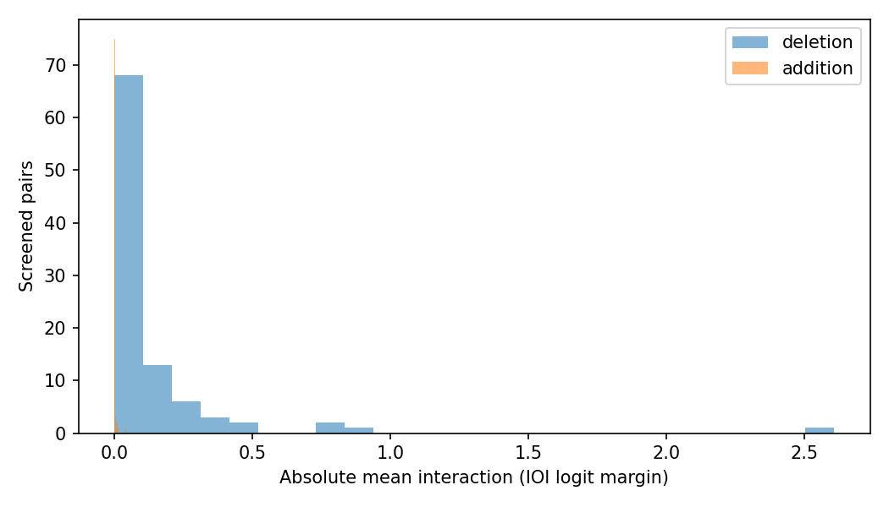
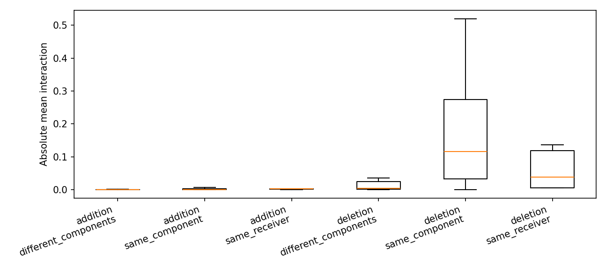
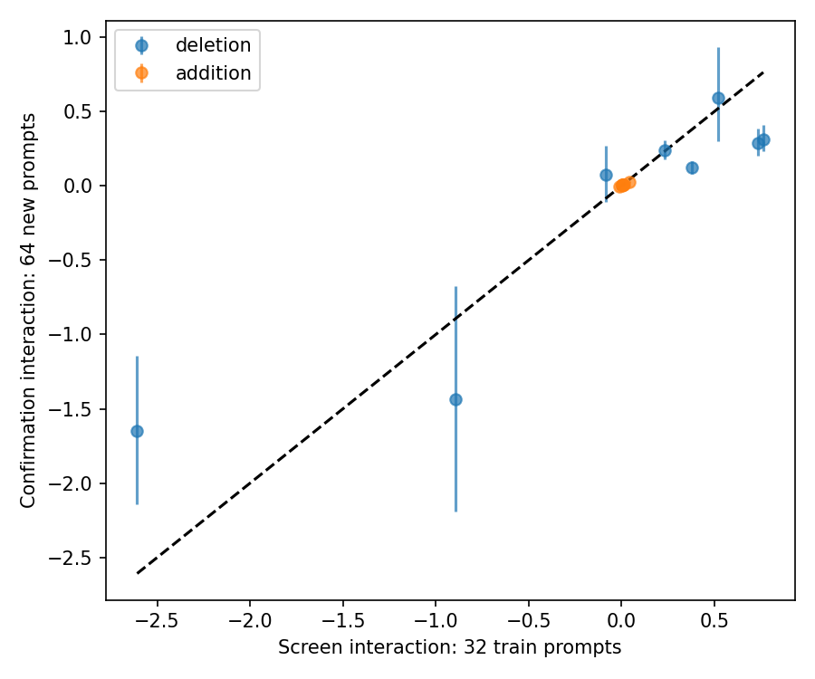
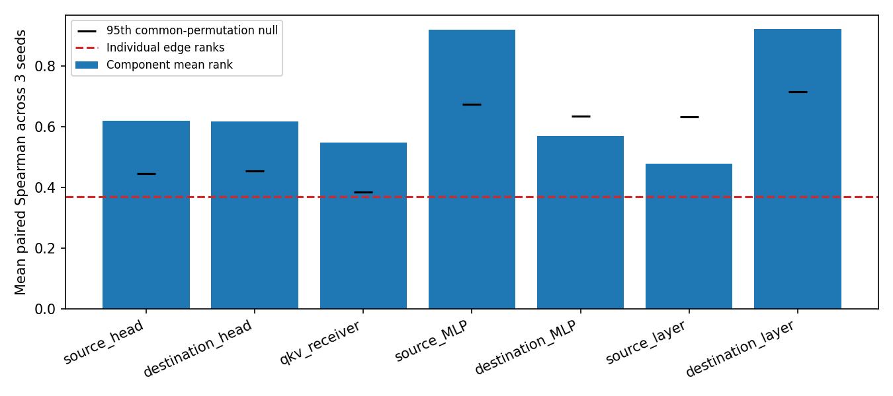

# Gate 5B: Edge interactions and component structure

Frozen diagnostic decision: **Option B**. No MAttr training, new mask algorithm, ranking refinement, or leaderboard submission occurred.

## Design and intervention semantics

GPT-2 Small, official MIB IOI, all32,491 edges. Saved Gate2 N128 rankings at5000 updates; seed42 interventions, seeds42/43/44 offline stability. Screen uses the first32 exact discovery rows; confirmation uses64 newly selected official validation prompts disjoint by row and clean prompt from prior small Gate2–5A development/confirmation manifests and from discovery prompts. Historical Gate1 used full validation, so this is fresh relative to development cohorts, not untouched across all research. Protocol SHA-256 `2ed5dd02a7b58377b532e3753abf088034a68c999d17766953bc2c6d60ea1519`.

Each base circuit is selected by official signed apply_topn and connectivity pruning. Subsequent individual/joint toggles are accepted only if official prune leaves exactly that mask. This fixes circuit context and prevents collateral cleanup from masquerading as interactions. Unsafe paths are recorded in topology_selection_audit.csv. Pruning stays enabled in the evaluator; disconnected additions are excluded. Consequently these diagnostics do not exhaust interactions requiring several new connecting edges.

The official evaluate_graph patcher is used verbatim. Safe caching stores immutable donor-only source matrices; every clean/patched source is recomputed live. Source/model/token/mask/cohort identities guard caches. Correctness compares dependent multi-edge paths against the pinned corrected MAttr live closure without running its trainer, and checks cache equivalence, repeatability and singleton batching. Per-example output is the official correct-minus-incorrect logit difference and official vocabulary top1 accuracy, not a homemade CPR/CMD. CPR/CMD are not computed for this bounded pair experiment.

## Pair selection and screening

48 candidates at each1%/2% nominal cutoff:24 retained and24 excluded, combining high/boundary/disagreement strata. Parent/head diversity and MLP connections are recorded. Up to120 unique i<j pairs per cutoff, stratified by receiver, shared component, cross-component and matched random controls. Shortfalls are reported rather than filling an unregistered sweep. Selection uses only learned train rankings/topology, including saved signed EAP-IG scores. Full all-pairs matrices are never constructed.

| fraction | direction | candidates | valid_pairs | joint_cleanup_rejections | selected_pairs | safe_singles_total | base_edges | requested_edges |
| --- | --- | --- | --- | --- | --- | --- | --- | --- |
| 0.0100 | deletion | 24 | 276 | 0 | 49 | 7033 | 317 | 324 |
| 0.0100 | addition | 24 | 276 | 0 | 47 | 7033 | 317 | 324 |
| 0.0200 | deletion | 24 | 276 | 0 | 47 | 10800 | 646 | 649 |
| 0.0200 | addition | 24 | 276 | 0 | 48 | 10800 | 646 | 649 |

| fraction | direction | pairs | mean_abs_interaction | median_abs_interaction | substantial_fraction | additive_sign_disagreements |
| --- | --- | --- | --- | --- | --- | --- |
| 0.0100 | addition | 47 | 0.0009 | 0.0002 | 0.0000 | 0 |
| 0.0100 | deletion | 49 | 0.0843 | 0.0046 | 0.0612 | 0 |
| 0.0200 | addition | 48 | 0.0025 | 0.0003 | 0.0000 | 0 |
| 0.0200 | deletion | 47 | 0.1543 | 0.0335 | 0.0213 | 0 |

Interactions are joint-minus-singleton-sum. A substantial interaction requires absolute mean>=.1 logit margin and relative magnitude>=.2, denominator max(.1,|single_i|+|single_j|). These are exploratory decision thresholds frozen before effects. A large interaction is not necessarily beneficial, and a deletion interaction does not demonstrate a missed addition.

## Held-out confirmation

Top3 absolute interactions plus1 joint-gain extremum per cutoff/direction were selected on train only; matched previously screened random controls were then selected by type/layer signature. Selection IDs and hashes were frozen before loading confirmation prompts. All uncertainty resamples prompts with shared draws across pairs. Tables provide95% and familywise Bonferroni intervals; pair rows are correlated and never treated as independent bootstrap units.

| fraction | direction | pairs | sign_consistency | reproduced_substantial | familywise_CI_nonzero | useful_additions | joint_accuracy_gain |
| --- | --- | --- | --- | --- | --- | --- | --- |
| 0.0100 | addition | 4 | 1.0000 | 0 | 3 | 0 | 0.0000 |
| 0.0100 | deletion | 4 | 1.0000 | 1 | 4 | 0 | -0.0078 |
| 0.0200 | addition | 4 | 1.0000 | 0 | 2 | 0 | 0.0000 |
| 0.0200 | deletion | 4 | 0.7500 | 1 | 3 | 0 | 0.0000 |

Primary pairs reproduced with substantial magnitude, consistent sign and nonzero95% CI: **2/16**. Useful held-out additions meeting the frozen margin, singleton and accuracy safeguards: **0**. Full values, sign consistency and familywise intervals are in heldout_consistency.csv; confirmation contains both primary and matched-control rows.

| pair_id | direction | interaction_train | interaction_validation | interaction_lo | interaction_hi | joint_validation | accuracy_joint | sign_consistent | useful_addition |
| --- | --- | --- | --- | --- | --- | --- | --- | --- | --- |
| 0.01_deletion_22442_24929 | deletion | 0.3771 | 0.1225 | 0.0812 | 0.1684 | -0.6194 | 0.0000 | True | False |
| 0.01_deletion_18562_21956 | deletion | 0.7635 | 0.3149 | 0.2323 | 0.4074 | -3.9878 | -0.0156 | True | False |
| 0.01_deletion_21956_22442 | deletion | 0.7341 | 0.2904 | 0.2048 | 0.3873 | -0.4942 | 0.0000 | True | False |
| 0.01_deletion_18562_30190 | deletion | 0.2310 | 0.2398 | 0.1756 | 0.3086 | -5.2604 | -0.0156 | True | False |
| 0.01_addition_3496_22242 | addition | 0.0095 | 0.0050 | 0.0027 | 0.0079 | 0.1657 | 0.0000 | True | False |
| 0.01_addition_26876_30108 | addition | 0.0089 | 0.0054 | -0.0021 | 0.0118 | 0.0559 | 0.0000 | True | False |
| 0.01_addition_1004_22242 | addition | 0.0045 | 0.0070 | 0.0034 | 0.0116 | 0.2612 | 0.0000 | True | False |
| 0.01_addition_1004_30972 | addition | 0.0027 | 0.0045 | 0.0024 | 0.0070 | 0.4724 | 0.0000 | True | False |
| 0.02_deletion_24258_24929 | deletion | -2.6082 | -1.6484 | -2.1427 | -1.1450 | -8.5274 | 0.0000 | True | False |
| 0.02_deletion_17334_18562 | deletion | -0.0855 | 0.0719 | -0.1068 | 0.2724 | -9.5430 | 0.0000 | False | False |
| 0.02_deletion_22442_24258 | deletion | 0.5201 | 0.5937 | 0.3018 | 0.9358 | -5.8458 | 0.0000 | True | False |
| 0.02_deletion_4535_18562 | deletion | -0.8919 | -1.4379 | -2.1890 | -0.6755 | -13.1672 | 0.0000 | True | False |
| 0.02_addition_30972_31884 | addition | 0.0418 | 0.0252 | 0.0186 | 0.0318 | 0.4887 | 0.0000 | True | False |
| 0.02_addition_23446_30972 | addition | 0.0117 | 0.0057 | 0.0042 | 0.0074 | 0.5083 | 0.0000 | True | False |
| 0.02_addition_24908_26098 | addition | -0.0113 | -0.0053 | -0.0143 | 0.0038 | 0.0741 | 0.0000 | True | False |
| 0.02_addition_29457_30972 | addition | 0.0029 | 0.0008 | -0.0007 | 0.0022 | 0.5047 | 0.0000 | True | False |

## Component structure and stability

Edges are grouped separately by source head, destination head, Q/K/V receiver, source/destination MLP and source/destination layer. Counts, retained fractions, eligibility-normalized enrichment, score distributions and rank distributions are saved for every group/seed/cutoff. The same edge can participate in different diagnostic groupings; grouping is not a partition across all tables. Edge sets use official connectivity-pruned membership; component ranks use mean percentile importance so size alone cannot dominate.

| grouping | components | edge_mean_spearman | component_mean_spearman | component_gain | common_permutation_null_mean | common_permutation_null_95 | above_null_95 |
| --- | --- | --- | --- | --- | --- | --- | --- |
| source_head | 144 | 0.3689 | 0.6199 | 0.2510 | 0.3401 | 0.4465 | True |
| destination_head | 144 | 0.3689 | 0.6174 | 0.2486 | 0.3305 | 0.4554 | True |
| qkv_receiver | 432 | 0.3689 | 0.5469 | 0.1781 | 0.3188 | 0.3839 | True |
| source_MLP | 12 | 0.3689 | 0.9207 | 0.5519 | 0.3065 | 0.6738 | True |
| destination_MLP | 12 | 0.3689 | 0.5688 | 0.1999 | 0.3097 | 0.6355 | False |
| source_layer | 12 | 0.3689 | 0.4779 | 0.1090 | 0.3166 | 0.6329 | False |
| destination_layer | 12 | 0.3689 | 0.9231 | 0.5542 | 0.3332 | 0.7161 | True |

The200 common edge-label permutations preserve cross-seed edge covariance, component sizes and overlapping group assignments. They test whether averaging correlated edge scores alone explains apparent stability. Top10% component/edge overlaps use comparable selection fractions but distinct units; official edge overlap at.5/1/2/5% is also saved. Three seeds give descriptive variation, not a training-randomness significance claim. Existing EAP-IG correlations are observational references, not new baseline runs.

Within-component primary versus type/layer-matched control comparison: `{"comparisons": 11, "mean_ratio": 28.075866130265318, "difference": 0.2718339995904402, "lo": 0.22327758473428813, "hi": 0.32223073911260475, "passed": true}`. Prompt-resampled confidence bounds apply to the mean difference of absolute mean interactions, with shared draws. Unmatched structural/layer differences and train-selected extremal pairs limit causal interpretations. Control matching quality is explicitly recorded; sparse candidate strata may not permit exact matching.

## Decision and limitations

Option A passes only with at least4 substantial reproducible primary interactions, at least50% primary reproducibility and2 jointly useful excluded additions with positive held-out accuracy gain. Option B passes only if at least2 groupings exceed individual-edge Spearman by.1 and the95th size/covariance-preserving null, plus >=1.5 within-component interaction concentration with a positive bootstrap difference bound. Actual frozen decision: `{"recommendation": "Option B", "option_A": false, "option_B": true, "primary_confirmation_pairs": 16, "reproduced_substantial_pairs": 2, "reproduced_fraction": 0.125, "useful_excluded_additions": 0, "component_groupings_passing": ["source_head", "destination_head", "qkv_receiver", "source_MLP", "destination_layer"], "within_component_vs_matched_control": {"comparisons": 11, "mean_ratio": 28.075866130265318, "difference": 0.2718339995904402, "lo": 0.22327758473428813, "hi": 0.32223073911260475, "passed": true}, "model_training_updates": 0, "protocol_sha256": "2ed5dd02a7b58377b532e3753abf088034a68c999d17766953bc2c6d60ea1519"}`.

These measurements cannot establish that a new masking algorithm would improve MAttr: its existing joint soft-mask objective already encounters interactions. Candidate selection is deliberately local around two small circuits and excludes cleanup-confounded paths. IOI prompts share templates; prompt-bootstrap intervals quantify sampling of this cohort and do not establish template-family generalization. Large margins need not improve behavioral fidelity. Fresh confirmation is small and historical full-validation exposure remains. Neither proposed algorithm is implemented or authorized automatically; the original Gate5 ranking refinement remains deferred.

## Compute and preservation

| stage | success | seconds | forward_batches | example_forwards | backward_calls | optimizer_updates | peak_allocated_mib | peak_reserved_mib | sampled_peak_cpu_rss_mib |
| --- | --- | --- | --- | --- | --- | --- | --- | --- | --- |
| offline_ranking_stability | True | 4.5262 | 0 | 0 | 0 | 0 | 0.0000 | 0.0000 | 1088.7266 |
| model_loading | True | 15.5636 | 0 | 0 | 0 | 0 | 635.5142 | 690.0000 | 2975.6562 |
| training_cohort_loading | True | 0.9314 | 0 | 0 | 0 | 0 | 635.5142 | 690.0000 | 1189.4922 |
| correctness_checks | True | 7.9163 | 80 | 136 | 0 | 0 | 842.1724 | 922.0000 | 1779.1836 |
| training_screen | True | 163.5473 | 2296 | 9184 | 0 | 0 | 951.2422 | 1474.0000 | 2117.5078 |
| confirmation_cohort_loading | True | 4.0941 | 0 | 0 | 0 | 0 | 675.5415 | 1474.0000 | 2127.7930 |
| heldout_confirmation | True | 74.3669 | 1072 | 4288 | 0 | 0 | 965.3169 | 1690.0000 | 2746.2891 |

Total process wall time: **4.78min**; actual root forward batches **3,448**, example-forwards **13,608**, model backwards/optimizer updates **0/0**. Exact evaluation cache hits **528**, donor cache hits **3338**, unique exact evaluations **373**. Peak CUDA allocation **965.3MiB**. Stage timers synchronize CUDA and use monotonic perf_counter; CPU offline work is separately labeled. CPU donor-cache bytes are recorded, not counted as VRAM. Raw masks, cached outputs and prompt manifests stay local; small per-example effects contain indices and numerical effects only. Completed artifact checks protect every pre-existing tracked file. No model weights, tokens or private data are published.

## Additional artifact audit and conditional effects

All three saved Gate2 rankings vary both discovery subset and training RNG; their stability analysis cannot separate these sources. This diagnostic does not infer a causal benefit of hierarchy or interaction-aware training. Candidate and matched-control strata are limited and train-selected; observed rates are not prevalence estimates for the full graph.

| fraction | direction | control | pairs | mean_abs_interaction | mean_joint_effect | mean_accuracy_effect |
| --- | --- | --- | --- | --- | --- | --- |
| 0.0100 | addition | False | 32 | 0.0011 | 0.1273 | -0.0029 |
| 0.0100 | addition | True | 15 | 0.0006 | 0.1464 | -0.0021 |
| 0.0100 | deletion | False | 34 | 0.1129 | -1.7558 | -0.0184 |
| 0.0100 | deletion | True | 15 | 0.0195 | -1.1865 | -0.0104 |
| 0.0200 | addition | False | 33 | 0.0034 | 0.0365 | 0.0000 |
| 0.0200 | addition | True | 15 | 0.0004 | 0.0146 | 0.0000 |
| 0.0200 | deletion | False | 32 | 0.1655 | -3.2274 | 0.0000 |
| 0.0200 | deletion | True | 15 | 0.1302 | -3.3701 | 0.0000 |

| direction | stratum_i | stratum_j | pairs | mean_abs_interaction | sign_disagreements |
| --- | --- | --- | --- | --- | --- |
| addition | boundary | boundary | 23 | 0.0014 | 0.0000 |
| addition | boundary | disagreement | 29 | 0.0009 | 0.0000 |
| addition | disagreement | boundary | 17 | 0.0010 | 0.0000 |
| addition | disagreement | disagreement | 26 | 0.0034 | 0.0000 |
| deletion | boundary | boundary | 7 | 0.0010 | 0.0000 |
| deletion | boundary | disagreement | 5 | 0.0019 | 0.0000 |
| deletion | boundary | high | 9 | 0.0080 | 0.0000 |
| deletion | disagreement | boundary | 13 | 0.0047 | 0.0000 |
| deletion | disagreement | disagreement | 11 | 0.2043 | 0.0000 |
| deletion | disagreement | high | 14 | 0.1824 | 0.0000 |
| deletion | high | boundary | 11 | 0.0055 | 0.0000 |
| deletion | high | disagreement | 12 | 0.0749 | 0.0000 |
| deletion | high | high | 14 | 0.3907 | 0.0000 |

Within-component retained-edge overlaps are saved in within_component_edge_stability.csv (empty unions are undefined, not perfect stability). Component-only cross-seed prediction and descriptive within-seed variance explained are in component_identity_explanation.csv. These are additional diagnostics, not new selection objectives or modified success criteria.

| grouping | within_source_seed_eta_squared | cross_seed_component_only_R2 | cross_seed_component_prediction_spearman | cross_seed_individual_edge_spearman_same_edges |
| --- | --- | --- | --- | --- |
| destination_MLP | 0.0252 | 0.0082 | 0.0997 | 0.6399 |
| destination_head | 0.0103 | 0.0034 | 0.0597 | 0.3520 |
| destination_layer | 0.0042 | 0.0037 | 0.0527 | 0.3649 |
| qkv_receiver | 0.0288 | 0.0040 | 0.0847 | 0.3520 |
| source_MLP | 0.0410 | 0.0318 | 0.1989 | 0.5705 |
| source_head | 0.0172 | 0.0044 | 0.0740 | 0.3424 |
| source_layer | 0.0009 | -0.0002 | 0.0096 | 0.3667 |

Important control limitation: **0/16 confirmation control matches were exact on all source/destination type and layer fields**. They are the closest available controls in the frozen candidate set. The large within-component/control contrast therefore remains vulnerable to layer/connectivity confounding; it is not a causal component-structure result. No extra controls were added after outcomes.

Component means can rank consistently while explaining little individual-edge variation. Source-head component-only cross-seed R2 averages 0.0044 and source-MLP R2 0.0318 here; a coarse component constraint could discard important edge-specific information. The formal frozen gate favors OptionB as a research hypothesis, not a validated replacement for edge-level masking.

Final diagnostic conclusion: 15/16 primary interaction signs agreed between train and confirmation, but only 2/16 met the full substantial/reproducible criterion and 0 excluded additions passed the usefulness/accuracy rule. Held-out conditional edge-effect sign reversals: 0. Frozen recommendation: Option B. These diagnostics do not demonstrate that a proposed algorithm improves CPR; do not begin either algorithm automatically.

Conditional edge effects `joint - other_single` and their sign changes are in conditional_edge_effects.csv. These expose context-dependent usefulness without interpreting every nonadditive pair as a missed useful circuit. Canonical mappings, exact mask cleanup, cache algebra, selection hashes, disjoint cohorts, forward counters and unchanged historical files were independently audited with zero additional model forwards.
