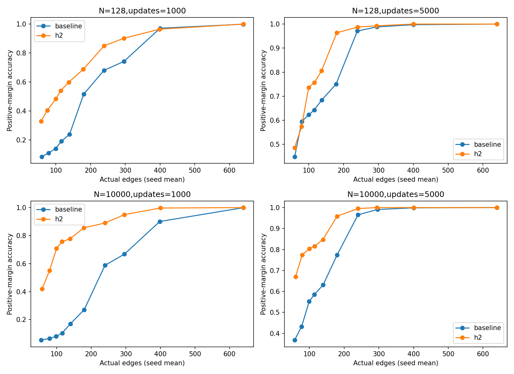
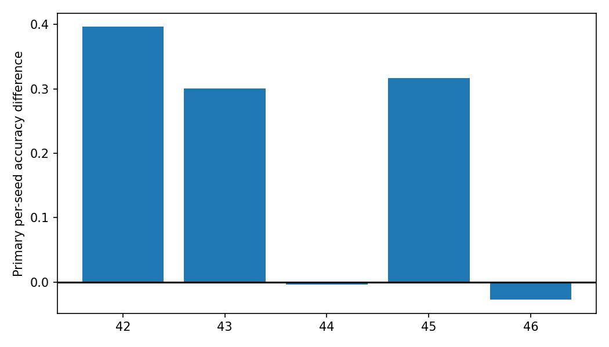
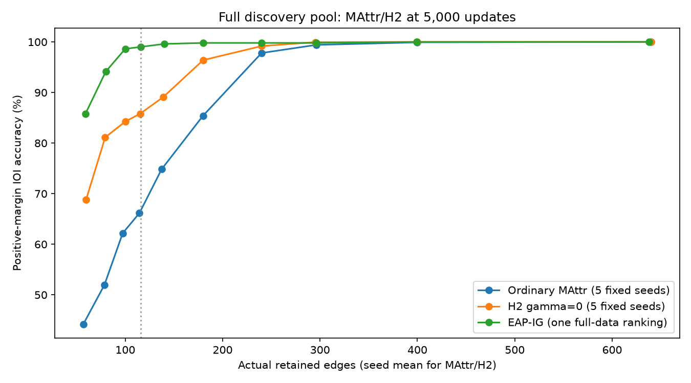

# Gate 5F: data scaling and training duration — interpreted results

## Main finding

Unregularized receiver-component hierarchy retains a meaningful compact-circuit advantage after scaling the discovery pool and training duration. The frozen classification is **Robust compact advantage**. This is a success for positive-margin IOI accuracy under the registered capped-size rule. **It did not improve official CPR, and EAP-IG achieved better accuracy at the primary compact budget.**

At N=10,000 and 5,000 updates, five-seed mean accuracy at the 116-edge cap was **85.82% for H2 versus 66.17% for ordinary MAttr**. The paired gain was **19.65 percentage points**, with a **95% paired prompt-bootstrap interval of 18.20–21.09 points**. All frozen correctness and larger-budget safeguards passed.

Three of five seeds improved; two regressed. The seed-effect SD was **19.72 points**, median **30.08 points**, and range **-2.73 to 39.65 points**. Thus the registered word “robust” does not mean every seed improved or that training-seed population significance was established. Confidence intervals resample prompts conditional on the five fixed trained models and exact template mix.

## Primary per-seed results

Accuracy columns below are percentages; differences are percentage points. All circuits contain at most116 actual edges.

| seed | baseline_accuracy_pct | h2_accuracy_pct | difference_pp | baseline_actual_edges | h2_actual_edges | corrected | broken |
| --- | --- | --- | --- | --- | --- | --- | --- |
| 42 | 11.3281 | 50.9766 | 39.6484 | 116 | 114 | 203 | 0 |
| 43 | 67.3828 | 97.4609 | 30.0781 | 115 | 116 | 154 | 0 |
| 44 | 96.6797 | 96.2891 | -0.3906 | 111 | 115 | 6 | 8 |
| 45 | 59.7656 | 91.4062 | 31.6406 | 116 | 116 | 162 | 0 |
| 46 | 95.7031 | 92.9688 | -2.7344 | 115 | 116 | 8 | 22 |

Only seed 45 is exactly size-matched at 116, where H2 gains31.64 points. The other pairs differ by one to four actual edges. This supports **capped-size superiority**, rather than a five-seed exact-size claim. Seeds44 and 46 already have high baseline accuracy and slightly worsen under H2; seed 42 remains a weak H2 outcome at 50.98% despite its large relative improvement. Across the five paired models there are 533 corrected and 30 broken prompt-model decisions; those are not 2,560 independent evaluation prompts.

## Does ordinary MAttr catch up with longer training?

It catches up partially. Using only the registered factorial seeds 42–44:

| dataset_size | step | baseline_accuracy_pct | h2_accuracy_pct | difference_pp |
| --- | --- | --- | --- | --- |
| 128 | 1000 | 19.1406 | 54.0365 | 34.8958 |
| 128 | 5000 | 64.2578 | 75.6510 | 11.3932 |
| 10000 | 1000 | 10.4167 | 75.6510 | 65.2344 |
| 10000 | 5000 | 58.4635 | 81.5755 | 23.1120 |

At N=128, longer training reduces the hierarchy advantage from 34.90 to 11.39 points. At N=10,000 it reduces the advantage from 65.23 to 23.11 points. Both methods improve in absolute accuracy, but ordinary MAttr improves more: **+45.12/+48.05 points** for N=128/N=10,000, compared with **+21.61/+5.92 points** for H2. The full-data65.23→23.11 comparison uses the same three seeds; the five-seed deciding gain of19.65 points is a separate estimand.

The registered **“Baseline catches up” classification does not pass**, because the full-data5,000-step advantage remains positive and its interval is well outside the practical-equivalence band. Narrowing the gap is different from eliminating it.

## Does more discovery data remove the advantage?

No, under this sampling design. Moving from N=128 to N=10,000 **increases** the relative H2 advantage by **30.34 points at 1,000 updates** and **11.72 points at 5,000 updates**. The data-by-duration interaction is **-18.62 points** (95% prompt interval -21.49 to -15.76). This reflects greater erosion of H2's advantage with extra optimization in the large-pool condition, not disappearance of its final advantage. The frozen data-limited pattern does not apply.

These are observed pool effects, not a clean causal estimate of dataset size: N=128 seeds vary both subset and optimization draws, while N=10,000 uses one fixed pool. “Full data” denotes the eligible pool, not a complete training pass. Five thousand stochastic draws visited **3890–3932 distinct training rows** per full-data seed. EAP-IG visited all 10,000 rows. Exact usage counts are in actual_training_example_usage.csv.

## Accuracy, CPR, CMD and EAP-IG

All comparisons below use the same fresh 512-prompt primary cohort. MAttr/H2 are five-seed averages at N=10,000/5,000 updates; EAP-IG is one full-data ranking.

| Method | Accuracy at 116-edge cap | Vocabulary top-1 at cap | Official CPR | Official CMD (lower is better) | Accuracy log-AUC |
| --- | --- | --- | --- | --- | --- |
| Ordinary MAttr | 66.17% | 61.72% | 10.535965 | 9.542178 | 0.847657 |
| H2, gamma0 | 85.82% | 76.91% | 10.429241 | 9.433280 | 0.902370 |
| Official EAP-IG | 99.02% | 91.02% | 2.021662 | 1.025542 | 0.892143 |

H2 lowers mean CPR by **0.106724** (about 1.01%) and does not improve CPR in any of the five primary seeds. Its lower CMD and higher accuracy log-AUC are different benefits. EAP-IG is strongest at the 116-edge cap, although H2 has higher accuracy log-AUC over the full official nominal grid. That grid weights extremely small nominal circuits too, so the two comparisons need not order methods identically. EAP-IG is not a five-seed significance comparison and no leaderboard/private-test evaluation was performed.

The large MAttr CPRs include pronounced margin amplification. The unmodified clean model's mean IOI margin is **3.277**; at the 640-edge cap, ordinary MAttr and H2 have mean margins of **59.343** and **57.982**, compared with **10.602** for EAP-IG. Their corresponding normalized faithfulness values are about 10.28,10.06 and 2.21. Higher CPR here is not equivalent to closer reproduction of clean-model behavior. All values come from the official normalization/evaluator; no replacement CPR/CMD was invented.

## Larger budgets and exact subsets

The five-seed H2-minus-baseline mean gains at 296, 400, and 640-edge caps are **+0.55**, **+0.08**, and **+0.00 percentage points**. No mean regression exceeds the frozen2-point safeguard. The accuracy-size curves show the main benefit in small circuits, followed by saturation. At240 edges all five pairs are exactly size-matched and the gain is1.37 points; at 400 it is0.08 points and at 640 zero. Exact subsets are descriptive and sometimes contain only one seed.

## Known IOI mechanisms and topology controls

At the primary cap, ordinary MAttr represents an average of15.0 known heads versus 17.6 for H2, compared with topology-control expectations of6.38 and 6.88. EAP-IG represents15 known heads and has the strongest compact accuracy despite not maximizing head count. All methods show incident-edge enrichment relative to the registered relabeling control; the full summaries retain each class separately.

The64 controls per observed mask exactly preserve actual size and connectivity by relabeling attention heads within layers, with Q/K/V coupled. They condition on layer structure and do not test whether the circuits favor the right layers. Head coverage/enrichment is a descriptive structural observation, not proof of causal mechanism fidelity or an explanation of H2's accuracy gains.

## Compute and integrity

Frozen protocol SHA-256: `a3daa1558382e2b78aba9ef4d73172f3dd21199535674db6f33e8113312962a9`.

- Recorded new process/stage wall time sums to **9.01 hours**: training processes 4.94 h, evaluation processes 3.55 h, attribution processes 0.46 h, plus bounded preflight and CPU preparation. This is accumulated monotonic job wall time, not CUDA utilization time or elapsed calendar time including user pauses.
- CPU aggregation/reporting took 71.3 s, including 54.3 s of topology-control analysis; do not add the latter again. Reused historical training timers total1.88 h and are separate from new work.
- The new registered training executed57,000 optimizer updates across12 trajectories. The aggregate counter is57,180, including 180 bounded smoke updates. Recorded root forwards:190,444; example-forwards:1,584,508; backwards:70,180.
- Peak CUDA allocation:5.39 GiB; peak reservation:6.62 GiB; sampled CPU RSS:4.09 GiB. These are allocator/RSS measurements, not total physical VRAM occupancy.
- Across matched new full-data seed 43–46 training stages, H2's time overhead was approximately0.88%. This is a measured training-stage comparison, not an end-to-end efficiency or leaderboard improvement claim.
- The final audit passed: all 64 evaluation jobs complete, paired streams verified, cohorts disjoint, model weights unchanged, counters reconciled and frozen classification reproduced. This interpretation independently recomputed the five deciding means from per-prompt outputs. The protocol and all previous gate decisions remain unchanged.

## Research decision

The narrow hypothesis survives: receiver-component parameterization improves compact circuits relative to ordinary MAttr after more data and training. Extra optimization erodes, but does not remove, the mean advantage. The result does **not** establish a CPR improvement, superiority to EAP-IG at the primary cap, uniform improvement across seeds, or exact-size superiority across all five pairs.

The next useful question is why seed failures persist and why EAP-IG achieves better compact correctness with far lower margin distortion. Retain ordinary MAttr as the CPR reference and EAP-IG as a required compact-accuracy reference. Prioritize independent validation and ranking-stability diagnosis before proposing another optimization change. No additional training, algorithm, research gate or submission is launched by this report.

## Detailed artifacts and figures

The complete automatically generated tables and original audit remain in [the registered analysis](results/mattr_data_scaling/gate5f/GATE5F_DATA_SCALING_REPORT.generated.md). Supporting interpretation tables include full_data_primary_summary.csv, primary_seed_interpretation.csv, factorial_interpretation.csv, actual_training_example_usage.csv, known_head_summary.csv and matched_training_overhead.csv. The secondary Gate 5E development cohort gives a20.27-point five-seed gain; it is descriptive and does not determine the classification. The primary cohort is new relative to smaller campaigns, not historically untouched across Gate1's full-validation evaluation.

