# Gate 6A faithfulness-trained MAttr

## Protocol and objective

Training SHA-256 `c8ee93736c22b8f8346f8dad519af0551fd388663696b27d63c358d96cc3a301`.

Margin matching uses squared per-example clean-margin error divided by D². KL uses the complete vocabulary and the clean distribution as target. R0 reuses the upstream per-example floored-gap CMD surrogate.

Discovery D = 5.560939789. Strategy: float32 CPU memory-mapped cache; transfer sampled row only.

Reference eapig_abs, development CMD values {'eapig_abs': 0.02962643425043935, 'eapig_signed': 1.032934253990354}. Positive ordinal score export preserves the learned signed order. The raw-absolute diagnostic uses untransformed scores.

Prior-work audit: node-level KL and CMD-shaped training appear in MAttr Appendix G.1, Table 8. The published loss ablation reports CPR and Compactness.

## Pilot

Decision **continue**. Checks {'all_5000_losses_finite': True, 'cmd_within_three_times_reference': True, 'correctness_passed': True, 'last_500_mean_strictly_lower': True}.

First and last 500-step means 0.08669934291691755 and 0.007048446524734591. CMD 0.01804679729693131, limit 0.08887930275131806.

Confirmation SHA-256 `07df545b56499577e910c46f9a9b981c871efe3e9b683041be07007c0ba7e581`.

Selected arm **M1**. Development 5,000-step arm means {'K0': 0.025761594506592416, 'K1': 0.028446730793536778, 'M0': 0.02532209217654524, 'M1': 0.02392845558265055, 'R0': 0.03207413475327948}.

## Registered CMD decision

**Inconclusive**

primary selected CMD 0.02734331, comparator CMD 0.02860539, paired difference -0.00126208 (-4.41%), 95% interval [-0.005151118185467563, 0.0029364631970309227], unstable draws 0.

mattr_abs selected CMD 0.02734331, comparator CMD 0.40854662, paired difference -0.38120331 (-93.31%), 95% interval [-0.38873710735718053, -0.373196993144311], unstable draws 0.

## Official per-ranking metrics

| role | ranking | arm | step | seed | cmd | cpr | accuracy_log_auc | faithfulness_above_one |
| --- | --- | --- | --- | --- | --- | --- | --- | --- |
| development | eapig_signed | eapig_signed | 0 | nan | 1.03293 | 2.02914 | 0.890834 | 7 |
| development | eapig_abs | eapig_abs | 0 | nan | 0.029626 | 0.969374 | 0.743013 | 0 |
| development | mattr_abs_s42_5000 | mattr_abs | 5000 | 42 | 0.432972 | 0.566028 | 0.199811 | 0 |
| development | mattr_abs_s43_5000 | mattr_abs | 5000 | 43 | 0.554796 | 0.444204 | 0.141023 | 0 |
| development | mattr_abs_s44_5000 | mattr_abs | 5000 | 44 | 0.382375 | 0.616625 | 0.411017 | 0 |
| development | mattr_abs_s45_5000 | mattr_abs | 5000 | 45 | 0.424266 | 0.574734 | 0.229058 | 0 |
| development | mattr_abs_s46_5000 | mattr_abs | 5000 | 46 | 0.249869 | 0.749131 | 0.481074 | 0 |
| development | B0_s42_1000 | B0 | 1000 | 42 | 9.21122 | 10.1865 | 0.645258 | 5 |
| development | B0_s42_5000 | B0 | 5000 | 42 | 9.62218 | 10.6094 | 0.732146 | 6 |
| development | B0_s43_1000 | B0 | 1000 | 43 | 9.16506 | 10.1525 | 0.734351 | 6 |
| development | B0_s43_5000 | B0 | 5000 | 43 | 9.6042 | 10.5971 | 0.814028 | 6 |
| development | B0_s44_1000 | B0 | 1000 | 44 | 9.29615 | 10.2818 | 0.713059 | 5 |
| development | B0_s44_5000 | B0 | 5000 | 44 | 9.75319 | 10.7494 | 0.896363 | 7 |
| development | B0_s45_1000 | B0 | 1000 | 45 | 9.13817 | 10.1252 | 0.72712 | 6 |
| development | B0_s45_5000 | B0 | 5000 | 45 | 9.55814 | 10.5529 | 0.841794 | 7 |
| development | B0_s46_1000 | B0 | 1000 | 46 | 9.24621 | 10.2375 | 0.7952 | 6 |
| development | B0_s46_5000 | B0 | 5000 | 46 | 9.57545 | 10.5731 | 0.929479 | 7 |
| development | B1_s42_1000 | B1 | 1000 | 42 | 9.03885 | 10.0296 | 0.791898 | 5 |
| development | B1_s42_5000 | B1 | 5000 | 42 | 9.57118 | 10.5632 | 0.82205 | 6 |
| development | B1_s43_1000 | B1 | 1000 | 43 | 9.23846 | 10.2337 | 0.854406 | 7 |
| development | B1_s43_5000 | B1 | 5000 | 43 | 9.41741 | 10.4144 | 0.913899 | 7 |
| development | B1_s44_1000 | B1 | 1000 | 44 | 9.13312 | 10.1257 | 0.82811 | 6 |
| development | B1_s44_5000 | B1 | 5000 | 44 | 9.58228 | 10.5798 | 0.936511 | 7 |
| development | B1_s45_1000 | B1 | 1000 | 45 | 9.15401 | 10.1443 | 0.777582 | 6 |
| development | B1_s45_5000 | B1 | 5000 | 45 | 9.4834 | 10.4797 | 0.894793 | 7 |
| development | B1_s46_1000 | B1 | 1000 | 46 | 9.04687 | 10.0425 | 0.859622 | 6 |
| development | B1_s46_5000 | B1 | 5000 | 46 | 9.50538 | 10.503 | 0.937791 | 7 |
| development | M0_s42_1000 | M0 | 1000 | 42 | 0.039653 | 0.995886 | 0.827332 | 3 |
| development | M0_s42_5000 | M0 | 5000 | 42 | 0.018047 | 0.997459 | 0.783492 | 2 |
| development | M0_s43_1000 | M0 | 1000 | 43 | 0.015509 | 0.990864 | 0.882554 | 2 |
| development | M0_s43_5000 | M0 | 5000 | 43 | 0.027904 | 0.979388 | 0.871153 | 1 |
| development | M0_s44_1000 | M0 | 1000 | 44 | 0.024955 | 0.984237 | 0.777113 | 4 |
| development | M0_s44_5000 | M0 | 5000 | 44 | 0.030015 | 0.969531 | 0.905538 | 1 |
| development | M1_s42_1000 | M1 | 1000 | 42 | 0.031279 | 0.994131 | 0.857766 | 2 |
| development | M1_s42_5000 | M1 | 5000 | 42 | 0.031221 | 0.987263 | 0.86023 | 1 |
| development | M1_s43_1000 | M1 | 1000 | 43 | 0.028452 | 0.993564 | 0.708046 | 3 |
| development | M1_s43_5000 | M1 | 5000 | 43 | 0.017993 | 0.981996 | 0.922371 | 1 |
| development | M1_s44_1000 | M1 | 1000 | 44 | 0.022481 | 0.99036 | 0.905867 | 2 |
| development | M1_s44_5000 | M1 | 5000 | 44 | 0.022571 | 0.99437 | 0.886266 | 3 |
| development | K0_s42_1000 | K0 | 1000 | 42 | 0.027406 | 0.977401 | 0.791939 | 2 |
| development | K0_s42_5000 | K0 | 5000 | 42 | 0.030316 | 0.997241 | 0.755915 | 2 |
| development | K0_s43_1000 | K0 | 1000 | 43 | 0.026332 | 0.975968 | 0.836548 | 3 |
| development | K0_s43_5000 | K0 | 5000 | 43 | 0.026293 | 0.972707 | 0.881822 | 0 |
| development | K0_s44_1000 | K0 | 1000 | 44 | 0.047674 | 0.954794 | 0.742671 | 1 |
| development | K0_s44_5000 | K0 | 5000 | 44 | 0.020675 | 0.978325 | 0.818027 | 0 |
| development | K1_s42_1000 | K1 | 1000 | 42 | 0.027618 | 0.975461 | 0.833115 | 1 |
| development | K1_s42_5000 | K1 | 5000 | 42 | 0.026737 | 1.0113 | 0.853113 | 3 |
| development | K1_s43_1000 | K1 | 1000 | 43 | 0.038852 | 0.999825 | 0.891336 | 5 |
| development | K1_s43_5000 | K1 | 5000 | 43 | 0.028714 | 0.976576 | 0.911393 | 1 |
| development | K1_s44_1000 | K1 | 1000 | 44 | 0.031645 | 0.971311 | 0.660452 | 1 |
| development | K1_s44_5000 | K1 | 5000 | 44 | 0.02989 | 0.978659 | 0.822009 | 1 |
| development | R0_s42_1000 | R0 | 1000 | 42 | 0.045181 | 0.98527 | 0.808549 | 4 |
| development | R0_s42_5000 | R0 | 5000 | 42 | 0.033133 | 0.982867 | 0.878004 | 3 |
| development | R0_s43_1000 | R0 | 1000 | 43 | 0.04381 | 0.96919 | 0.76519 | 2 |
| development | R0_s43_5000 | R0 | 5000 | 43 | 0.044489 | 0.954511 | 0.833964 | 0 |
| development | R0_s44_1000 | R0 | 1000 | 44 | 0.061503 | 0.942203 | 0.710331 | 2 |
| development | R0_s44_5000 | R0 | 5000 | 44 | 0.0186 | 0.9804 | 0.823946 | 0 |
| confirmation | B0_s42_5000 | B0 | 5000 | 42 | 9.77697 | 10.7642 | 0.740375 | 6 |
| confirmation | B0_s43_5000 | B0 | 5000 | 43 | 9.77969 | 10.7727 | 0.82616 | 6 |
| confirmation | B0_s44_5000 | B0 | 5000 | 44 | 9.90147 | 10.8977 | 0.911897 | 7 |
| confirmation | B0_s45_5000 | B0 | 5000 | 45 | 9.71894 | 10.7137 | 0.848042 | 7 |
| confirmation | B0_s46_5000 | B0 | 5000 | 46 | 9.75703 | 10.7547 | 0.932611 | 7 |
| confirmation | B1_s42_5000 | B1 | 5000 | 42 | 9.73447 | 10.7265 | 0.838376 | 6 |
| confirmation | B1_s43_5000 | B1 | 5000 | 43 | 9.58102 | 10.578 | 0.919793 | 7 |
| confirmation | B1_s44_5000 | B1 | 5000 | 44 | 9.74662 | 10.7441 | 0.938932 | 7 |
| confirmation | B1_s45_5000 | B1 | 5000 | 45 | 9.65459 | 10.6509 | 0.903939 | 7 |
| confirmation | B1_s46_5000 | B1 | 5000 | 46 | 9.67034 | 10.668 | 0.940083 | 7 |
| confirmation | K0_s42_5000 | K0 | 5000 | 42 | 0.03144 | 1.00005 | 0.774677 | 2 |
| confirmation | K0_s43_5000 | K0 | 5000 | 43 | 0.025703 | 0.973297 | 0.894597 | 0 |
| confirmation | K0_s44_5000 | K0 | 5000 | 44 | 0.019584 | 0.979514 | 0.832882 | 1 |
| confirmation | K1_s42_5000 | K1 | 5000 | 42 | 0.028091 | 1.01343 | 0.866617 | 3 |
| confirmation | K1_s43_5000 | K1 | 5000 | 43 | 0.028459 | 0.977067 | 0.90975 | 1 |
| confirmation | K1_s44_5000 | K1 | 5000 | 44 | 0.028977 | 0.980469 | 0.846472 | 2 |
| confirmation | M0_s42_5000 | M0 | 5000 | 42 | 0.017757 | 0.998739 | 0.804727 | 2 |
| confirmation | M0_s43_5000 | M0 | 5000 | 43 | 0.026993 | 0.980683 | 0.87768 | 1 |
| confirmation | M0_s44_5000 | M0 | 5000 | 44 | 0.030859 | 0.968761 | 0.91057 | 1 |
| confirmation | M1_s42_5000 | M1 | 5000 | 42 | 0.03236 | 0.989318 | 0.874913 | 1 |
| confirmation | M1_s43_5000 | M1 | 5000 | 43 | 0.018551 | 0.982623 | 0.928272 | 1 |
| confirmation | M1_s44_5000 | M1 | 5000 | 44 | 0.022514 | 0.993601 | 0.896504 | 4 |
| confirmation | M1_s45_5000 | M1 | 5000 | 45 | 0.028272 | 0.970728 | 0.73358 | 0 |
| confirmation | M1_s46_5000 | M1 | 5000 | 46 | 0.03502 | 0.983015 | 0.936069 | 6 |
| confirmation | R0_s42_5000 | R0 | 5000 | 42 | 0.031645 | 0.98486 | 0.892046 | 3 |
| confirmation | R0_s43_5000 | R0 | 5000 | 43 | 0.04579 | 0.95321 | 0.850458 | 0 |
| confirmation | R0_s44_5000 | R0 | 5000 | 44 | 0.019209 | 0.979791 | 0.844321 | 0 |
| confirmation | eapig_abs | eapig_abs | 0 | nan | 0.028605 | 0.970395 | 0.750556 | 0 |
| confirmation | eapig_signed | eapig_signed | 0 | nan | 1.04568 | 2.04189 | 0.898611 | 7 |
| confirmation | mattr_abs_s42_5000 | mattr_abs | 5000 | 42 | 0.430443 | 0.568557 | 0.246812 | 0 |
| confirmation | mattr_abs_s43_5000 | mattr_abs | 5000 | 43 | 0.549168 | 0.449832 | 0.186607 | 0 |
| confirmation | mattr_abs_s44_5000 | mattr_abs | 5000 | 44 | 0.378744 | 0.620256 | 0.468026 | 0 |
| confirmation | mattr_abs_s45_5000 | mattr_abs | 5000 | 45 | 0.430784 | 0.568216 | 0.27518 | 0 |
| confirmation | mattr_abs_s46_5000 | mattr_abs | 5000 | 46 | 0.253595 | 0.745405 | 0.518222 | 0 |

## Paired confirmation differences

| seed | selected_vs_eapig | selected_vs_raw_absolute |
| --- | --- | --- |
| 42 | 0.003755 | -0.398083 |
| 43 | -0.010054 | -0.530617 |
| 44 | -0.006091 | -0.356229 |
| 45 | -0.000334 | -0.402512 |
| 46 | 0.006414 | -0.218575 |

## Development raw-absolute diagnostic

| ranking | cmd | raw_score_stats |
| --- | --- | --- |
| mattr_abs_s42_5000 | 0.432972 | {'mean': -0.5543217658996582, 'median': -0.4654112458229065, 'min': -12.359807014465332, 'max': 11.301677703857422} |
| mattr_abs_s43_5000 | 0.554796 | {'mean': -0.4609124958515167, 'median': -0.4148814380168915, 'min': -13.468270301818848, 'max': 11.970803260803223} |
| mattr_abs_s44_5000 | 0.382375 | {'mean': -0.46109911799430847, 'median': -0.5539848804473877, 'min': -11.911705017089844, 'max': 12.751460075378418} |
| mattr_abs_s45_5000 | 0.424266 | {'mean': -0.5442001819610596, 'median': -0.5447299480438232, 'min': -12.443272590637207, 'max': 11.888256072998047} |
| mattr_abs_s46_5000 | 0.249869 | {'mean': -0.6143115162849426, 'median': -0.6946119666099548, 'min': -12.561314582824707, 'max': 12.189175605773926} |

## Runtime and fidelity artifacts

See `compute_accounting.csv` for actual process wall time, root forwards, example-forwards, backward calls, optimizer updates, CUDA allocator peaks, and sampled CPU RSS. Gate 5F baseline and attribution rankings were reused.

See `faithfulness_curves.csv` for all pruned edge counts, per-grid CMD contributions, compact accuracy, margin errors, KL, and agreement metrics.

See `edge_composition.csv`, `ranking_stability.csv`, `hierarchy_comparisons.csv`, `seed_fidelity_variability.csv`, and `sparsity_loss_bins.csv` for the descriptive analyses.

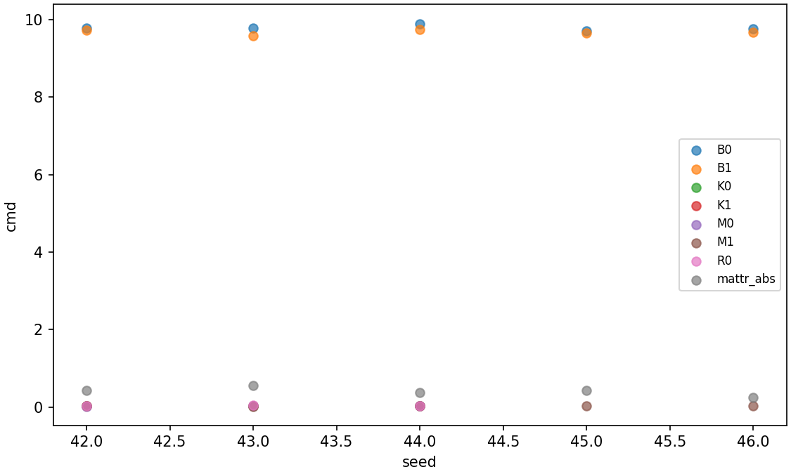

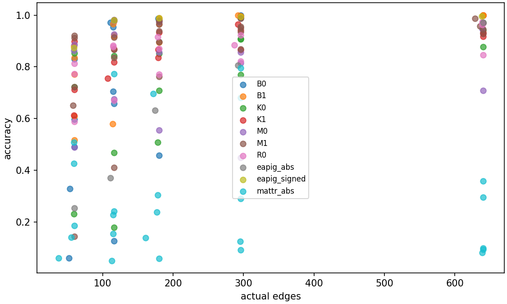

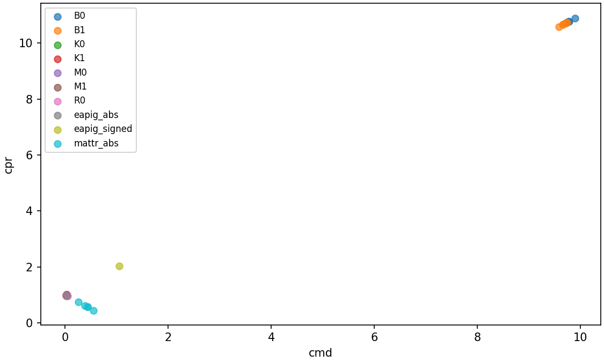

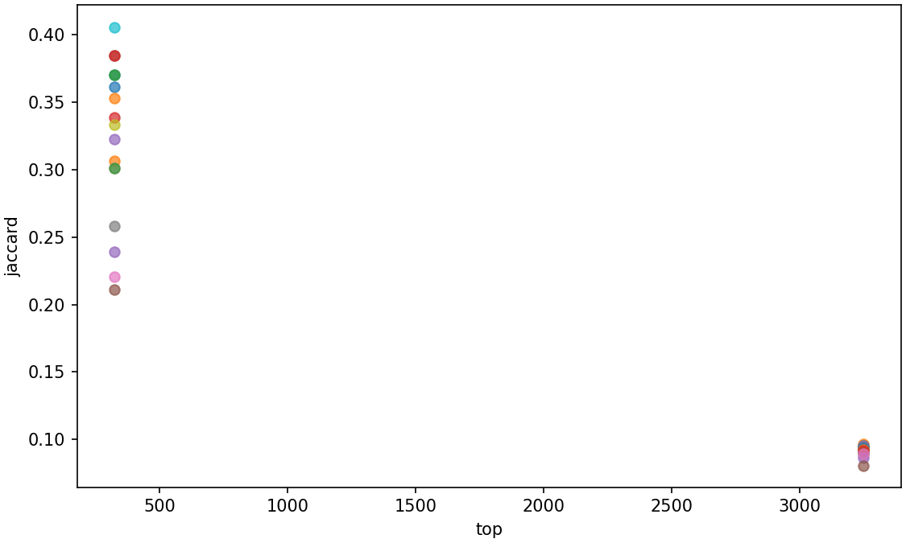

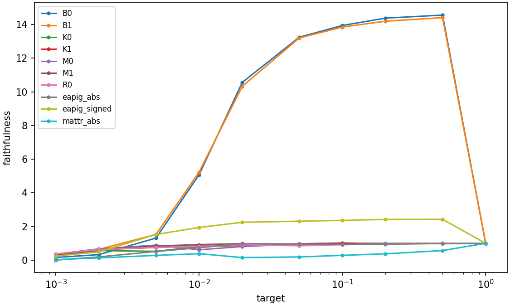

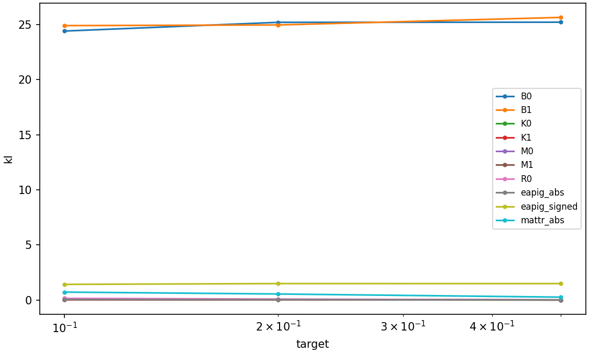

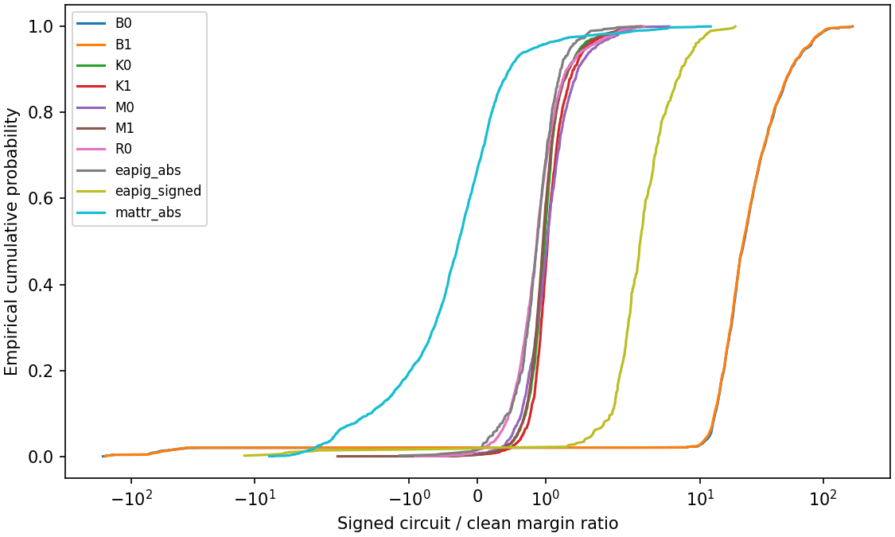

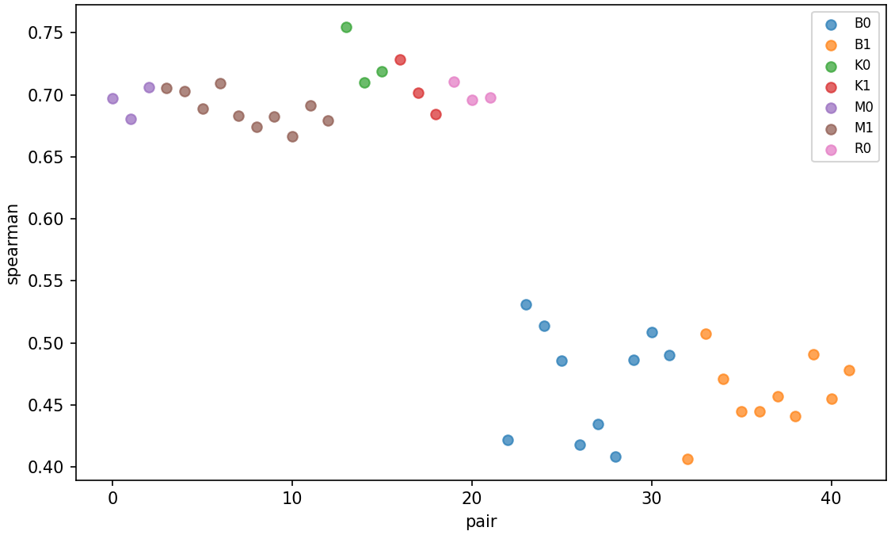

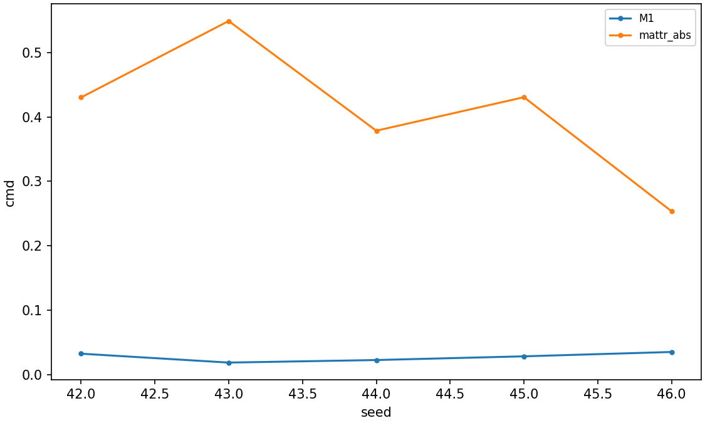

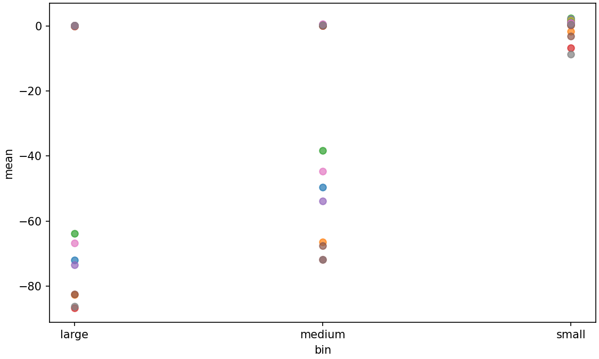

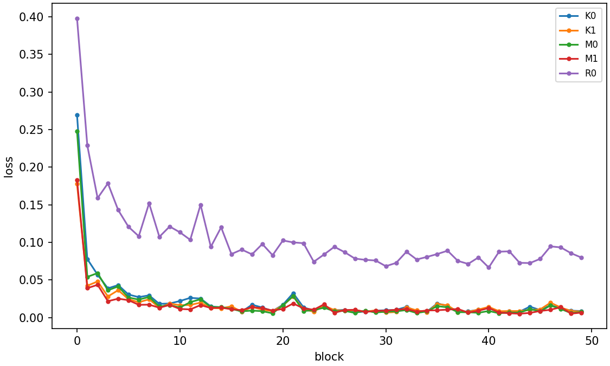

## Limitations

- All registered experiments use GPT-2 Small on IOI. Generalization to other tasks and models remains untested.
- New losses reuse the original optimizer configuration. It may be suboptimal for margin matching or KL.
- The selected EAP-IG reference is one fixed ranking. The experiment measures no variation across attribution runs.
- The development cohort was previously inspected. Confirmation is disjoint from the recent cohorts, with historical exposure through Gate 1's full validation.
- Published and leaderboard CMD values come from different splits and may use different score-selection settings.
- Prompt-bootstrap intervals condition on the fixed rankings, training seeds, and template mixture.
- The margin objective matches per-example margins during soft-mask training. Official CMD measures aggregate margins on discrete, connectivity-pruned circuits.

## Interpretation and recommendation (researcher-written)
