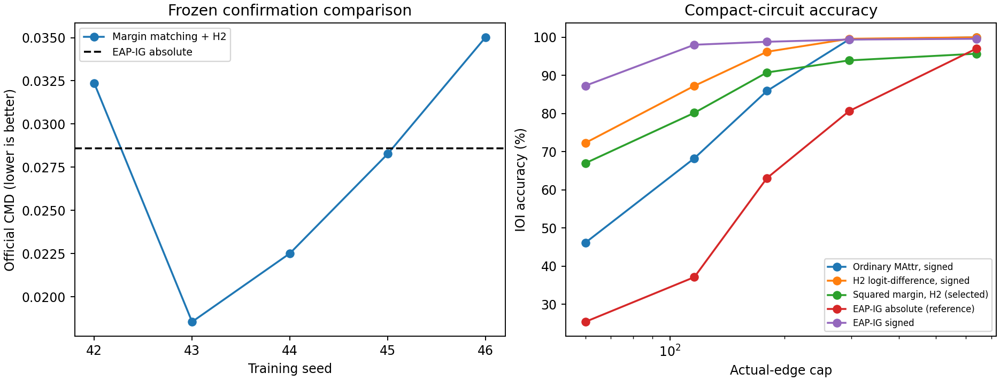

# Gate 6A results review

The registered outcome is **Inconclusive**. The selected method, squared margin matching with the H2 destination hierarchy (M1), reached mean confirmation CMD **0.027343**, compared with **0.028605** for the frozen absolute-order EAP-IG reference. The difference is **−0.001262 (−4.41%)**, with a paired prompt-bootstrap 95% interval **[−0.005151, +0.002936]**. Three of five seeds improved. The registered success rule requires four improving seeds and an interval entirely below zero. The interval also extends beyond the frozen ±0.005 equivalence band, so the classification remains Inconclusive.

Changing the training objective substantially reduced ordinary MAttr's margin distortion. Whether it reliably beats the strongest EAP-IG CMD reference remains unresolved.

## Completed experiment and verification

The campaign trained all five registered arms on seeds 42–44, then extended M1 to seeds 45–46. That is **17 trajectories and 85,000 registered optimizer updates**. Existing ordinary and H2 logit-difference rankings and full-data EAP-IG scores were reused. Screening used the historical 512-prompt development cohort. Confirmation used a separate 512-prompt cohort across nine exact templates. All evaluated metrics below are from confirmation unless marked development.

The pilot passed all four frozen conditions. Mean margin loss decreased from 0.086699 over the first 500 updates to 0.007048 over the last 500. Its development CMD was 0.018047, below the frozen 0.088879 limit. The cached discovery normalizer was D = 5.560939789.

The official audit passed. This review independently checked its artifact hashes, recomputed all five selected-seed differences, replayed the saved paired bootstrap draws and CMD quadrature, and reconciled the recorded root forwards and example-forwards. The signed/absolute ranking distinction is material. On development, EAP-IG CMD was 1.032934 under signed ordering and 0.029626 under absolute ordering. The preregistered rule froze the latter before new training results.

Training protocol SHA-256 `c8ee93736c22b8f8346f8dad519af0551fd388663696b27d63c358d96cc3a301`.

Confirmation protocol SHA-256 `07df545b56499577e910c46f9a9b981c871efe3e9b683041be07007c0ba7e581`.

## Development selection

| Arm | Development mean CMD |
| --- | --- |
| K0 | 0.025762 |
| K1 | 0.028447 |
| M0 | 0.025322 |
| M1 | 0.023928 |
| R0 | 0.032074 |

M1 won development screening with CMD 0.023928. Its five-seed confirmation mean rose to 0.027343. This change combines a new prompt cohort with two additional training seeds. It cannot be assigned entirely to prompt generalization. M0 and K0 have slightly lower descriptive confirmation means on their three trained seeds, but the frozen winner remains M1.

## Confirmation metrics

| arm | seeds | cmd | cpr | accuracy_log_auc |
| --- | --- | --- | --- | --- |
| Ordinary MAttr, signed | 5 | 9.786820 | 10.780623 | 0.851817 |
| H2 logit-difference, signed | 5 | 9.677409 | 10.673507 | 0.908225 |
| Squared margin, ordinary | 3 | 0.025203 | 0.982728 | 0.864326 |
| Squared margin, H2 (selected) | 5 | 0.027343 | 0.983857 | 0.873868 |
| KL, ordinary | 3 | 0.025576 | 0.984285 | 0.834052 |
| KL, H2 | 3 | 0.028509 | 0.990322 | 0.874280 |
| Upstream CMD surrogate | 3 | 0.032215 | 0.972620 | 0.862275 |
| EAP-IG absolute (reference) | 1 | 0.028605 | 0.970395 | 0.750556 |
| EAP-IG signed | 1 | 1.045676 | 2.041891 | 0.898611 |
| Raw MAttr absolute | 5 | 0.408547 | 0.590453 | 0.338969 |

The reported CPR uses each row's stated circuit ordering. Ordinal exports preserve signed learned scores, while the two EAP-IG conventions and raw-MAttr absolute diagnostic produce different circuits. Ordinary MAttr's high CPR accompanies CMD near 9.8 and large distributional distortion. Margin matching moves normalized faithfulness much closer to 1. H2 margin training gives accuracy log-AUC 0.873868 versus 0.750556 for the CMD-selected EAP-IG reference and 0.898611 for signed EAP-IG.

## Selected method by seed

| seed | cmd | cpr | accuracy_log_auc | delta_cmd_vs_reference |
| --- | --- | --- | --- | --- |
| 42 | 0.032360 | 0.989318 | 0.874913 | 0.003755 |
| 43 | 0.018551 | 0.982623 | 0.928272 | -0.010054 |
| 44 | 0.022514 | 0.993601 | 0.896504 | -0.006091 |
| 45 | 0.028272 | 0.970728 | 0.733580 | -0.000334 |
| 46 | 0.035020 | 0.983015 | 0.936069 | 0.006414 |

Seeds 43, 44 and 45 beat the fixed EAP-IG reference. Seeds 42 and 46 regress. Seed 45 has accuracy log-AUC 0.733580 despite a competitive CMD. A low aggregate CMD therefore leaves meaningful compact-circuit differences.

## Compact circuits and full-distribution fidelity

| Method | Mean actual edges | IOI accuracy |
| --- | --- | --- |
| Ordinary MAttr, signed | 114.6 | 68.28% |
| H2 logit-difference, signed | 115.4 | 87.27% |
| Squared margin, H2 (selected) | 116.0 | 80.20% |
| EAP-IG absolute (reference) | 111.0 | 37.11% |
| EAP-IG signed | 116.0 | 98.05% |

At the 116-edge cap, M1 improves positive-margin IOI accuracy by **11.91 percentage points** over ordinary MAttr, falls **7.07 points** below historical H2 logit-difference training, and falls **17.85 points** below signed EAP-IG. It exceeds absolute-order EAP-IG by **43.09 points**. Actual retained sizes vary as shown, so these are capped-budget comparisons.

At nominal 10%, 20%, and 50% retention, M1's full-vocabulary KL is **0.051842, 0.033516, and 0.011776**, versus **24.414367, 25.206347, and 25.218686** for ordinary signed MAttr. Absolute-order EAP-IG remains lower at **0.042166, 0.029401, and 0.006766**. Ordinary KL training gives **0.026321, 0.014974, and 0.002846** across its three seeds. Those are descriptive comparisons across unequal numbers of trained seeds.

M1's CMD improves by **93.31%** relative to the five original raw-score absolute MAttr rankings (0.408547 mean CMD). The paired interval for that difference is [−0.388737, −0.373197]. Raw-score absolute ordering depends on score centering, and these archived checkpoints do not independently reproduce a private leaderboard submission.

Cross-seed full-edge rank correlation averaged **0.6884** for M1, compared with **0.4699** for ordinary MAttr and **0.4597** for H2 logit-difference training. Greater ranking agreement accompanies lower distortion here. It does not establish that the selected components better match a ground-truth causal circuit.

## Compute and limitations

Recorded attempt wall time totals **11.30 hours**, comprising **7.77 hours** for new training processes and **3.30 hours** for evaluation processes, plus discovery targets and bounded checks. The records contain **234,815 root forward passes**, **1,490,103 example-forwards**, and **85,510 backward calls/optimizer updates**. The extra 510 updates belong to bounded checks. Peak CUDA allocated memory was **4.62 GiB**, reserved memory **10.85 GiB**, and sampled CPU RSS **4.43 GiB**. These are process timers and allocator/RSS measurements. Reused baseline training and original EAP-IG attribution costs are outside the new campaign total.

The bootstrap conditions on the fixed trained rankings and template mixture. Its interval captures prompt sampling, with zero unstable denominator draws. It does not estimate training-seed population uncertainty. The model/task scope is GPT-2 Small IOI. The new losses use the original optimizer settings, development was historically inspected, and Gate 1 previously evaluated the full validation split. Confirmation is fresh relative to recent gates. Public-test and leaderboard comparisons remain outside these results.

## Interpretation and recommendation (researcher-written)

Faithfulness training addresses the margin-amplification behavior that motivated Gate 6A and produces a useful tradeoff between CMD, distributional KL and compact accuracy. This campaign does not satisfy its registered EAP-IG superiority criterion. The distinction between absolute and signed rankings explains a substantial part of the apparent advantage over the earlier signed baselines.

The next research decision should preserve absolute-order EAP-IG as the CMD comparator and signed EAP-IG as a compact-accuracy comparator. KL training merits consideration when full-distribution fidelity is the objective. Any new hypothesis or expanded seed comparison should be frozen separately. No follow-up experiments were launched by this review.

The original generated report, registered classification, protocols and audit remain preserved. This separate report supplies the interpretation requested after execution.
