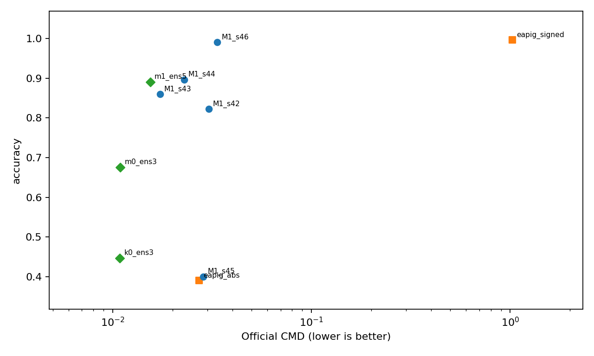

# Gate 6B results review

**Gate 6B met both registered goals.** On 512 official IOI validation prompts excluded from the recent research gates, the five-seed H2 squared-margin ensemble achieved lower Circuit Model Distance (CMD) and higher compact-circuit accuracy than the frozen absolute-order EAP-IG reference. Gate 6B was designed after the inconclusive Gate 6A result and evaluated on a separate cohort.

| Registered comparison | M1 ensemble | Absolute EAP-IG | Paired difference | 95% interval |
| --- | ---: | ---: | ---: | ---: |
| Official CMD, lower is better | 0.015442 | 0.027240 | −0.011798 (−43.31%) | [−0.015852, −0.007544] |
| IOI accuracy under the 116-edge cap | 89.06% | 39.06% | +50.00 pp | [+45.90, +54.10] pp |

The CMD interval lies below both the registered +0.005 non-inferiority margin and zero. The compact-accuracy interval lies above zero. The frozen classification is **Two-goal success**. The two circuits retained 116 and 111 edges, respectively.

## What ensembling changed

The ensemble beat every individual M1 seed on CMD. It lowered CMD by **0.01113** versus the five-seed mean (95% interval **[−0.01308, −0.00922]**). At exactly 116 edges, it raised accuracy from a seed mean of **79.38%** to **89.06%**, a gain of **9.69 pp** (95% interval **[+7.77, +11.60] pp**). The best individual seed still achieved **99.02%**. Accuracy log-AUC was close to the seed mean at **0.87615 versus 0.87498**, with a paired interval for the difference of **[−0.00363, +0.00589]**. Rank agreement among the five members averaged **0.688** by Spearman correlation, and their 116-edge circuits had Jaccard overlap of **0.381–0.478** with the ensemble.

## EAP-IG ordering and distribution fidelity

Signed EAP-IG reached **99.61%** accuracy at exactly 116 edges, **10.55 pp** ahead of the ensemble (paired interval for ensemble minus signed EAP-IG **[−13.09, −8.20] pp**). Signed EAP-IG led at all five compact budgets and had full-grid CMD **1.02527**. At the 116-edge cap, the ensemble had lower full-vocabulary KL than either EAP-IG ordering. The ordinary margin and ordinary KL ensembles reached lower CMD than M1 descriptively, with substantially lower compact accuracy.

| Ranking | Actual edges | IOI accuracy | Vocabulary top-1 | KL at cap | Official CMD |
| --- | ---: | ---: | ---: | ---: | ---: |
| H2 squared margin, five seeds | 116 | 89.06% | 67.19% | 0.23423 | 0.015442 |
| EAP-IG absolute | 111 | 39.06% | 18.95% | 0.63829 | 0.027240 |
| EAP-IG signed | 116 | 99.61% | 88.87% | 0.55787 | 1.025270 |
| Ordinary squared margin, three seeds | 116 | 67.58% | 37.30% | 0.45055 | 0.010931 |
| Ordinary KL, three seeds | 116 | 44.73% | 25.39% | 0.49511 | 0.010868 |

Accuracy and KL in this table are at the 116-edge cap. CMD spans the full official retention grid. The other ensembles use fewer members, so their differences cannot be assigned solely to training objective.

## Compute and scope

The ten evaluation jobs took **23.01 minutes** of recorded attempt wall time, with **7,384 root forwards**, **145,408 example-forwards**, **10 circuit cache hits**, and zero backward passes or optimizer updates. Peak CUDA memory was **3.17 GiB allocated** and **4.68 GiB reserved**. The five earlier M1 training runs cost **2.255 hours** separately. The audit passed and replayed 5,000 template-stratified paired bootstrap draws. The intervals describe prompt sampling for these fixed rankings and template proportions. The experiment covers GPT-2 Small IOI validation, with historical exposure through Gate 1’s full validation run.

[Full audited report, per-seed results, and figures](results/mattr_ensemble/gate6b/GATE6B_ENSEMBLE_REPORT.md)
