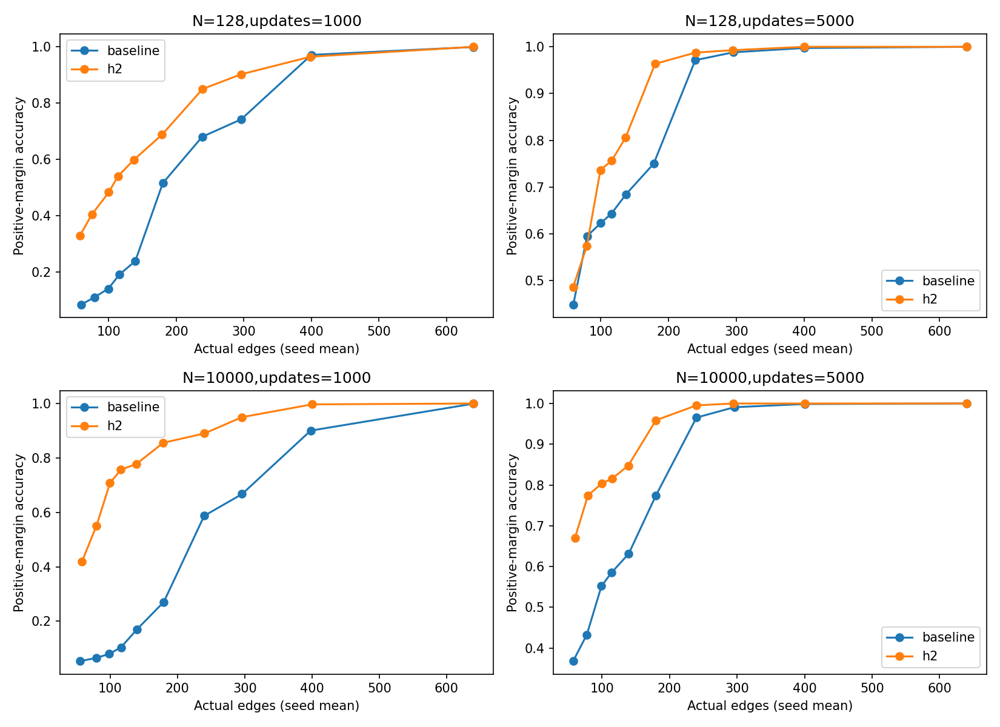
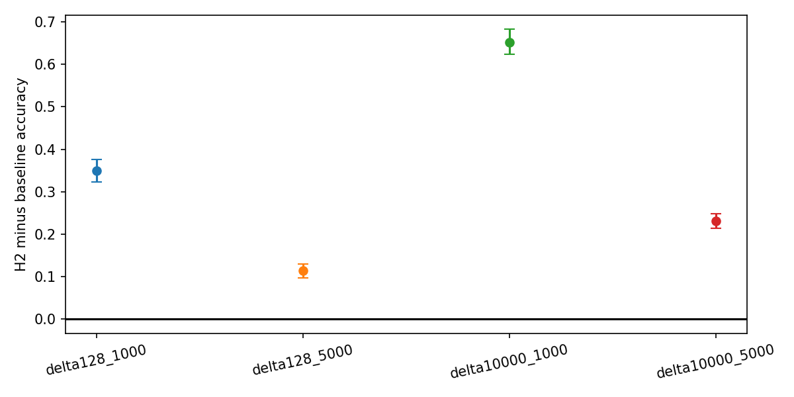
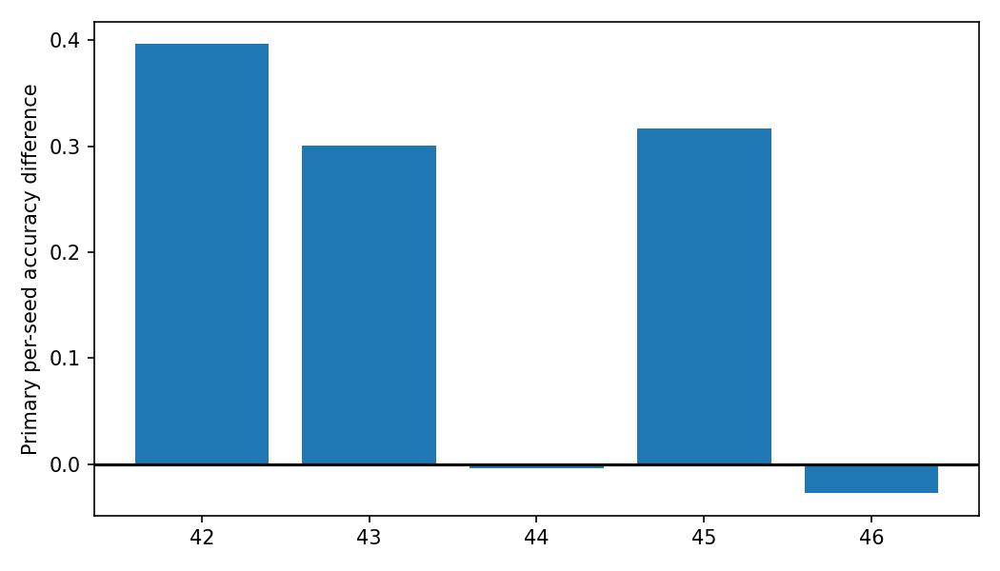
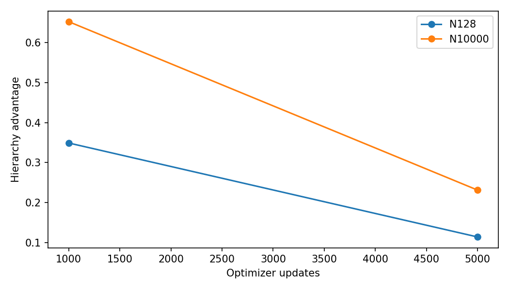
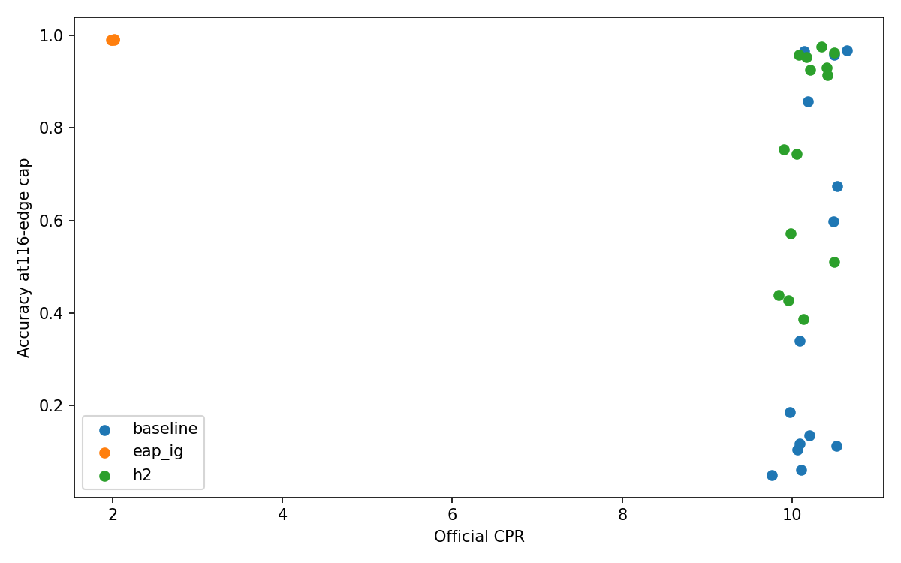
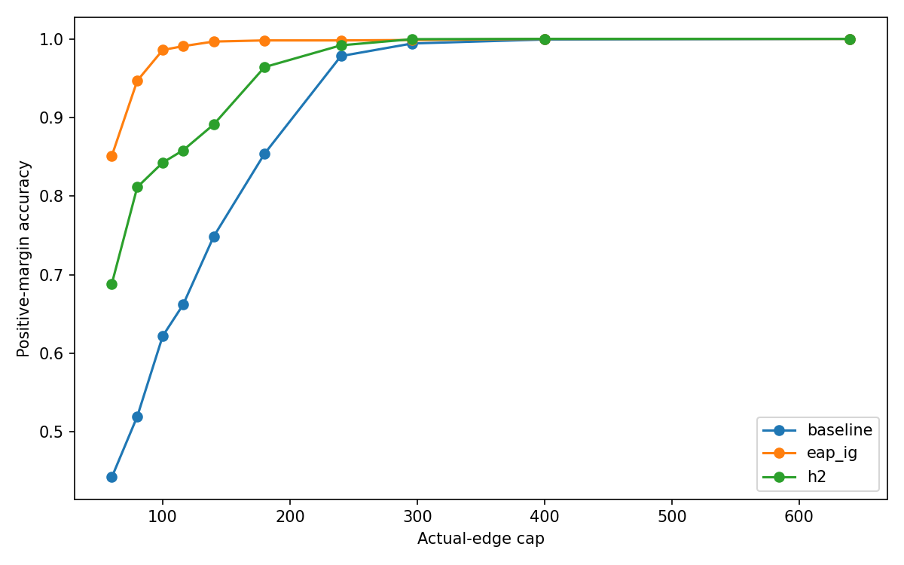
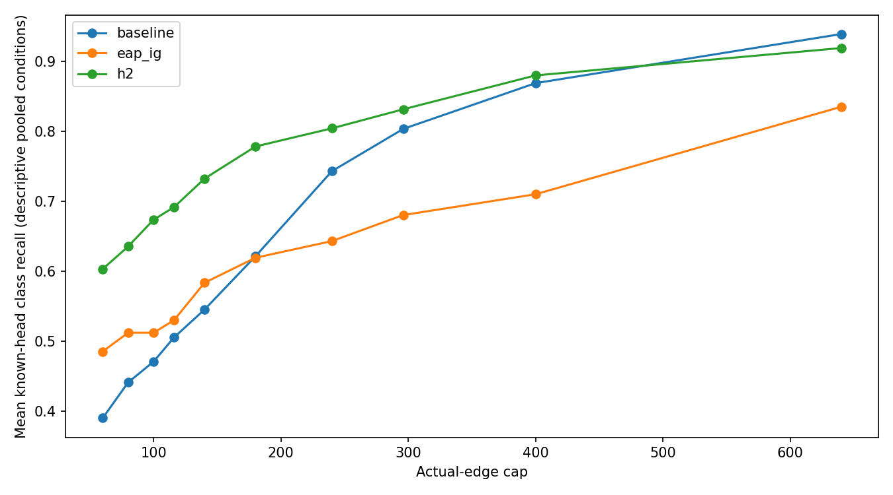
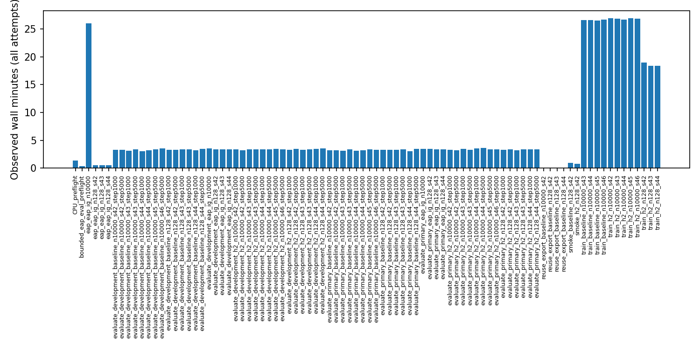

# Gate 5F: data scaling and training duration

## Registered primary result

Classification: **Robust compact advantage**. Five-seed mean and prompt interval:

```json
{
  "classification": "Robust compact advantage",
  "primary": {
    "mean": 0.19648437500000002,
    "lower": 0.18203125000000003,
    "upper": 0.2109375
  },
  "per_seed": [
    0.396484375,
    0.30078125,
    -0.00390625,
    0.31640625,
    -0.02734375
  ],
  "checks": {
    "robust": true,
    "small": false,
    "catches_up": false,
    "data_limited": false,
    "larger_budget_safe": true,
    "positive_seeds": 3,
    "seed_std": 0.1971766507266945,
    "seed_min": -0.02734375,
    "seed_max": 0.396484375,
    "seed_median": 0.30078125
  },
  "prompt_scope": "conditional on fixed trained models and nine-template mixture; no training-seed significance claim"
}
```

Only the fresh primary cohort decides this result. Gate5E cohort results are development comparisons. No historical Gate5C/5D/5E decisions were revised. No GPT-2 weights were trained.

## Design and provenance

Protocol SHA-256: `a3daa1558382e2b78aba9ef4d73172f3dd21199535674db6f33e8113312962a9`. Complete2×2 comparisons use seeds42–44; primary full-data5000 uses42–46. The additional seeds' intermediate checkpoints are not factorial observations. All28 registered training endpoints were evaluated on both512-prompt cohorts, with four EAP-IG rankings per cohort. The full-data EAP ranking is one ranking. Uniform-k, Adam.05, temperature.5, float32, iso masking and official live patching were unchanged. H2 gamma=0 uses all32491 edge residuals plus centered receiver components. Exact mapping hashes, checkpoint inventory, stream hashes and schedule tests are archived.

## Factorial accuracy table (three fixed seeds)

| method | dataset_size | step | accuracy | actual_edges |
| --- | --- | --- | --- | --- |
| baseline | 128 | 1000 | 0.1914 | 116.0000 |
| baseline | 128 | 5000 | 0.6426 | 115.3333 |
| baseline | 10000 | 1000 | 0.1042 | 116.0000 |
| baseline | 10000 | 5000 | 0.5846 | 114.0000 |
| h2 | 128 | 1000 | 0.5404 | 113.6667 |
| h2 | 128 | 5000 | 0.7565 | 116.0000 |
| h2 | 10000 | 1000 | 0.7565 | 115.6667 |
| h2 | 10000 | 5000 | 0.8158 | 115.0000 |

## Five-seed primary effects

| cohort | seed | effect | baseline_accuracy | h2_accuracy | corrected | broken |
| --- | --- | --- | --- | --- | --- | --- |
| primary | 42 | 0.3965 | 0.1133 | 0.5098 | 203 | 0 |
| primary | 43 | 0.3008 | 0.6738 | 0.9746 | 154 | 0 |
| primary | 44 | -0.0039 | 0.9668 | 0.9629 | 6 | 8 |
| primary | 45 | 0.3164 | 0.5977 | 0.9141 | 162 | 0 |
| primary | 46 | -0.0273 | 0.9570 | 0.9297 | 8 | 22 |

## Factorial contrasts

| contrast | seed | mean | lower | upper | cohort | positive_seeds |
| --- | --- | --- | --- | --- | --- | --- |
| delta128_1000 | equal_seed_mean | 0.3490 | 0.3229 | 0.3763 | primary | 3.0000 |
| delta128_5000 | equal_seed_mean | 0.1139 | 0.0977 | 0.1302 | primary | 2.0000 |
| delta10000_1000 | equal_seed_mean | 0.6523 | 0.6237 | 0.6823 | primary | 3.0000 |
| delta10000_5000 | equal_seed_mean | 0.2311 | 0.2135 | 0.2487 | primary | 2.0000 |
| data_effect1000 | equal_seed_mean | 0.3034 | 0.2799 | 0.3262 | primary | 3.0000 |
| data_effect5000 | equal_seed_mean | 0.1172 | 0.0977 | 0.1374 | primary | 2.0000 |
| step_effect128 | equal_seed_mean | -0.2350 | -0.2598 | -0.2109 | primary | 0.0000 |
| step_effect10000 | equal_seed_mean | -0.4212 | -0.4466 | -0.3958 | primary | 0.0000 |
| interaction | equal_seed_mean | -0.1862 | -0.2149 | -0.1576 | primary | 0.0000 |

Absolute per-method data/duration changes (three fixed seeds):

| cohort | method | seed | contrast | mean | lower | upper |
| --- | --- | --- | --- | --- | --- | --- |
| primary | baseline | equal_seed_mean | data_effect_1000 | -0.0872 | -0.1035 | -0.0710 |
| primary | baseline | equal_seed_mean | data_effect_5000 | -0.0579 | -0.0729 | -0.0423 |
| primary | baseline | equal_seed_mean | step_effect_128 | 0.4512 | 0.4303 | 0.4720 |
| primary | baseline | equal_seed_mean | step_effect_10000 | 0.4805 | 0.4622 | 0.4987 |
| primary | h2 | equal_seed_mean | data_effect_1000 | 0.2161 | 0.1953 | 0.2370 |
| primary | h2 | equal_seed_mean | data_effect_5000 | 0.0592 | 0.0469 | 0.0716 |
| primary | h2 | equal_seed_mean | step_effect_128 | 0.2161 | 0.1934 | 0.2383 |
| primary | h2 | equal_seed_mean | step_effect_10000 | 0.0592 | 0.0449 | 0.0749 |

All per-condition/per-seed corrected and broken counts, actual-size differences and prompt intervals are in paired_seed_effects.csv.

All data effects are observed discovery-pool effects under the registered subset/optimizer sampling design. N128 seeds change both subset and optimizer draws; full-pool seeds change optimizer draws. Neither a three-seed nor a five-seed comparison is an independent set of prompt datasets. The5000 paired bootstrap draws (seed5644) resample exact template strata and use identical prompt indices for every method/condition/seed within each cohort. Intervals condition on fixed models and template mix; they do not establish significance across training seeds or unseen template families. Raw corrected/broken counts and per-seed ranges/SD/median are retained. Secondary intervals are descriptive and unadjusted.

## Exact counts and safeguards

This is an at-most116-edge primary endpoint. Exact equal-count subsets and both-attain-target flags are in exact_size_subsets.csv; all actual counts, nominal prefixes, shortfalls and mask hashes are in accuracy_size_curves.csv. No edges were artificially added. Larger-cap safeguards at296/400/640 and all frozen classification booleans are recorded above. A zero-crossing interval alone does not demonstrate equivalence. The full criteria and operational definitions were frozen before training.

## Official CPR, CMD and fidelity

| method | dataset_size | seed | step | cohort | CPR | CMD | accuracy_log_AUC |
| --- | --- | --- | --- | --- | --- | --- | --- |
| baseline | 128 | 42 | 1000 | primary | 9.7642 | 8.7902 | 0.6443 |
| baseline | 128 | 42 | 5000 | primary | 10.0643 | 9.0767 | 0.7416 |
| h2 | 128 | 42 | 1000 | primary | 9.8438 | 8.8593 | 0.7472 |
| h2 | 128 | 42 | 5000 | primary | 10.1318 | 9.1408 | 0.8071 |
| baseline | 128 | 43 | 1000 | primary | 10.0851 | 9.0962 | 0.7641 |
| baseline | 128 | 43 | 5000 | primary | 10.1452 | 9.1490 | 0.8959 |
| h2 | 128 | 43 | 1000 | primary | 9.9537 | 8.9633 | 0.7807 |
| h2 | 128 | 43 | 5000 | primary | 10.2105 | 9.2148 | 0.8693 |
| baseline | 128 | 44 | 1000 | primary | 9.9727 | 8.9848 | 0.7444 |
| baseline | 128 | 44 | 5000 | primary | 10.1825 | 9.1863 | 0.8940 |
| h2 | 128 | 44 | 1000 | primary | 9.9062 | 8.9135 | 0.8259 |
| h2 | 128 | 44 | 5000 | primary | 10.0835 | 9.0859 | 0.9371 |
| baseline | 10000 | 42 | 1000 | primary | 10.1040 | 9.1289 | 0.6528 |
| baseline | 10000 | 42 | 5000 | primary | 10.5226 | 9.5354 | 0.7374 |
| h2 | 10000 | 42 | 1000 | primary | 9.9801 | 8.9900 | 0.7962 |
| h2 | 10000 | 42 | 5000 | primary | 10.4924 | 9.5006 | 0.8293 |
| baseline | 10000 | 43 | 1000 | primary | 10.0876 | 9.1002 | 0.7365 |
| baseline | 10000 | 43 | 5000 | primary | 10.5292 | 9.5361 | 0.8203 |
| h2 | 10000 | 43 | 1000 | primary | 10.1655 | 9.1703 | 0.8581 |
| h2 | 10000 | 43 | 5000 | primary | 10.3418 | 9.3449 | 0.9148 |
| baseline | 10000 | 44 | 1000 | primary | 10.1986 | 9.2134 | 0.7177 |
| baseline | 10000 | 44 | 5000 | primary | 10.6493 | 9.6530 | 0.9034 |
| h2 | 10000 | 44 | 1000 | primary | 10.0500 | 9.0577 | 0.8305 |
| h2 | 10000 | 44 | 5000 | primary | 10.4926 | 9.4953 | 0.9365 |
| baseline | 10000 | 45 | 5000 | primary | 10.4863 | 9.4915 | 0.8449 |
| h2 | 10000 | 45 | 5000 | primary | 10.4113 | 9.4152 | 0.8941 |
| baseline | 10000 | 46 | 5000 | primary | 10.4924 | 9.4948 | 0.9324 |
| h2 | 10000 | 46 | 5000 | primary | 10.4081 | 9.4105 | 0.9371 |
| eap_ig | 128 | 42 | 0 | primary | 1.9937 | 0.9978 | 0.8873 |
| eap_ig | 128 | 43 | 0 | primary | 2.0206 | 1.0246 | 0.8878 |
| eap_ig | 128 | 44 | 0 | primary | 1.9873 | 0.9917 | 0.8780 |
| eap_ig | 10000 | one_full_ranking | 0 | primary | 2.0217 | 1.0255 | 0.8921 |
| baseline | 128 | 42 | 1000 | development | 9.8325 | 8.8585 | 0.6409 |
| baseline | 128 | 42 | 5000 | development | 10.1077 | 9.1201 | 0.7387 |
| h2 | 128 | 42 | 1000 | development | 9.9093 | 8.9248 | 0.7459 |
| h2 | 128 | 42 | 5000 | development | 10.1666 | 9.1756 | 0.8075 |
| baseline | 128 | 43 | 1000 | development | 10.1458 | 9.1569 | 0.7637 |
| baseline | 128 | 43 | 5000 | development | 10.2075 | 9.2113 | 0.8955 |
| h2 | 128 | 43 | 1000 | development | 10.0219 | 9.0314 | 0.7862 |
| h2 | 128 | 43 | 5000 | development | 10.2889 | 9.2933 | 0.8721 |
| baseline | 128 | 44 | 1000 | development | 10.0423 | 9.0545 | 0.7443 |
| baseline | 128 | 44 | 5000 | development | 10.2346 | 9.2385 | 0.8971 |
| h2 | 128 | 44 | 1000 | development | 9.9460 | 8.9532 | 0.8244 |
| h2 | 128 | 44 | 5000 | development | 10.1328 | 9.1352 | 0.9377 |
| baseline | 10000 | 42 | 1000 | development | 10.1874 | 9.2122 | 0.6522 |
| baseline | 10000 | 42 | 5000 | development | 10.5992 | 9.6120 | 0.7351 |
| h2 | 10000 | 42 | 1000 | development | 10.0328 | 9.0424 | 0.8027 |
| h2 | 10000 | 42 | 5000 | development | 10.5348 | 9.5430 | 0.8325 |
| baseline | 10000 | 43 | 1000 | development | 10.1453 | 9.1579 | 0.7368 |
| baseline | 10000 | 43 | 5000 | development | 10.5950 | 9.6020 | 0.8199 |
| h2 | 10000 | 43 | 1000 | development | 10.2302 | 9.2350 | 0.8571 |
| h2 | 10000 | 43 | 5000 | development | 10.4151 | 9.4181 | 0.9176 |
| baseline | 10000 | 44 | 1000 | development | 10.2666 | 9.2813 | 0.7147 |
| baseline | 10000 | 44 | 5000 | development | 10.7160 | 9.7198 | 0.9059 |
| h2 | 10000 | 44 | 1000 | development | 10.0968 | 9.1044 | 0.8320 |
| h2 | 10000 | 44 | 5000 | development | 10.5516 | 9.5542 | 0.9355 |
| baseline | 10000 | 45 | 5000 | development | 10.5523 | 9.5575 | 0.8462 |
| h2 | 10000 | 45 | 5000 | development | 10.4621 | 9.4659 | 0.8995 |
| baseline | 10000 | 46 | 5000 | development | 10.5712 | 9.5736 | 0.9306 |
| h2 | 10000 | 46 | 5000 | development | 10.4852 | 9.4876 | 0.9373 |
| eap_ig | 128 | 42 | 0 | development | 2.0070 | 1.0110 | 0.8927 |
| eap_ig | 128 | 43 | 0 | development | 2.0108 | 1.0148 | 0.8938 |
| eap_ig | 128 | 44 | 0 | development | 1.9796 | 0.9839 | 0.8770 |
| eap_ig | 10000 | one_full_ranking | 0 | development | 2.0200 | 1.0238 | 0.8989 |

Every area uses the pinned official evaluator on the indicated cohort. Do not compare these512-row CPRs directly against Gate1 full-validation CPR as identical samples. Positive-margin correctness, full-vocabulary top1, margin magnitude, normalized faithfulness, accuracy log-AUC and CPR remain distinct. The plots expose cases where margin amplification changes CPR without corresponding compact correctness. Full nominal/per-prompt outputs are retained for each job.

## EAP-IG reference

The pinned EAP-IG-inputs implementation uses five left endpoints, batch4 and official mean-loss reduction. Equal-batch partitioning was verified in preflight. Changing batch size changes raw scale under this upstream reduction, so it was not changed. Full10000 attribution is one fixed-data ranking, not five seeds. Its attribution cost and each cohort's evaluation are charged separately.

## Known-head overlap and topology controls

The26-head reference is pinned to the authoritative ACDC author implementation and Wang et al., [Interpretability in the Wild, v1](https://arxiv.org/html/2211.00593v1). Known IOI classes and exact reference commit/hash were frozen. Overlap measures head representation and incident-edge fraction, not validated mechanistic equivalence. Sixty-four seeded within-layer head-relabeling automorphisms preserve Q/K/V identities together, actual size, layer structure, source/destination types and official connectivity. They test identity enrichment conditional on layer structure, not enrichment in known layers. All controls passed official pruning; achieved sizes/zero shortfalls and descriptive observed-minus-control means are archived. This analysis cannot change classification.

## Compute and reuse

| job | attempt | status | wall_seconds | optimizer_updates | forward_batches | example_forwards | backward_calls | peak_allocated_mib | peak_reserved_mib | sampled_peak_cpu_rss_mib | training_seconds | eap_ig_seconds | official_evaluation_seconds |
| --- | --- | --- | --- | --- | --- | --- | --- | --- | --- | --- | --- | --- | --- |
| CPU_preflight | preflight | complete | 81.9295 | nan | nan | nan | nan | nan | nan | nan | nan | nan | nan |
| reuse_export_baseline_n10000_s42 | CPU_export | complete | 0.5669 | 0.0000 | nan | nan | nan | nan | nan | nan | nan | nan | nan |
| reuse_export_baseline_n128_s42 | CPU_export | complete | 0.8842 | 0.0000 | nan | nan | nan | nan | nan | nan | nan | nan | nan |
| reuse_export_baseline_n128_s43 | CPU_export | complete | 2.3344 | 0.0000 | nan | nan | nan | nan | nan | nan | nan | nan | nan |
| reuse_export_baseline_n128_s44 | CPU_export | complete | 0.7021 | 0.0000 | nan | nan | nan | nan | nan | nan | nan | nan | nan |
| bounded_eap_eval_preflight | 20261024T005554_17ae10d2 | complete | 20.2233 | 0.0000 | 76.0000 | 208.0000 | 20.0000 | 1916.8491 | 2454.0000 | 4184.1406 | 0.0000 | 0.0000 | 0.0000 |
| eap_eap_ig_n10000 | 20261024T204404_c3d13999 | complete | 1561.8481 | 0.0000 | 17500.0000 | 70000.0000 | 12500.0000 | 1305.5332 | 2168.0000 | 2918.8047 | 0.0000 | 1551.8200 | 0.0000 |
| eap_eap_ig_n128_s42 | 20261024T204157_5dd118ab | complete | 30.2480 | 0.0000 | 224.0000 | 896.0000 | 160.0000 | 1237.4585 | 1754.0000 | 2915.5664 | 0.0000 | 21.1738 | 0.0000 |
| eap_eap_ig_n128_s43 | 20261024T204238_7155a752 | complete | 31.7535 | 0.0000 | 224.0000 | 896.0000 | 160.0000 | 1236.3335 | 1736.0000 | 2933.0234 | 0.0000 | 20.8073 | 0.0000 |
| eap_eap_ig_n128_s44 | 20261024T204321_727cb1e9 | complete | 31.3632 | 0.0000 | 224.0000 | 896.0000 | 160.0000 | 1270.8403 | 1934.0000 | 2927.1094 | 0.0000 | 21.9087 | 0.0000 |
| evaluate_development_baseline_n10000_s42_step1000 | 20261024T234234_ccebd816 | complete | 197.6570 | 0.0000 | 1092.0000 | 21504.0000 | 0.0000 | 2452.5332 | 6784.0000 | 2851.4922 | 0.0000 | 0.0000 | 185.4659 |
| evaluate_development_baseline_n10000_s42_step5000 | 20261024T234600_219a23b9 | complete | 195.2285 | 0.0000 | 1092.0000 | 21504.0000 | 0.0000 | 2452.5332 | 6784.0000 | 2906.4531 | 0.0000 | 0.0000 | 182.0044 |
| evaluate_development_baseline_n10000_s43_step1000 | 20261024T235629_ea061a8a | complete | 186.1492 | 0.0000 | 1040.0000 | 20480.0000 | 0.0000 | 2452.5332 | 6784.0000 | 2983.0508 | 0.0000 | 0.0000 | 172.5970 |
| evaluate_development_baseline_n10000_s43_step5000 | 20261024T235949_f4b39031 | complete | 201.2222 | 0.0000 | 1144.0000 | 22528.0000 | 0.0000 | 2452.5332 | 6784.0000 | 2994.0430 | 0.0000 | 0.0000 | 188.2241 |
| evaluate_development_baseline_n10000_s44_step1000 | 20261025T001135_82e4c26b | complete | 184.6454 | 0.0000 | 1040.0000 | 20480.0000 | 0.0000 | 2452.5332 | 6784.0000 | 2879.0039 | 0.0000 | 0.0000 | 171.2138 |
| evaluate_development_baseline_n10000_s44_step5000 | 20261025T001353_d865f50c | complete | 194.2667 | 0.0000 | 1092.0000 | 21504.0000 | 0.0000 | 2452.5332 | 6784.0000 | 2846.6289 | 0.0000 | 0.0000 | 180.9939 |
| evaluate_development_baseline_n10000_s45_step5000 | 20261025T002430_e6c579e2 | complete | 202.7010 | 0.0000 | 1144.0000 | 22528.0000 | 0.0000 | 2452.5332 | 6784.0000 | 2937.3477 | 0.0000 | 0.0000 | 189.6794 |
| evaluate_development_baseline_n10000_s46_step5000 | 20261025T003149_f7046c3b | complete | 213.5770 | 0.0000 | 1144.0000 | 22528.0000 | 0.0000 | 2452.5332 | 6784.0000 | 2908.9219 | 0.0000 | 0.0000 | 190.5676 |
| evaluate_development_baseline_n128_s42_step1000 | 20261024T230034_aaa68797 | complete | 198.7927 | 0.0000 | 1092.0000 | 21504.0000 | 0.0000 | 2452.5332 | 6784.0000 | 2875.7930 | 0.0000 | 0.0000 | 184.3354 |
| evaluate_development_baseline_n128_s42_step5000 | 20261024T230402_cfd90fce | complete | 198.4557 | 0.0000 | 1092.0000 | 21504.0000 | 0.0000 | 2452.5332 | 6784.0000 | 2934.1250 | 0.0000 | 0.0000 | 184.8236 |
| evaluate_development_baseline_n128_s43_step1000 | 20261024T231428_80c753be | complete | 199.9339 | 0.0000 | 1092.0000 | 21504.0000 | 0.0000 | 2452.5332 | 6784.0000 | 2971.1250 | 0.0000 | 0.0000 | 186.1036 |
| evaluate_development_baseline_n128_s43_step5000 | 20261024T231755_394032fb | complete | 203.2849 | 0.0000 | 1144.0000 | 22528.0000 | 0.0000 | 2452.5332 | 6784.0000 | 2932.4102 | 0.0000 | 0.0000 | 190.2974 |
| evaluate_development_baseline_n128_s44_step1000 | 20261024T232831_7bbec7de | complete | 190.5469 | 0.0000 | 1040.0000 | 20480.0000 | 0.0000 | 2452.5332 | 6784.0000 | 2941.4141 | 0.0000 | 0.0000 | 177.9593 |
| evaluate_development_baseline_n128_s44_step5000 | 20261024T233147_39d1939a | complete | 205.3555 | 0.0000 | 1144.0000 | 22528.0000 | 0.0000 | 2452.5332 | 6784.0000 | 2860.2734 | 0.0000 | 0.0000 | 192.1604 |
| evaluate_development_eap_ig_n10000 | 20261025T005002_28ae36b9 | complete | 211.4347 | 0.0000 | 1144.0000 | 22528.0000 | 0.0000 | 2452.5332 | 6784.0000 | 2977.5898 | 0.0000 | 0.0000 | 196.7895 |
| evaluate_development_eap_ig_n128_s42 | 20261025T003910_f01f52c9 | complete | 201.3748 | 0.0000 | 1144.0000 | 22528.0000 | 0.0000 | 2452.5332 | 6784.0000 | 2881.6172 | 0.0000 | 0.0000 | 187.7324 |
| evaluate_development_eap_ig_n128_s43 | 20261025T004245_8fca81e3 | complete | 201.3766 | 0.0000 | 1144.0000 | 22528.0000 | 0.0000 | 2452.5332 | 6784.0000 | 2992.1680 | 0.0000 | 0.0000 | 187.9960 |
| evaluate_development_eap_ig_n128_s44 | 20261025T004626_88c145b5 | complete | 201.8439 | 0.0000 | 1144.0000 | 22528.0000 | 0.0000 | 2452.5332 | 6784.0000 | 2901.1211 | 0.0000 | 0.0000 | 187.9518 |
| evaluate_development_h2_n10000_s42_step1000 | 20261024T234927_9bc010d8 | complete | 202.6026 | 0.0000 | 1144.0000 | 22528.0000 | 0.0000 | 2452.5332 | 6784.0000 | 2873.7148 | 0.0000 | 0.0000 | 189.4218 |
| evaluate_development_h2_n10000_s42_step5000 | 20261024T235302_f9e046f6 | complete | 192.6596 | 0.0000 | 1092.0000 | 21504.0000 | 0.0000 | 2452.5332 | 6784.0000 | 2979.0859 | 0.0000 | 0.0000 | 179.5417 |
| evaluate_development_h2_n10000_s43_step1000 | 20261025T000324_0aefee07 | complete | 200.6835 | 0.0000 | 1144.0000 | 22528.0000 | 0.0000 | 2452.5332 | 6784.0000 | 2918.2539 | 0.0000 | 0.0000 | 187.7138 |
| evaluate_development_h2_n10000_s43_step5000 | 20261025T000658_a00360b6 | complete | 201.5532 | 0.0000 | 1144.0000 | 22528.0000 | 0.0000 | 2452.5332 | 6784.0000 | 2953.3945 | 0.0000 | 0.0000 | 188.6057 |
| evaluate_development_h2_n10000_s44_step1000 | 20261025T001721_7e0b20f8 | complete | 200.8098 | 0.0000 | 1144.0000 | 22528.0000 | 0.0000 | 2452.5332 | 6784.0000 | 2918.4062 | 0.0000 | 0.0000 | 188.4111 |
| evaluate_development_h2_n10000_s44_step5000 | 20261025T002054_951dfd38 | complete | 200.9786 | 0.0000 | 1144.0000 | 22528.0000 | 0.0000 | 2452.5332 | 6784.0000 | 2983.4180 | 0.0000 | 0.0000 | 187.5855 |
| evaluate_development_h2_n10000_s45_step5000 | 20261025T002805_03213306 | complete | 205.8102 | 0.0000 | 1144.0000 | 22528.0000 | 0.0000 | 2452.5332 | 6784.0000 | 2956.6992 | 0.0000 | 0.0000 | 192.0058 |
| evaluate_development_h2_n10000_s46_step5000 | 20261025T003535_79c7fd71 | complete | 200.6181 | 0.0000 | 1144.0000 | 22528.0000 | 0.0000 | 2452.5332 | 6784.0000 | 2986.0664 | 0.0000 | 0.0000 | 188.7007 |
| evaluate_development_h2_n128_s42_step1000 | 20261024T230729_81855ee7 | complete | 195.7740 | 0.0000 | 1092.0000 | 21504.0000 | 0.0000 | 2452.5332 | 6784.0000 | 2938.6797 | 0.0000 | 0.0000 | 182.8458 |
| evaluate_development_h2_n128_s42_step5000 | 20261024T231054_2182cd9e | complete | 205.7996 | 0.0000 | 1144.0000 | 22528.0000 | 0.0000 | 2452.5332 | 6784.0000 | 2893.8633 | 0.0000 | 0.0000 | 192.7744 |
| evaluate_development_h2_n128_s43_step1000 | 20261024T232130_320f448c | complete | 198.7358 | 0.0000 | 1092.0000 | 21504.0000 | 0.0000 | 2452.5332 | 6784.0000 | 2908.2109 | 0.0000 | 0.0000 | 184.9389 |
| evaluate_development_h2_n128_s43_step5000 | 20261024T232456_4ecca410 | complete | 203.3432 | 0.0000 | 1144.0000 | 22528.0000 | 0.0000 | 2452.5332 | 6784.0000 | 2876.5859 | 0.0000 | 0.0000 | 190.0880 |
| evaluate_development_h2_n128_s44_step1000 | 20261024T233523_e7e60801 | complete | 206.0038 | 0.0000 | 1144.0000 | 22528.0000 | 0.0000 | 2452.5332 | 6784.0000 | 2938.9531 | 0.0000 | 0.0000 | 190.8274 |
| evaluate_development_h2_n128_s44_step5000 | 20261024T233857_ce194529 | complete | 211.7022 | 0.0000 | 1144.0000 | 22528.0000 | 0.0000 | 2452.5332 | 6784.0000 | 2895.0000 | 0.0000 | 0.0000 | 196.7880 |
| evaluate_primary_baseline_n10000_s42_step1000 | 20261024T215101_f2097e2d | complete | 191.5946 | 0.0000 | 1092.0000 | 21504.0000 | 0.0000 | 2384.6470 | 5940.0000 | 2918.2695 | 0.0000 | 0.0000 | 178.7288 |
| evaluate_primary_baseline_n10000_s42_step5000 | 20261024T215526_0d1a9a10 | complete | 194.1713 | 0.0000 | 1092.0000 | 21504.0000 | 0.0000 | 2384.6470 | 5940.0000 | 2984.2500 | 0.0000 | 0.0000 | 181.3478 |
| evaluate_primary_baseline_n10000_s43_step1000 | 20261024T220443_1de47498 | complete | 187.5237 | 0.0000 | 1040.0000 | 20480.0000 | 0.0000 | 2384.6470 | 5940.0000 | 2919.8867 | 0.0000 | 0.0000 | 173.5670 |
| evaluate_primary_baseline_n10000_s43_step5000 | 20261024T220759_6a7aac57 | complete | 202.8003 | 0.0000 | 1144.0000 | 22528.0000 | 0.0000 | 2384.6470 | 5940.0000 | 2873.0117 | 0.0000 | 0.0000 | 188.8200 |
| evaluate_primary_baseline_n10000_s44_step1000 | 20261024T221832_df10d814 | complete | 185.6933 | 0.0000 | 1040.0000 | 20480.0000 | 0.0000 | 2384.6470 | 5940.0000 | 2935.1914 | 0.0000 | 0.0000 | 173.2693 |
| evaluate_primary_baseline_n10000_s44_step5000 | 20261024T222249_39c212a2 | complete | 192.5934 | 0.0000 | 1092.0000 | 21504.0000 | 0.0000 | 2384.6470 | 5940.0000 | 2899.1133 | 0.0000 | 0.0000 | 179.2880 |
| evaluate_primary_baseline_n10000_s45_step5000 | 20261024T223214_4447f619 | complete | 202.8076 | 0.0000 | 1144.0000 | 22528.0000 | 0.0000 | 2384.6470 | 5940.0000 | 2934.2383 | 0.0000 | 0.0000 | 188.6099 |
| evaluate_primary_baseline_n10000_s46_step5000 | 20261024T223919_bd795f69 | complete | 197.7708 | 0.0000 | 1144.0000 | 22528.0000 | 0.0000 | 2384.6470 | 5940.0000 | 2860.8242 | 0.0000 | 0.0000 | 185.8570 |
| evaluate_primary_baseline_n128_s42_step1000 | 20261024T210948_d6a0a6ee | complete | 195.0983 | 0.0000 | 1092.0000 | 21504.0000 | 0.0000 | 2384.6470 | 5940.0000 | 2993.4336 | 0.0000 | 0.0000 | 182.5330 |
| evaluate_primary_baseline_n128_s42_step5000 | 20261024T211311_136b2e4b | complete | 196.6384 | 0.0000 | 1092.0000 | 21504.0000 | 0.0000 | 2384.6470 | 5940.0000 | 2958.4297 | 0.0000 | 0.0000 | 183.3324 |
| evaluate_primary_baseline_n128_s43_step1000 | 20261024T212326_216ea7e6 | complete | 199.7136 | 0.0000 | 1092.0000 | 21504.0000 | 0.0000 | 2384.6470 | 5940.0000 | 2990.0391 | 0.0000 | 0.0000 | 186.9525 |
| evaluate_primary_baseline_n128_s43_step5000 | 20261024T212649_b5a73e3b | complete | 201.3365 | 0.0000 | 1144.0000 | 22528.0000 | 0.0000 | 2384.6470 | 5940.0000 | 2881.7773 | 0.0000 | 0.0000 | 188.5941 |
| evaluate_primary_baseline_n128_s44_step1000 | 20261024T213713_83b3ebab | complete | 182.9226 | 0.0000 | 1040.0000 | 20480.0000 | 0.0000 | 2384.6470 | 5940.0000 | 2879.5312 | 0.0000 | 0.0000 | 170.0655 |
| evaluate_primary_baseline_n128_s44_step5000 | 20261024T214027_1603aaed | complete | 205.3345 | 0.0000 | 1144.0000 | 22528.0000 | 0.0000 | 2384.6470 | 5940.0000 | 2987.0391 | 0.0000 | 0.0000 | 191.2354 |
| evaluate_primary_eap_ig_n10000 | 20261024T225701_9087e2f1 | complete | 205.3198 | 0.0000 | 1144.0000 | 22528.0000 | 0.0000 | 2384.6470 | 5940.0000 | 2898.5430 | 0.0000 | 0.0000 | 191.5351 |
| evaluate_primary_eap_ig_n128_s42 | 20261024T224623_53369b8e | complete | 207.0109 | 0.0000 | 1144.0000 | 22528.0000 | 0.0000 | 2384.6470 | 5940.0000 | 2986.8945 | 0.0000 | 0.0000 | 193.2635 |
| evaluate_primary_eap_ig_n128_s43 | 20261024T225057_e747b2e0 | complete | 200.8563 | 0.0000 | 1144.0000 | 22528.0000 | 0.0000 | 2384.6470 | 5940.0000 | 2920.3750 | 0.0000 | 0.0000 | 187.5156 |
| evaluate_primary_eap_ig_n128_s44 | 20261024T225328_f904bf41 | complete | 201.3250 | 0.0000 | 1144.0000 | 22528.0000 | 0.0000 | 2384.6470 | 5940.0000 | 2966.6992 | 0.0000 | 0.0000 | 187.2755 |
| evaluate_primary_h2_n10000_s42_step1000 | 20261024T215849_2a7e7920 | complete | 199.4491 | 0.0000 | 1144.0000 | 22528.0000 | 0.0000 | 2384.6470 | 5940.0000 | 2906.3477 | 0.0000 | 0.0000 | 186.0295 |
| evaluate_primary_h2_n10000_s42_step5000 | 20261024T220119_d8cf0e01 | complete | 192.2310 | 0.0000 | 1092.0000 | 21504.0000 | 0.0000 | 2384.6470 | 5940.0000 | 2982.6562 | 0.0000 | 0.0000 | 179.1733 |
| evaluate_primary_h2_n10000_s43_step1000 | 20261024T221130_3697f848 | complete | 204.9313 | 0.0000 | 1144.0000 | 22528.0000 | 0.0000 | 2384.6470 | 5940.0000 | 2921.8945 | 0.0000 | 0.0000 | 191.2924 |
| evaluate_primary_h2_n10000_s43_step5000 | 20261024T221502_c29add9d | complete | 199.6995 | 0.0000 | 1144.0000 | 22528.0000 | 0.0000 | 2384.6470 | 5940.0000 | 2846.6133 | 0.0000 | 0.0000 | 187.3908 |
| evaluate_primary_h2_n10000_s44_step1000 | 20261024T222511_ce2eef83 | complete | 214.2464 | 0.0000 | 1144.0000 | 22528.0000 | 0.0000 | 2384.6470 | 5940.0000 | 2933.7070 | 0.0000 | 0.0000 | 200.8752 |
| evaluate_primary_h2_n10000_s44_step5000 | 20261024T222842_ac3e17c1 | complete | 217.4827 | 0.0000 | 1144.0000 | 22528.0000 | 0.0000 | 2384.6470 | 5940.0000 | 2862.2031 | 0.0000 | 0.0000 | 202.8430 |
| evaluate_primary_h2_n10000_s45_step5000 | 20261024T223648_bd7763a6 | complete | 200.5448 | 0.0000 | 1144.0000 | 22528.0000 | 0.0000 | 2384.6470 | 5940.0000 | 2932.0664 | 0.0000 | 0.0000 | 186.7586 |
| evaluate_primary_h2_n10000_s46_step5000 | 20261024T224250_c4614ba2 | complete | 204.0623 | 0.0000 | 1144.0000 | 22528.0000 | 0.0000 | 2384.6470 | 5940.0000 | 2919.0977 | 0.0000 | 0.0000 | 190.6200 |
| evaluate_primary_h2_n128_s42_step1000 | 20261024T211635_d09970c6 | complete | 195.4022 | 0.0000 | 1092.0000 | 21504.0000 | 0.0000 | 2384.6470 | 5940.0000 | 2979.3359 | 0.0000 | 0.0000 | 181.5171 |
| evaluate_primary_h2_n128_s42_step5000 | 20261024T212058_11a77def | complete | 201.4952 | 0.0000 | 1144.0000 | 22528.0000 | 0.0000 | 2384.6470 | 5940.0000 | 2899.0742 | 0.0000 | 0.0000 | 188.6710 |
| evaluate_primary_h2_n128_s43_step1000 | 20261024T213122_c09dea1b | complete | 192.5793 | 0.0000 | 1092.0000 | 21504.0000 | 0.0000 | 2384.6470 | 5940.0000 | 2860.2656 | 0.0000 | 0.0000 | 180.2549 |
| evaluate_primary_h2_n128_s43_step5000 | 20261024T213444_cb141091 | complete | 202.5927 | 0.0000 | 1144.0000 | 22528.0000 | 0.0000 | 2384.6470 | 5940.0000 | 2892.7148 | 0.0000 | 0.0000 | 189.5266 |
| evaluate_primary_h2_n128_s44_step1000 | 20261024T214358_8f24ff58 | complete | 201.2716 | 0.0000 | 1144.0000 | 22528.0000 | 0.0000 | 2384.6470 | 5940.0000 | 2937.0625 | 0.0000 | 0.0000 | 187.7080 |
| evaluate_primary_h2_n128_s44_step5000 | 20261024T214729_c6467c74 | complete | 201.4295 | 0.0000 | 1144.0000 | 22528.0000 | 0.0000 | 2384.6470 | 5940.0000 | 2990.7148 | 0.0000 | 0.0000 | 188.3445 |
| smoke_baseline_n128_s42 | 20261024T005410_edcda617 | complete | 55.6872 | 90.0000 | 127.0000 | 127.0000 | 90.0000 | 1871.9224 | 2042.0000 | 2961.4414 | 10.6762 | 0.0000 | 0.0000 |
| smoke_h2_n128_s42 | 20261024T005506_ba472640 | complete | 48.2963 | 90.0000 | 127.0000 | 127.0000 | 90.0000 | 1914.1460 | 2282.0000 | 3949.4219 | 9.4309 | 0.0000 | 0.0000 |
| train_baseline_n10000_s43 | 20261024T170959_1da94dab | complete | 1594.4698 | 5000.0000 | 9765.0000 | 9765.0000 | 5000.0000 | 5514.0547 | 5792.0000 | 3010.1133 | 1569.3879 | 0.0000 | 0.0000 |
| train_baseline_n10000_s44 | 20261024T180257_7011658a | complete | 1596.1092 | 5000.0000 | 9755.0000 | 9755.0000 | 5000.0000 | 5511.3799 | 5718.0000 | 2981.8945 | 1571.2935 | 0.0000 | 0.0000 |
| train_baseline_n10000_s45 | 20261024T185559_85963b5d | complete | 1592.4657 | 5000.0000 | 9790.0000 | 9790.0000 | 5000.0000 | 5510.3750 | 5784.0000 | 2973.0352 | 1567.5986 | 0.0000 | 0.0000 |
| train_baseline_n10000_s46 | 20261024T194847_c06bcad6 | complete | 1601.1744 | 5000.0000 | 9755.0000 | 9755.0000 | 5000.0000 | 5516.8496 | 5734.0000 | 2940.5586 | 1574.9143 | 0.0000 | 0.0000 |
| train_h2_n10000_s42 | 20261024T164307_c981f405 | complete | 1616.1877 | 5000.0000 | 9772.0000 | 9772.0000 | 5000.0000 | 5515.8584 | 5758.0000 | 2900.7227 | 1592.8541 | 0.0000 | 0.0000 |
| train_h2_n10000_s43 | 20261024T173616_87d1d6ee | complete | 1613.1352 | 5000.0000 | 9765.0000 | 9765.0000 | 5000.0000 | 5515.3584 | 5790.0000 | 2948.8594 | 1584.1006 | 0.0000 | 0.0000 |
| train_h2_n10000_s44 | 20261024T183029_328ba3f4 | complete | 1602.1543 | 5000.0000 | 9755.0000 | 9755.0000 | 5000.0000 | 5512.6836 | 5726.0000 | 2920.4219 | 1577.0525 | 0.0000 | 0.0000 |
| train_h2_n10000_s45 | 20261024T192215_3c595c7a | complete | 1617.8845 | 5000.0000 | 9790.0000 | 9790.0000 | 5000.0000 | 5511.6787 | 5790.0000 | 2884.3008 | 1591.7844 | 0.0000 | 0.0000 |
| train_h2_n10000_s46 | 20261024T201510_b2164391 | complete | 1609.2333 | 5000.0000 | 9755.0000 | 9755.0000 | 5000.0000 | 5518.1533 | 5742.0000 | 2977.7891 | 1585.3622 | 0.0000 | 0.0000 |
| train_h2_n128_s42 | 20261024T154046_935b545a | complete | 1137.9175 | 4000.0000 | 4128.0000 | 4128.0000 | 4000.0000 | 2693.2832 | 2844.0000 | 2957.9102 | 1118.2876 | 0.0000 | 0.0000 |
| train_h2_n128_s43 | 20261024T160553_2c0c0a97 | complete | 1105.0899 | 4000.0000 | 4128.0000 | 4128.0000 | 4000.0000 | 2687.3037 | 2886.0000 | 2999.7617 | 1092.8744 | 0.0000 | 0.0000 |
| train_h2_n128_s44 | 20261024T162433_17678f22 | complete | 1100.4709 | 4000.0000 | 4128.0000 | 4128.0000 | 4000.0000 | 2692.8394 | 2832.0000 | 2865.9023 | 1091.3764 | 0.0000 | 0.0000 |

CUDA-synchronized wall times are distinct from GPU utilization. Root forwards, example-forwards, backwards, updates, serialization, cold attempts, peak allocated/reserved CUDA memory and sampled CPU RSS are logged; allocation is not physical VRAM occupancy. Reused historical training costs are separate in reused_training_cost.csv, never relabeled as new work. Interrupted attempts are included. All rejected/incompatible reuse reasons are in checkpoint_inventory.csv. Cache hits execute no forwards and reuse immutable exact outputs only.

## Limitations and recommendation

These are fixed trained models, known IOI templates, capped circuits, and public validation data historically exposed by Gate1. The primary cohort is fresh relative to smaller campaigns only. There is no private-test or leaderboard claim. Classification and observed data/step contrasts determine whether additional independent validation of compact hierarchy is justified; CPR/fidelity tradeoffs and control results must accompany any claim. No further algorithm or gate is automatically authorized.


















## Final audit

All protocol, history, stream, cohort, model, counter and decision checks passed. See final_audit.json.
