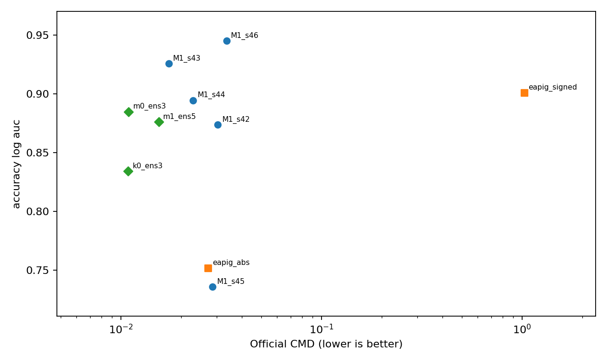
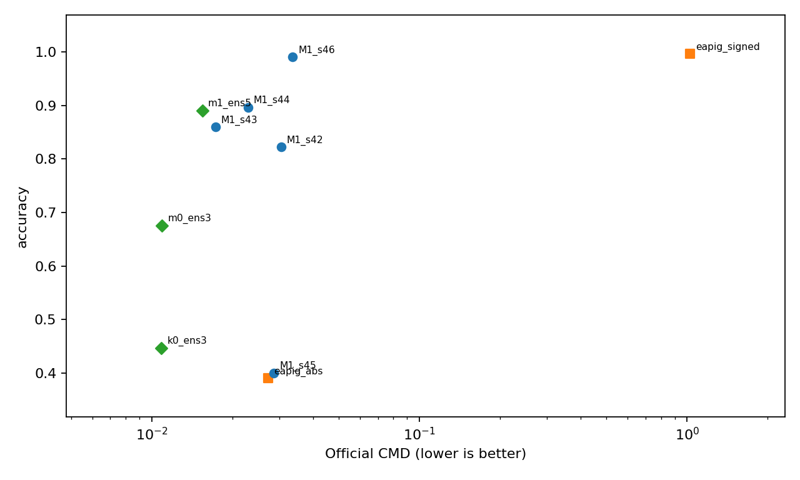
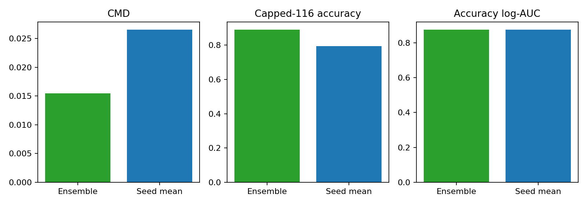
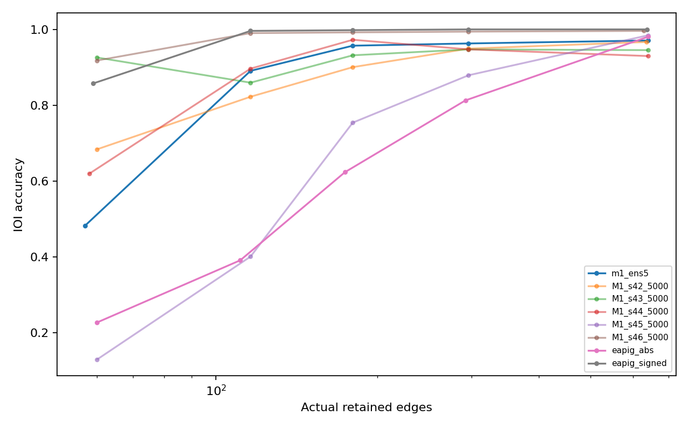
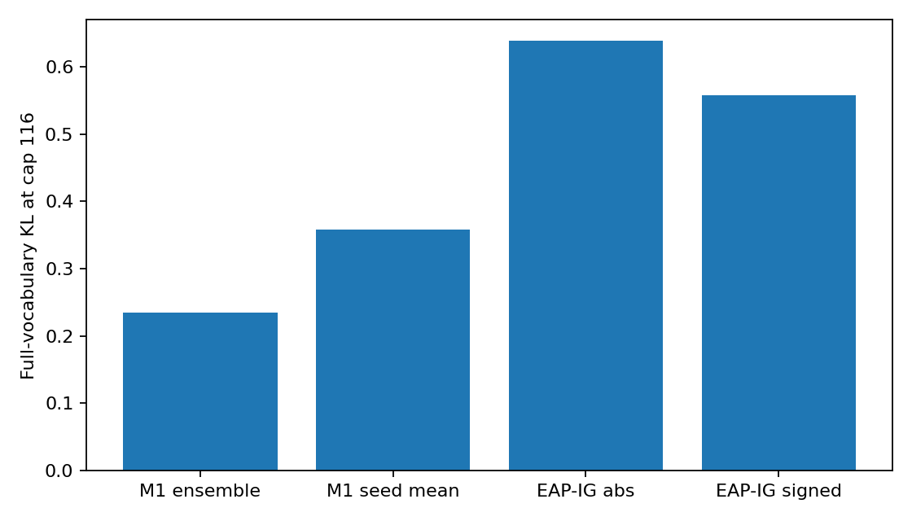
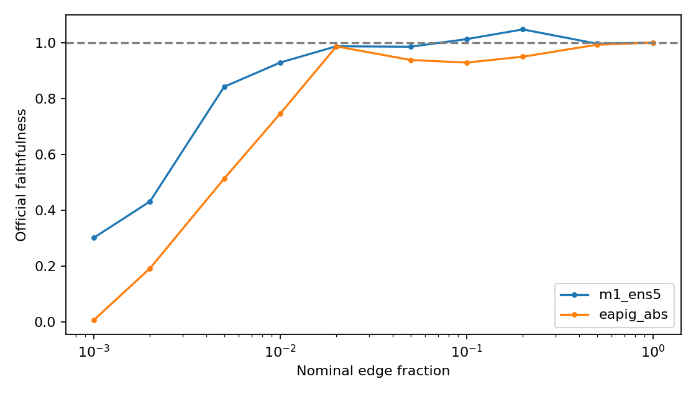
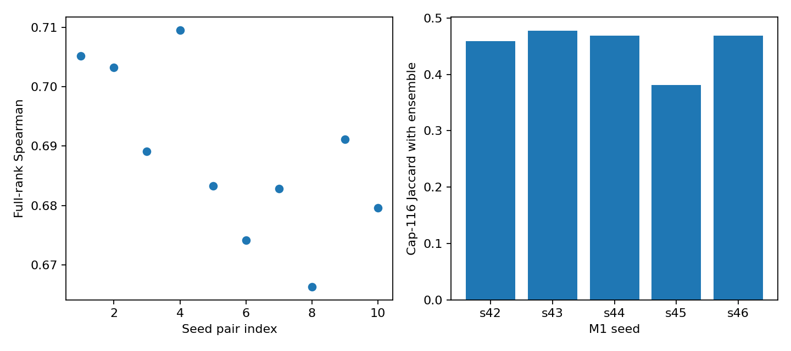

# Gate 6B seed ensemble results

Gate 6B was designed after Gate 6A, whose registered outcome was **Inconclusive**. The primary ranking averages canonical positions across five H2 squared-margin seeds with equal weights and canonical-index tie-breaking.

Protocol SHA-256 `a01c3555d546d5c03bd29b39139724e0b43b77e21887866b8884f8fc9ce28f6b`. Selection seed 5548 retained 512 of 6736 eligible validation prompts across nine exact template strata. The preflight used excluded discovery prompts.

## Registered result — Two-goal success

Ensemble CMD 0.0154419, absolute EAP-IG CMD 0.0272402, difference -0.0117983 (-43.312%), paired 95% interval [-0.015851966361312333, -0.007543689780797881]. Numerically lower CMD: True. Interval entirely below zero: True. CMD non-inferiority at +0.005: True. Unstable draws: 0.

Capped-116 IOI accuracy 89.06% versus 39.06%, paired difference +50.00%, paired 95% interval [0.458984375, 0.541015625]. Compact superiority: True.

CMD superiority requires an interval wholly below zero. The registered non-inferiority rule permits a CMD increase within the 0.005 margin.

## Capped-116 results

Actual edges, IOI accuracy, top-1 accuracy and full-vocabulary KL refer to the capped circuit. CMD and CPR use the full official grid.

| ranking | actual_edges | accuracy | top1_accuracy | kl | cmd | cpr | accuracy_log_auc |
| --- | --- | --- | --- | --- | --- | --- | --- |
| m1_ens5 | 116 | 0.890625 | 0.671875 | 0.234228 | 0.0154419 | 1.00429 | 0.876146 |
| eapig_abs | 111 | 0.390625 | 0.189453 | 0.638285 | 0.0272402 | 0.97176 | 0.751596 |
| M1_s42_5000 | 116 | 0.822266 | 0.673828 | 0.232473 | 0.0303976 | 0.988299 | 0.873716 |
| M1_s43_5000 | 116 | 0.859375 | 0.568359 | 0.282716 | 0.0173071 | 0.985655 | 0.925822 |
| M1_s44_5000 | 116 | 0.896484 | 0.714844 | 0.240911 | 0.0229206 | 0.999728 | 0.894484 |
| M1_s45_5000 | 116 | 0.400391 | 0.234375 | 0.632643 | 0.0286085 | 0.970392 | 0.735725 |
| M1_s46_5000 | 116 | 0.990234 | 0.880859 | 0.404315 | 0.0336132 | 0.985995 | 0.945145 |
| eapig_signed | 116 | 0.996094 | 0.888672 | 0.557873 | 1.02527 | 2.02148 | 0.900956 |
| m0_ens3 | 116 | 0.675781 | 0.373047 | 0.450552 | 0.010931 | 0.994036 | 0.884833 |
| k0_ens3 | 116 | 0.447266 | 0.253906 | 0.495111 | 0.0108683 | 0.988392 | 0.834133 |

## Ensemble versus the individual M1 seeds

| metric | first | comparator | difference | interval | unstable | median | best | worst | beats_mean | beats_best | beats_worst |
| --- | --- | --- | --- | --- | --- | --- | --- | --- | --- | --- | --- |
| CMD | 0.0154419 | 0.0265694 | -0.0111275 | [-0.013079134091927399, -0.009215926371622697] | 0 | 0.0286085 | 0.0173071 | 0.0336132 | True | True | True |
| Capped-116 accuracy | 0.890625 | 0.79375 | 0.096875 | [0.07772460937500003, 0.11601562499999996] | 0 | 0.859375 | 0.990234 | 0.400391 | True | False | True |
| Accuracy log-AUC | 0.876146 | 0.874979 | 0.00116703 | [-0.00363244554858074, 0.005889034686660096] | 0 | 0.894484 | 0.945145 | 0.735725 | True | False | True |

## Compact accuracy versus signed EAP-IG

| cap | first | comparator | difference | interval | unstable | ensemble_edges | signed_edges | ensemble_top1 | signed_top1 |
| --- | --- | --- | --- | --- | --- | --- | --- | --- | --- |
| 60 | 0.482422 | 0.857422 | -0.375 | [-0.41796875, -0.333984375] | 0 | 57 | 59 | 0.232422 | 0.699219 |
| 116 | 0.890625 | 0.996094 | -0.105469 | [-0.13090820312499998, -0.08203125] | 0 | 116 | 116 | 0.671875 | 0.888672 |
| 180 | 0.957031 | 0.998047 | -0.0410156 | [-0.05859375, -0.025390625] | 0 | 180 | 180 | 0.722656 | 0.9375 |
| 296 | 0.962891 | 1 | -0.0371094 | [-0.0546875, -0.021484375] | 0 | 296 | 296 | 0.675781 | 0.962891 |
| 640 | 0.970703 | 1 | -0.0292969 | [-0.044921875, -0.015625] | 0 | 640 | 638 | 0.683594 | 0.980469 |

## Descriptive comparison of the three ensembles

| ranking | actual_edges | accuracy | top1_accuracy | kl | cmd | cpr | accuracy_log_auc | KL 10% | edges 10% | KL 20% | edges 20% | KL 50% | edges 50% |
| --- | --- | --- | --- | --- | --- | --- | --- | --- | --- | --- | --- | --- | --- |
| m1_ens5 | 116 | 0.890625 | 0.671875 | 0.234228 | 0.0154419 | 1.00429 | 0.876146 | 0.0227443 | 2268 | 0.0156527 | 4857 | 0.00802824 | 16146 |
| m0_ens3 | 116 | 0.675781 | 0.373047 | 0.450552 | 0.010931 | 0.994036 | 0.884833 | 0.0345883 | 3207 | 0.0168056 | 6470 | 0.00215049 | 16245 |
| k0_ens3 | 116 | 0.447266 | 0.253906 | 0.495111 | 0.0108683 | 0.988392 | 0.834133 | 0.0150735 | 3206 | 0.00694488 | 6464 | 0.00122868 | 16245 |

M0 and K0 each use three trained rankings. M1 uses five.

## Rank and circuit agreement

Pairwise full-edge Spearman mean 0.68842, median 0.68617, minimum 0.66625, maximum 0.70957.

| ranking | jaccard | known_heads |
| --- | --- | --- |
| m1_ens5 | 1 | 17 |
| M1_s42_5000 | 0.459119 | 15 |
| M1_s43_5000 | 0.477707 | 17 |
| M1_s44_5000 | 0.468354 | 17 |
| M1_s45_5000 | 0.380952 | 14 |
| M1_s46_5000 | 0.468354 | 17 |

The CSV tables provide all official grid points, mask hashes, retained counts, accuracy, CMD contributions, destination counts and pairwise correlations.

## Runtime

The five historical M1 training processes took 2.255 hours. CPU ranking verification and construction took 13.45 seconds. Gate 6B evaluation attempts took 23.01 minutes and recorded 7384 root forwards, 145408 example-forwards, zero backwards and zero optimizer updates. Peak allocation 3247.2 MiB, reservation 4792.0 MiB, and sampled CPU RSS 3918.2 MiB. Attempts without completion: 0.

## Ensemble members and hashes

`k0_ens3` score SHA-256 `3e7faa94dc92dc9152722d414c1fd045fdb0d17e0b8770872303fea245797be7`. Ordering SHA-256 `b6d48609776338efce1d65194620a97b1a20e9a62d2139e4e8f147197e6e4bcd`.

- `K0_s42_5000` `7a51abb260c7e814295984febd1d64e8726f22f19233a0ba64aed9dd6ac382c7`
- `K0_s43_5000` `9fba0ad3c3f8b9ee1a279d63a1b6cb71ac60fd257ba0344ae5d7e74052472281`
- `K0_s44_5000` `97343be951b4f435efb558f0427d3bb7f26fcf06c8bc0e60392a3984c7a6b1a3`

`m0_ens3` score SHA-256 `88c29ec8ced65b000075481d5e96728d82d8368f4bb0574b49ca798777c336b2`. Ordering SHA-256 `8fe5c8aad3e6024656f58298254ccc7549d791a66c6639be10668794150a73d9`.

- `M0_s42_5000` `deecca2b0e1e301360edd15fdfeb6345b32d9c6441a8d7ff02093e8815519042`
- `M0_s43_5000` `d5f7e35584c67e99cf1bf1f8d8bf877e4bba5f688ef00a62c859e67809858c0a`
- `M0_s44_5000` `7a385ecdf74da45902d735011e8988909da03487051fbf8e0e909776d8f1d02a`

`m1_ens5` score SHA-256 `58effcb6cd2e3396354b4a0ee957c5626ea2303e143cf11fc74116b8287b8354`. Ordering SHA-256 `036e571dc2e3360720888c1f4faf52eacd40ae49e208a4fb02deb73430ecc1e7`.

- `M1_s42_5000` `2f14edb0c5bf6c4efabb6faacc0b8efc7e20ed5ef9a0d76d4b1d15163e15a0a8`
- `M1_s43_5000` `7fbd446b18868548765b0b03b5c326d1bd13ca4c2123e36a3cfc50baf807dde6`
- `M1_s44_5000` `b1421538f3d242274f1d02db79971b9dd00482da256d8d0e9036d6b5c31f07f9`
- `M1_s45_5000` `db2c5041a89b42cde51fa0cbd0baba43e18b8fc6545b4b53bcdabe83583ff743`
- `M1_s46_5000` `b2d226211c8d802656f613b8320a69b519066080a5d758feae1919069d4d57bb`

## Limitations

This study covers GPT-2 Small IOI. The faithfulness losses used the original untuned MAttr hyperparameters. EAP-IG uses fixed attribution rankings. Gate 6A selected M1 on a historically inspected development cohort, and Gate 6B followed those results. Gate 1 previously evaluated all official validation rows. The five related ensemble members are fixed rankings on the same prompts. The bootstrap conditions on their rankings and exact template mixture, so it measures prompt sampling uncertainty. Ensembling requires all five training trajectories. The CMD margin allows a modest increase. Capped budgets can contain different actual edge counts. Evaluation was limited to validation.

## Interpretation and recommendation (researcher-written)
