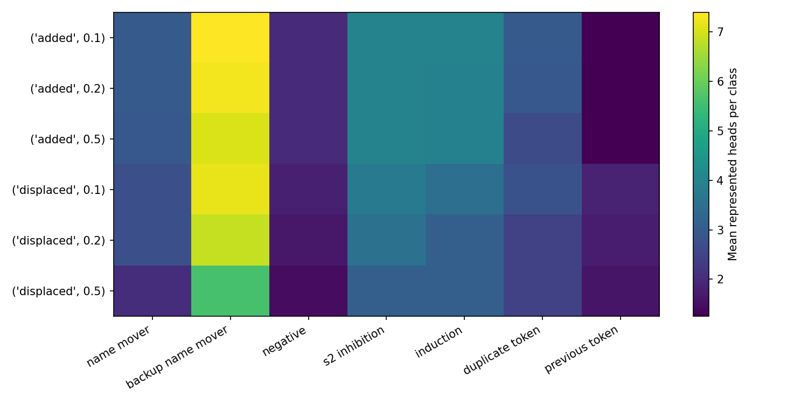
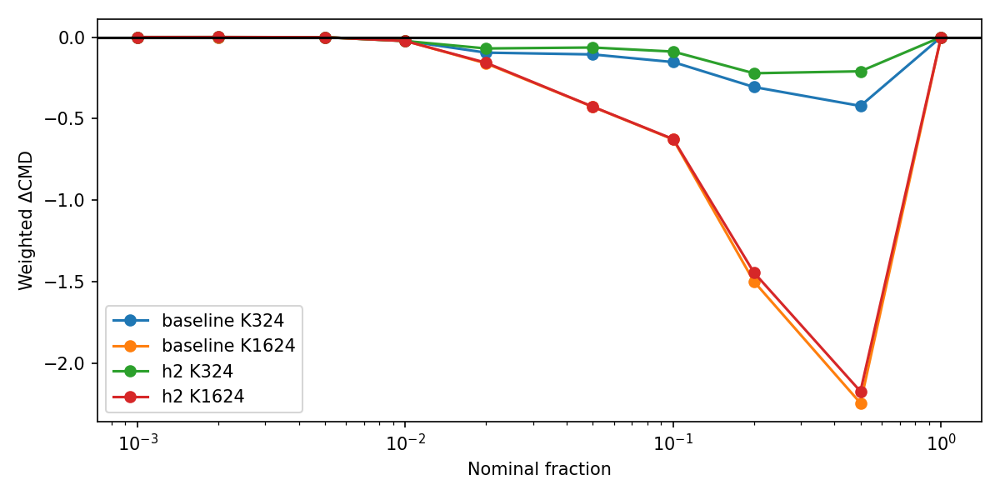
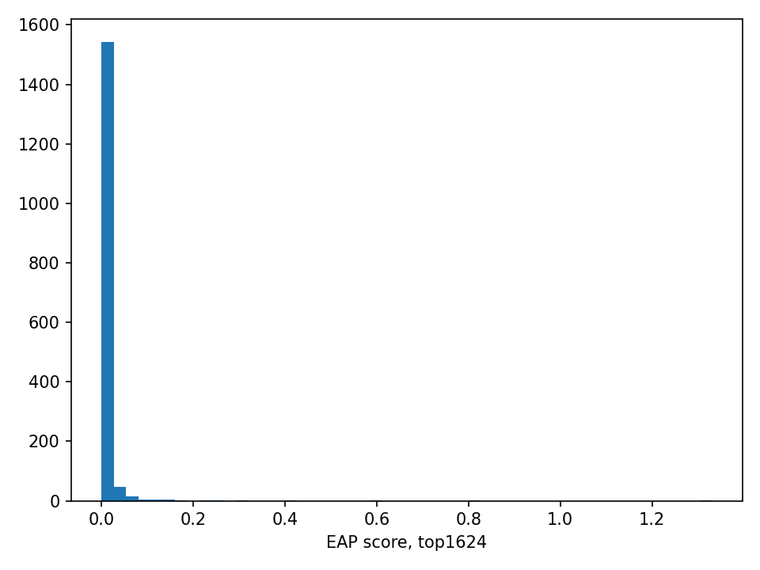
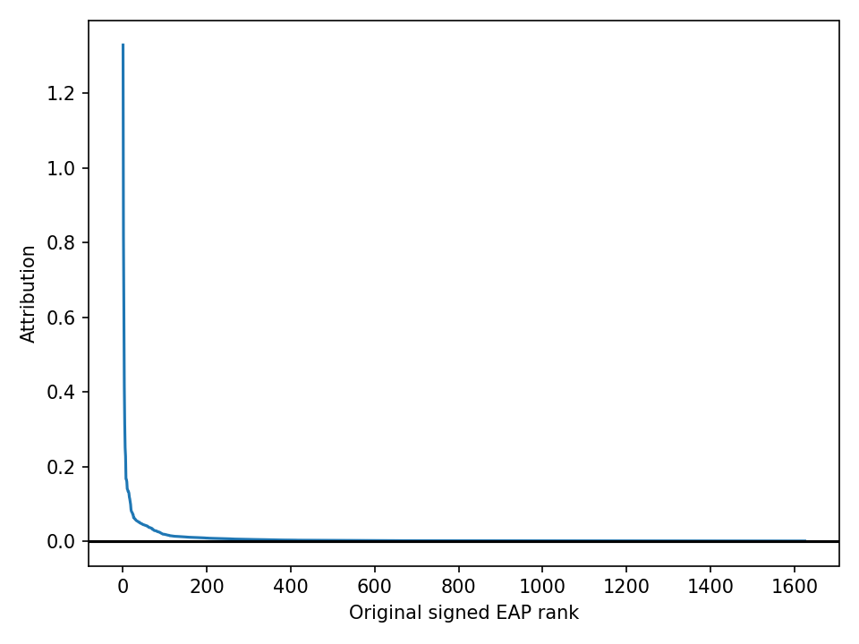
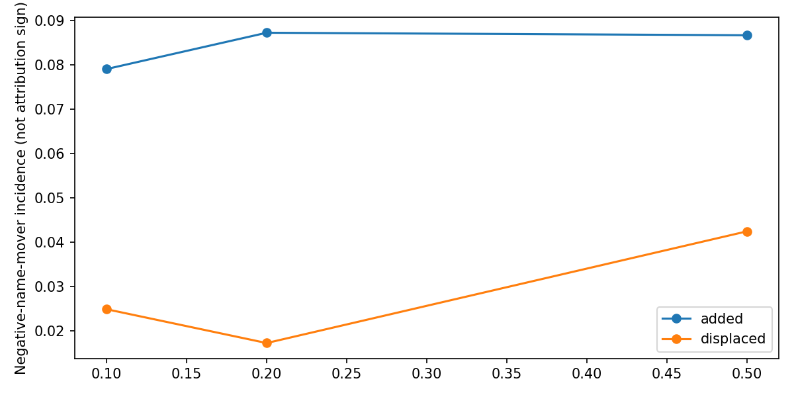
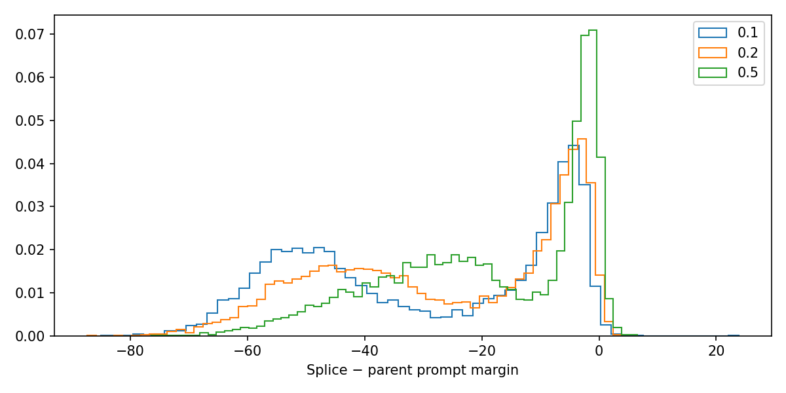
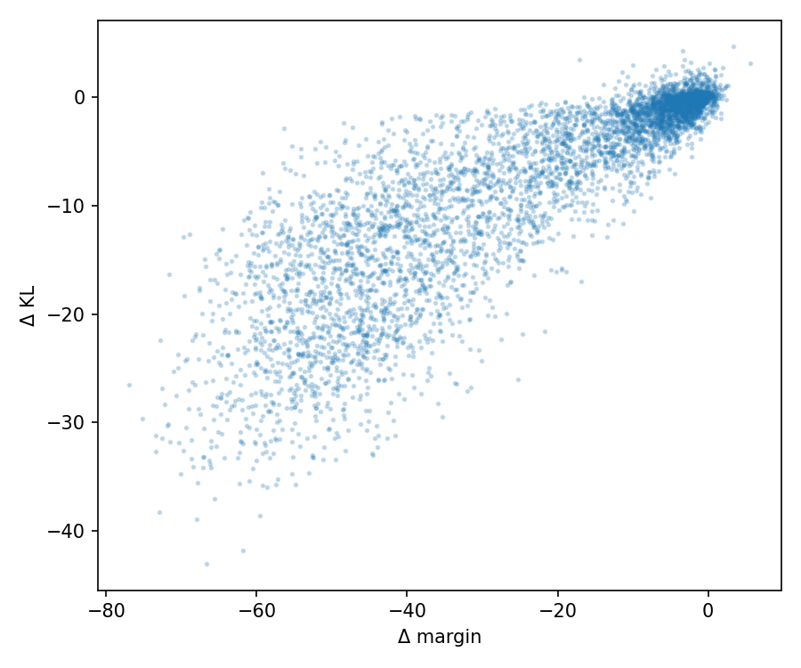

# Gate 5G addendum: post hoc diagnostic measurements

All analyses are exploratory and post hoc. Original decisions remain **EAP-IG closer** and **Compact gain with CPR cost**. No new model outputs were produced.

## Source identity and attribution semantics

{'passed': True, 'original_protocol_sha256': 'c051cf92d775c92693205b22d07684b911268b96e41d99e777efc1018e8c3462', 'plan_commit': 'fb2e6a30a3233cc664ecd88d5e53ab3ddb52208d', 'plan_sha256': 'f03e96a72811bcca111cf007fad27bbd7b83ed717046a38dfa9f243a1a9330f6', 'first_nonpositive_eap_rank': 15698, 'original_implementation': '60e98c15d7ed7c8fa96485ae5a2b0a7e7b1f9133', 'model_forwards': 0, 'backwards': 0, 'optimizer_updates': 0, 'bootstrap_indices_sha256': '3c7b44d3b88da87e330d02f6420d263eb3e425ddb9146f3ea48e38773ce9be1d', 'CPR_CMD_tolerance': 'rtol1e-9,atol1e-10; original unrounded JSON faithfulness used', 'frozen_decisions_unchanged': True, 'seconds': 71.577828818, 'source_sha256': {'src/mattr_gate5g_addendum/analysis.py': '0a5c44f313a5462ee2a3fcf922ef1f6d59cbfba782ac4bc756f86dea03f4bc94', 'src/mattr_gate5g_addendum/cli.py': '6481fd390efb5cdd6d3dc4d12736a08a19f5e0965fda5b6b1a1109eda4373da8', 'src/mattr_gate5g_addendum/common.py': '40016555d0916384cb4ac841ba60aa9f2dc79da0db9d323b842f197ba9644a87', 'src/mattr_gate5g_addendum/smoke.py': 'b559b33e66c22849fe2129bd81e6e71a918975decb86077baefc81c774d55407', 'src/mattr_gate5g_addendum/stage1.py': 'c619680309fa77384481858ad4bb044157b15574fbe7918fc9fa8bb96ea48639', 'src/mattr_gate5g_addendum/stage2.py': 'bef10c8c70421eb54a4b2c10a5b4906038ab70628a9562e3bf8e8c309f5f84ab', 'src/mattr_gate5g_addendum/__init__.py': '73ea4d7535e83fc14b1d28069ae568c8da799ca88beb27b6203417a6f5152ace', 'scripts/gate5g_addendum/00_stage1.sh': 'ac77758553041a2ab88446309995d3b1808e7d9fc6de1b3cfb5f32d955be45f2', 'scripts/gate5g_addendum/01_freeze_stage2.sh': '215462821a9006a9a32f17d723d3ae313c4fd7a13394ce0b6fd4c0089bbdfb24', 'scripts/gate5g_addendum/02_displacement.sh': 'a637667ac895bb0fb7b0058cff0f3a231e9d65268f6d0a8ca3fecbf510f834b4', 'scripts/gate5g_addendum/03_seed42_search.sh': 'b6cc2514148970c083b543224fae7336fc012fed72c3258b403f619c211d0cdb', 'scripts/gate5g_addendum/04_seed42_confirm.sh': '411592eb0651810437299b3869ad8e599e6923472c19dbdb3d74275868d5a29c', 'scripts/gate5g_addendum/05_analyze.sh': '0bc684c991f971f2b18b82ca52b6b1c26f356e81da7695d41445d9ac9cf1daae', 'scripts/gate5g_addendum/06_audit.sh': '6f08336f72a4af829b4a5967ee89b623c6acb66bfa0c450fe4e697eccafd1973', 'scripts/gate5g_addendum/07_package.sh': '0a52c41f6d8bc14968178176b00dd5439dae93883d76176f1201ad4a04e83e3b', 'scripts/gate5g_addendum/08_smoke.sh': '5f14fab96eacdd8b085f616b32c13a5bd6cd297dad8f4c0e4a6dda88250ef152', 'scripts/gate5g_addendum/_environment.sh': '39ffe810a01fba7226c00d853ec384ca2d3b994f58ed9333bcb0db431e78c98d', 'tests/test_mattr_gate5g_addendum.py': 'e8555d33787842ce12909b15d5a311993591e077a18e8e3b0da68645e7625970'}}

Gate5F uses negative mean IOI logit difference as its attribution loss. Official hooks form corrupted-minus-clean activations and contract them with loss gradients, giving the corresponding clean-minus-corrupted margin-gradient convention. Positive scores are local/IG attribution under this objective, not exact causal effects. No abs or negation is applied to the saved scores. Source line references and SHA256 are in source_references.json. MAttr signs are not interpreted causally.

| prefix | positive | zero | negative | suppressor_incident_edges | suppressor_incident_fraction | negative_among_incident |
| --- | --- | --- | --- | --- | --- | --- |
| 324 | 324 | 0 | 0 | 31 | 0.095679 | 0 |
| 1624 | 1624 | 0 | 0 | 124 | 0.0763547 | 0 |
| 32491 | 15697 | 14 | 16780 | 863 | 0.0265612 | 0.514484 |

First non-positive signed EAP rank: 15698.

The K=324 splice does not introduce negatively attributed edges through its EAP-IG prefix. Negative EAP-IG attribution is therefore not a direct explanation for the observed CPR decrease.

Suppressor-associated incidence and negative attribution remain distinct. Neither head membership nor attribution proves causal function, and other negative causal effects remain possible.

## Exact official CPR/CMD accounting

Original unrounded official JSON faithfulness, linear nominal trapezoid weights and absolute-distance CMD integrand reproduce all20 differences at rtol1e-9/atol1e-10. The full100% contribution is zero. Band intervals below use saved shared5000 paired exact-template bootstrap draws and normalize replicate cohort means. They condition on fixed trained rankings, not training-seed population uncertainty.

| method | k | metric | band | mean | lower | upper | signed_accounting_share |
| --- | --- | --- | --- | --- | --- | --- | --- |
| baseline | 324 | CMD | 10%-50% | -0.88015 | -0.915252 | -0.846792 | 0.796042 |
| baseline | 324 | CMD | 100% | 0 | 0 | 0 | -0 |
| baseline | 324 | CMD | 2%-5% | -0.201229 | -0.208735 | -0.19414 | 0.181999 |
| baseline | 324 | CMD | <=1% | -0.0242791 | -0.0252449 | -0.0233189 | 0.021959 |
| baseline | 324 | CPR | 10%-50% | -0.88015 | -0.915252 | -0.846792 | 0.797813 |
| baseline | 324 | CPR | 100% | 0 | 0 | 0 | -0 |
| baseline | 324 | CPR | 2%-5% | -0.201229 | -0.208735 | -0.19414 | 0.182404 |
| baseline | 324 | CPR | <=1% | -0.0218239 | -0.0228284 | -0.0208293 | 0.0197823 |
| baseline | 1624 | CMD | 10%-50% | -4.36499 | -4.52129 | -4.22426 | 0.87702 |
| baseline | 1624 | CMD | 100% | 0 | 0 | 0 | -0 |
| baseline | 1624 | CMD | 2%-5% | -0.587803 | -0.604919 | -0.572305 | 0.118102 |
| baseline | 1624 | CMD | <=1% | -0.0242791 | -0.0252449 | -0.0233189 | 0.00487819 |
| baseline | 1624 | CPR | 10%-50% | -4.36499 | -4.52129 | -4.22426 | 0.877452 |
| baseline | 1624 | CPR | 100% | 0 | 0 | 0 | -0 |
| baseline | 1624 | CPR | 2%-5% | -0.587803 | -0.604919 | -0.572305 | 0.11816 |
| baseline | 1624 | CPR | <=1% | -0.0218239 | -0.0228284 | -0.0208293 | 0.00438705 |
| h2 | 324 | CMD | 10%-50% | -0.519561 | -0.544263 | -0.496748 | 0.767068 |
| h2 | 324 | CMD | 100% | 0 | 0 | 0 | -0 |
| h2 | 324 | CMD | 2%-5% | -0.133302 | -0.138769 | -0.128223 | 0.196804 |
| h2 | 324 | CMD | <=1% | -0.0244708 | -0.0254558 | -0.0234806 | 0.0361281 |
| h2 | 324 | CPR | 10%-50% | -0.519561 | -0.544263 | -0.496748 | 0.767205 |
| h2 | 324 | CPR | 100% | 0 | 0 | 0 | -0 |
| h2 | 324 | CPR | 2%-5% | -0.133302 | -0.138769 | -0.128223 | 0.196839 |
| h2 | 324 | CPR | <=1% | -0.0243497 | -0.0253667 | -0.0233389 | 0.0359557 |
| h2 | 1624 | CMD | 10%-50% | -4.23582 | -4.38173 | -4.10377 | 0.874644 |
| h2 | 1624 | CMD | 100% | 0 | 0 | 0 | -0 |
| h2 | 1624 | CMD | 2%-5% | -0.582617 | -0.599093 | -0.567535 | 0.120303 |
| h2 | 1624 | CMD | <=1% | -0.0244708 | -0.0254558 | -0.0234806 | 0.0050529 |
| h2 | 1624 | CPR | 10%-50% | -4.23582 | -4.38173 | -4.10377 | 0.874666 |
| h2 | 1624 | CPR | 100% | 0 | 0 | 0 | -0 |
| h2 | 1624 | CPR | 2%-5% | -0.582617 | -0.599093 | -0.567535 | 0.120306 |
| h2 | 1624 | CPR | <=1% | -0.0243497 | -0.0253667 | -0.0233389 | 0.00502803 |

Signed shares in band_contributions.csv can exceed100% or be negative when gains/losses cancel; they are accounting shares, not probabilities. Mean-margin normalization is algebra, not an independent discovery.

## Insertions and displacements

| method | k | fraction | added | displaced | fraction_changed | parent_actual | splice_actual | post_added | post_displaced |
| --- | --- | --- | --- | --- | --- | --- | --- | --- | --- |
| baseline | 324 | 0.1 | 135.2 | 135.2 | 0.0416128 | 3246.8 | 3245.8 | 135.2 | 136.2 |
| baseline | 324 | 0.2 | 110.8 | 110.8 | 0.0170514 | 6498 | 6498 | 110.8 | 110.8 |
| baseline | 324 | 0.5 | 81.2 | 81.2 | 0.00499846 | 16245 | 16245 | 81.2 | 81.2 |
| baseline | 1624 | 0.1 | 1056.8 | 1056.8 | 0.325269 | 3246.8 | 3239.4 | 1049.4 | 1056.8 |
| baseline | 1624 | 0.2 | 868.2 | 868.2 | 0.13361 | 6498 | 6497.2 | 868 | 868.8 |
| baseline | 1624 | 0.5 | 626.6 | 626.6 | 0.0385719 | 16245 | 16245 | 626.6 | 626.6 |
| h2 | 324 | 0.1 | 130 | 130 | 0.0400123 | 3245 | 3243 | 128.2 | 130.2 |
| h2 | 324 | 0.2 | 103 | 103 | 0.015851 | 6493.2 | 6491.6 | 101.2 | 102.8 |
| h2 | 324 | 0.5 | 73.6 | 73.6 | 0.00453062 | 16245 | 16245 | 73.6 | 73.6 |
| h2 | 1624 | 0.1 | 1054.8 | 1054.8 | 0.324654 | 3245 | 3238.4 | 1047.6 | 1054.2 |
| h2 | 1624 | 0.2 | 864.4 | 864.4 | 0.133026 | 6493.2 | 6496.8 | 865.2 | 861.6 |
| h2 | 1624 | 0.5 | 626 | 626 | 0.0385349 | 16245 | 16245 | 626 | 626 |

Full pre/post-pruning identities are in edge_inventory.csv. edge_composition.csv and edge_attributes.csv retain signed EAP scores, score quantiles, parent ranks, every known-head class, suppressor incidence and source/destination components separately.

## Prompt margin/KL changes

| method | k | fraction | mean | median | reduced_fraction | top10_signed_net_share | top10_negative_mass_share | kl_lower_fraction | kl_change_mean | margin_kl_spearman |
| --- | --- | --- | --- | --- | --- | --- | --- | --- | --- | --- |
| baseline | 324 | 0.1 | -12.1209 | -10.9547 | 0.990625 | 0.222303 | 0.221959 | 0.81875 | -3.10751 | 0.702878 |
| baseline | 324 | 0.2 | -9.08 | -8.07024 | 0.973828 | 0.252637 | 0.251206 | 0.779687 | -2.43319 | 0.644047 |
| baseline | 324 | 0.5 | -6.26198 | -5.87076 | 0.925391 | 0.258875 | 0.251071 | 0.721094 | -1.7328 | 0.585657 |
| baseline | 1624 | 0.1 | -49.6731 | -50.1046 | 0.999609 | 0.134801 | 0.134801 | 1 | -17.5049 | 0.506155 |
| baseline | 1624 | 0.2 | -44.4571 | -44.4245 | 1 | 0.14608 | 0.14608 | 0.998828 | -15.3562 | 0.624692 |
| baseline | 1624 | 0.5 | -33.2998 | -31.8726 | 1 | 0.170051 | 0.170051 | 0.989844 | -10.4288 | 0.718485 |
| h2 | 324 | 0.1 | -7.02755 | -6.39349 | 0.981641 | 0.234112 | 0.232676 | 0.820312 | -2.0306 | 0.681188 |
| h2 | 324 | 0.2 | -6.57734 | -5.65649 | 0.972656 | 0.252163 | 0.250885 | 0.911719 | -2.78977 | 0.657321 |
| h2 | 324 | 0.5 | -3.11176 | -2.69184 | 0.864844 | 0.332541 | 0.299328 | 0.797266 | -1.1028 | 0.52518 |
| h2 | 1624 | 0.1 | -49.4842 | -49.9899 | 1 | 0.136069 | 0.136069 | 1 | -18.9004 | 0.486226 |
| h2 | 1624 | 0.2 | -42.8212 | -42.4318 | 1 | 0.144978 | 0.144978 | 0.999609 | -15.64 | 0.571871 |
| h2 | 1624 | 0.5 | -32.2344 | -30.7954 | 1 | 0.168279 | 0.168279 | 0.998828 | -11.417 | 0.661277 |

Per-comparison quantiles, negative mass and template distributions remain in margin_changes.csv and margin_by_template.csv. Near-zero net changes get no signed concentration ratio. CPR loss, prompt margin loss and KL improvement/regression are distinct.

## Seed42 saved-data diagnostics

| target | accuracy | top1_accuracy | failures | wrong_name_top1 | other_top1 | known_heads | complete_name_mover_path | eap_jaccard | nominal_prefix | pruned_edges |
| --- | --- | --- | --- | --- | --- | --- | --- | --- | --- | --- |
| 116 | 0.09375 | 0.0605469 | 464 | 383 | 81 | 13 | True | 0.148515 | 145 | 29 |
| 296 | 0.992188 | 0.986328 | 4 | 2 | 2 | 22 | True | 0.131931 | 300 | 4 |

New components are in seed42_new_components.json, edges in seed42_added_edges.csv, and template failures in seed42_template_failures.csv. These descriptors do not identify a causally missing edge.

## Stage2 — not executed

Displacement/insertion/non-additivity, adaptive search and fresh confirmation remain unmeasured. The user must run the bounded, frozen manual pipeline. Remove/Add vary budgets; pruning is nonlinear. Circuit-level non-additivity does not isolate individual-edge neural interactions. Candidate restoration also changes size and is not an equal-size superiority claim.

## Resources

CPU wall seconds: 71.578; model forwards/backwards/optimizer updates:0/0/0. No original artifacts or classifications changed.

## Interpretation and recommendation (researcher-written)
