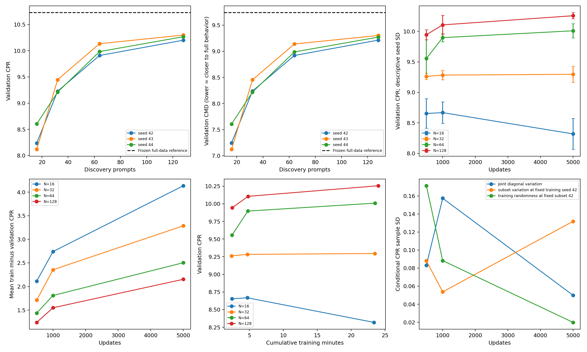
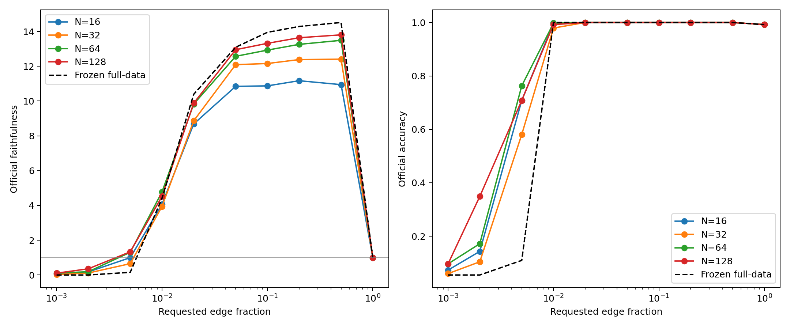
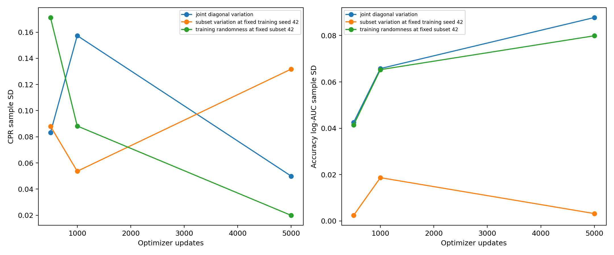

# Gate 2 final analysis

All results below are measured with pinned official edge-MAttr and the official seven-value MIB evaluator. No MAttr algorithm has been modified. No Gate 3 run, public/private test access or submission was performed. All twelve pool/seed jobs and four conditional controls use 5,000 updates; checkpoints are evaluated without optimizer feedback.

## Findings and metric interpretation

The frozen full-data Gate 1 ranking on this exact 128-prompt validation cohort has CPR **10.725481**, CMD **9.738246**, accuracy log-AUC **0.738303**. This is the directly comparable reference; its original full-10,000-validation score is a separate result. No retraining was performed.

CPR integrates normalized logit-difference recovery; it is unbounded and rewards amplification. CMD integrates absolute distance from faithfulness 1, so lower means closer to the original model. A rise in CPR together with CMD is a real tradeoff, not automatically better circuit fidelity. Scores are ratios of dataset means, not means of per-example ratios. We do not clip curves, invert signs or replace the official metrics.

At 5,000 updates, the highest three-seed mean CPR is at **N=128**, the lowest mean CMD is at **N=16**, and the smallest mean train–validation CPR gap is at **N=128**. Across the twelve final runs CPR and CMD have descriptive correlation **0.999992**; this is a metric tradeoff diagnostic, not a significance test.

At N=128, the mean CPR increment from 1,000 to 5,000 updates is **0.149770**; the measured cumulative-training-time ratio is **5.00x**. See the exact step and compact-circuit tables before interpreting this increment as worth its cost.

Mean N=128 accuracy log-AUC rises from **0.721693** at 1,000 updates to **0.843666** at 5,000. Thus a short run is useful for screening CPR, but cannot replace the longer compact-quality confirmation. At 500 updates the seed-43/44 N=128 runs had visited only 125/126 rows; all main runs had visited their full eligible pool by 1,000 updates.

## All measured checkpoints

Train scores at 500/1,000 are additional frozen-checkpoint evaluations. Every gap uses the train pool and the same validation cohort at that step. Times are actual cumulative checkpoint training timers; they exclude the subsequent official evaluation. Unique rows and presentations come from actual draw logs. The 5,000-step usage totals were cross-checked against training_example_usage.csv.

Each split uses its own clean/empty-circuit reference denominator. Train–validation CPR gaps therefore combine generalization with cohort normalization differences and are not standalone proof of overfitting. The measured references are saved in cohort_references.csv; compact-circuit accuracy and behavior curves provide additional context.

| seed | N | updates | val CPR | val CMD | train CPR | train CMD | CPR gap | CMD gap | unique rows | presentations | train seconds |
| --- | --- | --- | --- | --- | --- | --- | --- | --- | --- | --- | --- |
| 42 | 16 | 500 | 8.3896 | 7.4166 | 11.5325 | 10.5590 | 3.1429 | 3.1424 | 16 | 500 | 142.1771 |
| 42 | 16 | 1000 | 8.4673 | 7.4945 | 12.3733 | 11.4001 | 3.9060 | 3.9055 | 16 | 1000 | 277.3611 |
| 42 | 16 | 5000 | 8.2359 | 7.2468 | 13.6893 | 12.6992 | 5.4534 | 5.4524 | 16 | 5000 | 1368.8753 |
| 43 | 16 | 500 | 8.7036 | 7.7208 | 10.8194 | 9.8332 | 2.1158 | 2.1124 | 16 | 500 | 148.3805 |
| 43 | 16 | 1000 | 8.7436 | 7.7549 | 11.3322 | 10.3414 | 2.5885 | 2.5864 | 16 | 1000 | 284.5475 |
| 43 | 16 | 5000 | 8.1185 | 7.1236 | 12.2456 | 11.2505 | 4.1270 | 4.1269 | 16 | 5000 | 1415.9436 |
| 44 | 16 | 500 | 8.8666 | 7.8857 | 9.9480 | 8.9615 | 1.0814 | 1.0758 | 16 | 500 | 143.8104 |
| 44 | 16 | 1000 | 8.7921 | 7.8056 | 10.5170 | 9.5304 | 1.7249 | 1.7248 | 16 | 1000 | 281.2998 |
| 44 | 16 | 5000 | 8.6028 | 7.6076 | 11.4248 | 10.4286 | 2.8220 | 2.8210 | 16 | 5000 | 1418.5701 |
| 42 | 32 | 500 | 9.2198 | 8.2419 | 11.4315 | 10.4530 | 2.2117 | 2.2111 | 32 | 500 | 139.5243 |
| 42 | 32 | 1000 | 9.3654 | 8.3906 | 12.2455 | 11.2701 | 2.8800 | 2.8795 | 32 | 1000 | 277.5055 |
| 42 | 32 | 5000 | 9.2282 | 8.2390 | 13.2400 | 12.2506 | 4.0118 | 4.0116 | 32 | 5000 | 1376.5738 |
| 43 | 32 | 500 | 9.2467 | 8.2661 | 10.4080 | 9.4213 | 1.1613 | 1.1552 | 32 | 500 | 141.8318 |
| 43 | 32 | 1000 | 9.2676 | 8.2809 | 11.0527 | 10.0658 | 1.7851 | 1.7849 | 32 | 1000 | 278.6663 |
| 43 | 32 | 5000 | 9.4478 | 8.4531 | 11.9214 | 10.9265 | 2.4736 | 2.4734 | 32 | 5000 | 1397.9164 |
| 44 | 32 | 500 | 9.3176 | 8.3463 | 11.0800 | 10.1083 | 1.7624 | 1.7621 | 32 | 500 | 143.7477 |
| 44 | 32 | 1000 | 9.2155 | 8.2418 | 11.6136 | 10.6377 | 2.3980 | 2.3959 | 32 | 1000 | 289.2766 |
| 44 | 32 | 5000 | 9.2105 | 8.2195 | 12.5819 | 11.5867 | 3.3714 | 3.3673 | 32 | 5000 | 1450.3008 |
| 42 | 64 | 500 | 9.5764 | 8.6003 | 11.2698 | 10.2925 | 1.6934 | 1.6922 | 64 | 500 | 142.3529 |
| 42 | 64 | 1000 | 9.8296 | 8.8535 | 11.8569 | 10.8790 | 2.0273 | 2.0255 | 64 | 1000 | 278.1440 |
| 42 | 64 | 5000 | 9.9088 | 8.9193 | 12.6743 | 11.6837 | 2.7655 | 2.7644 | 64 | 5000 | 1371.8957 |
| 43 | 64 | 500 | 9.2392 | 8.2624 | 10.6156 | 9.6370 | 1.3764 | 1.3746 | 64 | 500 | 146.3182 |
| 43 | 64 | 1000 | 9.8936 | 8.9071 | 11.6851 | 10.6986 | 1.7914 | 1.7914 | 64 | 1000 | 289.1738 |
| 43 | 64 | 5000 | 10.1342 | 9.1396 | 12.6028 | 11.6078 | 2.4686 | 2.4682 | 64 | 5000 | 1425.8815 |
| 44 | 64 | 500 | 9.8509 | 8.8695 | 11.0915 | 10.1053 | 1.2407 | 1.2358 | 64 | 500 | 147.8268 |
| 44 | 64 | 1000 | 9.9661 | 8.9773 | 11.5747 | 10.5853 | 1.6085 | 1.6079 | 64 | 1000 | 290.5153 |
| 44 | 64 | 5000 | 9.9831 | 8.9874 | 12.2594 | 11.2632 | 2.2763 | 2.2758 | 64 | 5000 | 1431.6541 |
| 42 | 128 | 500 | 9.9275 | 8.9539 | 11.3199 | 10.3457 | 1.3924 | 1.3918 | 128 | 500 | 143.3159 |
| 42 | 128 | 1000 | 9.9477 | 8.9735 | 11.6311 | 10.6558 | 1.6834 | 1.6823 | 128 | 1000 | 277.4320 |
| 42 | 128 | 5000 | 10.2006 | 9.2129 | 12.4250 | 11.4368 | 2.2244 | 2.2238 | 128 | 5000 | 1391.0752 |
| 43 | 128 | 500 | 10.0343 | 9.0476 | 11.4315 | 10.4449 | 1.3973 | 1.3973 | 125 | 500 | 152.1124 |
| 43 | 128 | 1000 | 10.2624 | 9.2735 | 11.9532 | 10.9624 | 1.6908 | 1.6889 | 128 | 1000 | 289.5096 |
| 43 | 128 | 5000 | 10.2984 | 9.3020 | 12.6901 | 11.6926 | 2.3917 | 2.3906 | 128 | 5000 | 1462.1246 |
| 44 | 128 | 500 | 9.8704 | 8.8868 | 10.7996 | 9.8130 | 0.9293 | 0.9262 | 126 | 500 | 147.6217 |
| 44 | 128 | 1000 | 10.1065 | 9.1185 | 11.3792 | 10.3908 | 1.2727 | 1.2723 | 128 | 1000 | 296.4203 |
| 44 | 128 | 5000 | 10.2670 | 9.2707 | 12.1083 | 11.1115 | 1.8413 | 1.8407 | 128 | 5000 | 1462.2369 |

## Three-seed descriptive variability

| pool | step | cpr_mean | cpr_sd | cpr_min | cpr_max | cmd_mean | cmd_sd | accuracy_auc_mean | accuracy_auc_sd |
| --- | --- | --- | --- | --- | --- | --- | --- | --- | --- |
| 16 | 500 | 8.6533 | 0.2425 | 8.3896 | 8.8666 | 7.6744 | 0.2380 | 0.6781 | 0.0302 |
| 16 | 1000 | 8.6677 | 0.1752 | 8.4673 | 8.7921 | 7.6850 | 0.1669 | 0.7020 | 0.0585 |
| 16 | 5000 | 8.3191 | 0.2526 | 8.1185 | 8.6028 | 7.3260 | 0.2515 | 0.8190 | 0.0494 |
| 32 | 500 | 9.2614 | 0.0505 | 9.2198 | 9.3176 | 8.2848 | 0.0546 | 0.6640 | 0.0301 |
| 32 | 1000 | 9.2828 | 0.0761 | 9.2155 | 9.3654 | 8.3044 | 0.0771 | 0.6752 | 0.0489 |
| 32 | 5000 | 9.2955 | 0.1322 | 9.2105 | 9.4478 | 8.3039 | 0.1296 | 0.7971 | 0.0342 |
| 64 | 500 | 9.5555 | 0.3064 | 9.2392 | 9.8509 | 8.5774 | 0.3042 | 0.6751 | 0.0186 |
| 64 | 1000 | 9.8965 | 0.0683 | 9.8296 | 9.9661 | 8.9127 | 0.0621 | 0.7109 | 0.0546 |
| 64 | 5000 | 10.0087 | 0.1149 | 9.9088 | 10.1342 | 9.0154 | 0.1128 | 0.8299 | 0.0570 |
| 128 | 500 | 9.9441 | 0.0832 | 9.8704 | 10.0343 | 8.9628 | 0.0808 | 0.6898 | 0.0425 |
| 128 | 1000 | 10.1055 | 0.1574 | 9.9477 | 10.2624 | 9.1218 | 0.1500 | 0.7217 | 0.0658 |
| 128 | 5000 | 10.2553 | 0.0499 | 10.2006 | 10.2984 | 9.2619 | 0.0452 | 0.8437 | 0.0878 |

Sample SD describes three coupled pool/training-seed runs. These are not confidence intervals, a significance test, or evidence that 128 prompts suffice for a leaderboard run.

## Paired baseline differences

Subtractions below share exactly the same validation prompts. The full-data ranking is one frozen seed-42 reference, so its contrasts are paired on evaluation data, not on independent full-data training repetitions. N=128 contrasts match nominal training seed and checkpoint. The 5,000-minus-earlier contrasts hold the discovery pool and optimizer trajectory fixed.

| seed | N | step | ΔCPR full | ΔCMD full | ΔaccAUC full | ΔCPR N128 | ΔCMD N128 | ΔaccAUC N128 | CPR gain to 5k | CMD change to 5k | accAUC gain to 5k |
| --- | --- | --- | --- | --- | --- | --- | --- | --- | --- | --- | --- |
| 42 | 16 | 500 | -2.3359 | -2.3216 | -0.0950 | -1.5379 | -1.5373 | 0.0008 | -0.1537 | -0.1698 | 0.1186 |
| 42 | 16 | 1000 | -2.2582 | -2.2437 | -0.0973 | -1.4804 | -1.4790 | -0.0055 | -0.2314 | -0.2477 | 0.1210 |
| 42 | 16 | 5000 | -2.4896 | -2.4914 | 0.0237 | -1.9647 | -1.9661 | 0.0196 | 0.0000 | 0.0000 | 0.0000 |
| 43 | 16 | 500 | -2.0218 | -2.0175 | -0.0448 | -1.3306 | -1.3268 | -0.0316 | -0.5851 | -0.5972 | 0.1534 |
| 43 | 16 | 1000 | -1.9818 | -1.9833 | 0.0192 | -1.5188 | -1.5186 | -0.0108 | -0.6251 | -0.6313 | 0.0893 |
| 43 | 16 | 5000 | -2.6069 | -2.6146 | 0.1086 | -2.1798 | -2.1784 | -0.0469 | 0.0000 | 0.0000 | 0.0000 |
| 44 | 16 | 500 | -1.8589 | -1.8525 | -0.0409 | -1.0037 | -1.0010 | -0.0042 | -0.2638 | -0.2782 | 0.1509 |
| 44 | 16 | 1000 | -1.9334 | -1.9326 | -0.0309 | -1.3144 | -1.3129 | -0.0429 | -0.1892 | -0.1981 | 0.1409 |
| 44 | 16 | 5000 | -2.1227 | -2.1307 | 0.1100 | -1.6642 | -1.6632 | -0.0466 | 0.0000 | 0.0000 | 0.0000 |
| 42 | 32 | 500 | -1.5057 | -1.4963 | -0.0659 | -0.7077 | -0.7120 | 0.0298 | 0.0084 | -0.0029 | 0.0935 |
| 42 | 32 | 1000 | -1.3600 | -1.3477 | -0.0863 | -0.5822 | -0.5829 | 0.0055 | -0.1373 | -0.1516 | 0.1139 |
| 42 | 32 | 5000 | -1.4973 | -1.4992 | 0.0276 | -0.9724 | -0.9739 | 0.0235 | 0.0000 | 0.0000 | 0.0000 |
| 43 | 32 | 500 | -1.4788 | -1.4721 | -0.0492 | -0.7876 | -0.7815 | -0.0361 | 0.2011 | 0.1870 | 0.1447 |
| 43 | 32 | 1000 | -1.4579 | -1.4573 | -0.0069 | -0.9949 | -0.9926 | -0.0369 | 0.1802 | 0.1722 | 0.1023 |
| 43 | 32 | 5000 | -1.2777 | -1.2852 | 0.0954 | -0.8506 | -0.8489 | -0.0601 | 0.0000 | 0.0000 | 0.0000 |
| 44 | 32 | 500 | -1.4079 | -1.3920 | -0.1076 | -0.5528 | -0.5405 | -0.0709 | -0.1071 | -0.1268 | 0.1611 |
| 44 | 32 | 1000 | -1.5099 | -1.4964 | -0.0960 | -0.8909 | -0.8766 | -0.1079 | -0.0051 | -0.0224 | 0.1495 |
| 44 | 32 | 5000 | -1.5150 | -1.5188 | 0.0535 | -1.0565 | -1.0513 | -0.1030 | 0.0000 | 0.0000 | 0.0000 |
| 42 | 64 | 500 | -1.1491 | -1.1379 | -0.0769 | -0.3511 | -0.3536 | 0.0188 | 0.3324 | 0.3189 | 0.1062 |
| 42 | 64 | 1000 | -0.8959 | -0.8847 | -0.0855 | -0.1181 | -0.1200 | 0.0063 | 0.0791 | 0.0658 | 0.1148 |
| 42 | 64 | 5000 | -0.8167 | -0.8190 | 0.0292 | -0.2918 | -0.2936 | 0.0252 | 0.0000 | 0.0000 | 0.0000 |
| 43 | 64 | 500 | -1.4863 | -1.4758 | -0.0705 | -0.7950 | -0.7852 | -0.0574 | 0.8950 | 0.8772 | 0.1752 |
| 43 | 64 | 1000 | -0.8318 | -0.8311 | -0.0196 | -0.3688 | -0.3664 | -0.0496 | 0.2406 | 0.2324 | 0.1242 |
| 43 | 64 | 5000 | -0.5912 | -0.5987 | 0.1047 | -0.1641 | -0.1624 | -0.0508 | 0.0000 | 0.0000 | 0.0000 |
| 44 | 64 | 500 | -0.8746 | -0.8687 | -0.0421 | -0.0195 | -0.0173 | -0.0054 | 0.1322 | 0.1179 | 0.1830 |
| 44 | 64 | 1000 | -0.7594 | -0.7609 | 0.0229 | -0.1404 | -0.1412 | 0.0109 | 0.0170 | 0.0101 | 0.1181 |
| 44 | 64 | 5000 | -0.7424 | -0.7508 | 0.1410 | -0.2839 | -0.2833 | -0.0156 | 0.0000 | 0.0000 | 0.0000 |
| 42 | 128 | 500 | -0.7979 | -0.7843 | -0.0957 | 0.0000 | 0.0000 | 0.0000 | 0.2730 | 0.2590 | 0.0998 |
| 42 | 128 | 1000 | -0.7778 | -0.7647 | -0.0918 | 0.0000 | 0.0000 | 0.0000 | 0.2529 | 0.2394 | 0.0958 |
| 42 | 128 | 5000 | -0.5249 | -0.5253 | 0.0040 | 0.0000 | 0.0000 | 0.0000 | 0.0000 | 0.0000 | 0.0000 |
| 43 | 128 | 500 | -0.6912 | -0.6907 | -0.0132 | 0.0000 | 0.0000 | 0.0000 | 0.2641 | 0.2544 | 0.1687 |
| 43 | 128 | 1000 | -0.4631 | -0.4647 | 0.0300 | 0.0000 | 0.0000 | 0.0000 | 0.0359 | 0.0285 | 0.1255 |
| 43 | 128 | 5000 | -0.4271 | -0.4362 | 0.1555 | 0.0000 | 0.0000 | 0.0000 | 0.0000 | 0.0000 | 0.0000 |
| 44 | 128 | 500 | -0.8551 | -0.8515 | -0.0367 | 0.0000 | 0.0000 | 0.0000 | 0.3966 | 0.3840 | 0.1933 |
| 44 | 128 | 1000 | -0.6190 | -0.6198 | 0.0120 | 0.0000 | 0.0000 | 0.0000 | 0.1605 | 0.1523 | 0.1446 |
| 44 | 128 | 5000 | -0.4585 | -0.4675 | 0.1566 | 0.0000 | 0.0000 | 0.0000 | 0.0000 | 0.0000 | 0.0000 |

## Separating subset and training variation

Four additional unchanged N=128 controls hold subset seed 42 fixed while training seeds vary (42/43/44), or hold training seed 42 fixed while subset seeds vary. Diagonal results are reused from the main experiment. Thus conditional variation is measured separately rather than attributed from confounded diagonal seeds.

At 5,000 steps, subset-seed versus training-seed conditional CPR SD is **0.131773 versus 0.019878**. Corresponding accuracy-log-AUC SD is **0.003185 versus 0.079893**. This separates the measured sensitivity of margin recovery from compact decision recovery at this anchor configuration.

| training_seed | subset_seed | step | cpr | cmd | accuracy_auc | cpr_anchor | cmd_anchor | accuracy_auc_anchor | cpr_minus_anchor | cmd_minus_anchor | accuracy_auc_minus_anchor |
| --- | --- | --- | --- | --- | --- | --- | --- | --- | --- | --- | --- |
| 42 | 42 | 500 | 9.9275 | 8.9539 | 0.6426 | 9.9275 | 8.9539 | 0.6426 | 0.0000 | 0.0000 | 0.0000 |
| 43 | 42 | 500 | 9.7694 | 8.7822 | 0.7154 | 9.9275 | 8.9539 | 0.6426 | -0.1581 | -0.1718 | 0.0729 |
| 44 | 42 | 500 | 9.5854 | 8.6116 | 0.6449 | 9.9275 | 8.9539 | 0.6426 | -0.3421 | -0.3423 | 0.0024 |
| 42 | 43 | 500 | 9.8786 | 8.9063 | 0.6379 | 9.9275 | 8.9539 | 0.6426 | -0.0489 | -0.0476 | -0.0047 |
| 43 | 43 | 500 | 10.0343 | 9.0476 | 0.7251 | 9.9275 | 8.9539 | 0.6426 | 0.1067 | 0.0937 | 0.0826 |
| 42 | 44 | 500 | 9.7566 | 8.7840 | 0.6394 | 9.9275 | 8.9539 | 0.6426 | -0.1709 | -0.1699 | -0.0031 |
| 44 | 44 | 500 | 9.8704 | 8.8868 | 0.7016 | 9.9275 | 8.9539 | 0.6426 | -0.0572 | -0.0671 | 0.0590 |
| 42 | 42 | 1000 | 9.9477 | 8.9735 | 0.6465 | 9.9477 | 8.9735 | 0.6465 | 0.0000 | 0.0000 | 0.0000 |
| 43 | 42 | 1000 | 9.9862 | 8.9960 | 0.7770 | 9.9477 | 8.9735 | 0.6465 | 0.0386 | 0.0225 | 0.1305 |
| 44 | 42 | 1000 | 9.8178 | 8.8319 | 0.7100 | 9.9477 | 8.9735 | 0.6465 | -0.1299 | -0.1417 | 0.0635 |
| 42 | 43 | 1000 | 10.0313 | 9.0522 | 0.6757 | 9.9477 | 8.9735 | 0.6465 | 0.0836 | 0.0787 | 0.0293 |
| 43 | 43 | 1000 | 10.2624 | 9.2735 | 0.7683 | 9.9477 | 8.9735 | 0.6465 | 0.3147 | 0.3000 | 0.1219 |
| 42 | 44 | 1000 | 10.0477 | 9.0745 | 0.6410 | 9.9477 | 8.9735 | 0.6465 | 0.1000 | 0.1010 | -0.0055 |
| 44 | 44 | 1000 | 10.1065 | 9.1185 | 0.7503 | 9.9477 | 8.9735 | 0.6465 | 0.1588 | 0.1450 | 0.1038 |
| 42 | 42 | 5000 | 10.2006 | 9.2129 | 0.7423 | 10.2006 | 9.2129 | 0.7423 | 0.0000 | 0.0000 | 0.0000 |
| 43 | 42 | 5000 | 10.1974 | 9.2012 | 0.8945 | 10.2006 | 9.2129 | 0.7423 | -0.0031 | -0.0117 | 0.1522 |
| 44 | 42 | 5000 | 10.1647 | 9.1695 | 0.8607 | 10.2006 | 9.2129 | 0.7423 | -0.0359 | -0.0435 | 0.1183 |
| 42 | 43 | 5000 | 10.2952 | 9.3076 | 0.7415 | 10.2006 | 9.2129 | 0.7423 | 0.0946 | 0.0947 | -0.0008 |
| 43 | 43 | 5000 | 10.2984 | 9.3020 | 0.8938 | 10.2006 | 9.2129 | 0.7423 | 0.0978 | 0.0891 | 0.1515 |
| 42 | 44 | 5000 | 10.4609 | 9.4731 | 0.7474 | 10.2006 | 9.2129 | 0.7423 | 0.2603 | 0.2601 | 0.0051 |
| 44 | 44 | 5000 | 10.2670 | 9.2707 | 0.8949 | 10.2006 | 9.2129 | 0.7423 | 0.0664 | 0.0578 | 0.1525 |

| axis | step | n | cpr_mean | cpr_sd | cmd_mean | cmd_sd | accuracy_auc_mean | accuracy_auc_sd |
| --- | --- | --- | --- | --- | --- | --- | --- | --- |
| training randomness at fixed subset 42 | 500 | 3 | 9.7608 | 0.1712 | 8.7825 | 0.1712 | 0.6676 | 0.0414 |
| training randomness at fixed subset 42 | 1000 | 3 | 9.9172 | 0.0883 | 8.9338 | 0.0890 | 0.7112 | 0.0653 |
| training randomness at fixed subset 42 | 5000 | 3 | 10.1875 | 0.0199 | 9.1945 | 0.0225 | 0.8325 | 0.0799 |
| subset variation at fixed training seed 42 | 500 | 3 | 9.8543 | 0.0880 | 8.8814 | 0.0877 | 0.6400 | 0.0024 |
| subset variation at fixed training seed 42 | 1000 | 3 | 10.0089 | 0.0536 | 9.0334 | 0.0531 | 0.6544 | 0.0187 |
| subset variation at fixed training seed 42 | 5000 | 3 | 10.3189 | 0.1318 | 9.3312 | 0.1317 | 0.7438 | 0.0032 |
| joint diagonal variation | 500 | 3 | 9.9441 | 0.0832 | 8.9628 | 0.0808 | 0.6898 | 0.0425 |
| joint diagonal variation | 1000 | 3 | 10.1055 | 0.1574 | 9.1218 | 0.1500 | 0.7217 | 0.0658 |
| joint diagonal variation | 5000 | 3 | 10.2553 | 0.0499 | 9.2619 | 0.0452 | 0.8437 | 0.0878 |

The two complete 2x2 anchor blocks permit signed interaction contrasts: F(seed,seed) − F(seed,42) − F(42,seed) + F(42,42). These measured contrasts show departures from additive seed effects; they are descriptive, not significance tests.

| alternate_seed | step | cpr_interaction_contrast | cmd_interaction_contrast | accuracy_auc_interaction_contrast |
| --- | --- | --- | --- | --- |
| 43 | 500 | 0.3137 | 0.3130 | 0.0144 |
| 44 | 500 | 0.4559 | 0.4451 | 0.0598 |
| 43 | 1000 | 0.1926 | 0.1988 | -0.0380 |
| 44 | 1000 | 0.1887 | 0.1856 | 0.0458 |
| 43 | 5000 | 0.0063 | 0.0061 | 0.0001 |
| 44 | 5000 | -0.1580 | -0.1589 | 0.0291 |

The conditional SDs are not an additive decomposition of total variance: subset–training interactions are present, two off-axis cells of the 3x3 design are unmeasured, and only three values lie on each axis. The controls are conditional at N=128; they do not establish the decomposition at smaller N. Data-subset variation includes which prompt is drawn by each training RNG index. Source-index overlap is saved in subset_overlap.csv. No statistical-significance claim is made.

## Compact circuits at 5,000 steps

Fractions are requested ranking cutoffs, followed by official connectivity pruning. The CSV includes actual surviving edge counts and all 0.1/0.2/0.5/1/2/5% checkpoints; complete ten-point curves at every step are retained. High faithfulness above 1 is amplification, while accuracy reports the fraction with positive IOI logit difference.

| seed | pool | faithfulness_0.5pct | faithfulness_1pct | faithfulness_2pct | faithfulness_5pct | accuracy_0.5pct | accuracy_1pct | accuracy_2pct | accuracy_5pct |
| --- | --- | --- | --- | --- | --- | --- | --- | --- | --- |
| 42 | 16 | 0.3593 | 4.1135 | 8.7305 | 10.8174 | 0.3125 | 1.0000 | 1.0000 | 1.0000 |
| 43 | 16 | 1.3097 | 3.7080 | 8.0989 | 10.7606 | 0.8984 | 1.0000 | 1.0000 | 1.0000 |
| 44 | 16 | 1.3243 | 4.3585 | 9.2216 | 10.9541 | 0.9141 | 0.9922 | 1.0000 | 1.0000 |
| 42 | 32 | 0.3956 | 3.4747 | 8.2926 | 12.2192 | 0.3594 | 0.9844 | 1.0000 | 1.0000 |
| 43 | 32 | 1.0264 | 4.8166 | 9.5778 | 12.1915 | 0.8516 | 1.0000 | 1.0000 | 1.0000 |
| 44 | 32 | 0.5355 | 3.5184 | 8.7220 | 11.8680 | 0.5312 | 0.9531 | 1.0000 | 1.0000 |
| 42 | 64 | 0.4014 | 4.3040 | 9.5790 | 12.1248 | 0.3438 | 0.9922 | 1.0000 | 1.0000 |
| 43 | 64 | 1.7386 | 4.6146 | 10.0431 | 12.8893 | 0.9688 | 1.0000 | 1.0000 | 1.0000 |
| 44 | 64 | 1.7737 | 5.3977 | 9.8570 | 12.7002 | 0.9766 | 1.0000 | 1.0000 | 1.0000 |
| 42 | 128 | 0.1996 | 3.0524 | 9.5292 | 12.8261 | 0.1641 | 0.9766 | 1.0000 | 1.0000 |
| 43 | 128 | 1.8753 | 5.5136 | 9.6387 | 13.1651 | 0.9766 | 1.0000 | 1.0000 | 1.0000 |
| 44 | 128 | 1.9251 | 4.9934 | 10.4694 | 12.8653 | 0.9844 | 1.0000 | 1.0000 | 1.0000 |

Frozen full-data reference curve:

| fraction | weighted_edge_count | faithfulness | accuracy |
| --- | --- | --- | --- |
| 0.0010 | 0.0000 | 0.0000 | 0.0547 |
| 0.0020 | 22.0000 | -0.0000 | 0.0547 |
| 0.0050 | 135.0000 | 0.1545 | 0.1094 |
| 0.0100 | 319.0000 | 4.4087 | 1.0000 |
| 0.0200 | 649.0000 | 10.3881 | 1.0000 |
| 0.0500 | 1611.0000 | 13.0935 | 1.0000 |
| 0.1000 | 3247.0000 | 13.9514 | 1.0000 |
| 0.2000 | 6498.0000 | 14.2873 | 1.0000 |
| 0.5000 | 16245.0000 | 14.5162 | 1.0000 |
| 1.0000 | 32491.0000 | 1.0000 | 0.9922 |

## Reuse and compute

| seed | pool | actual_unique_visited | actual_presentations | min_reuse | max_reuse | mean_reuse |
| --- | --- | --- | --- | --- | --- | --- |
| 42 | 16 | 16 | 5000 | 272 | 332 | 312.5000 |
| 43 | 16 | 16 | 5000 | 272 | 337 | 312.5000 |
| 44 | 16 | 16 | 5000 | 280 | 357 | 312.5000 |
| 42 | 32 | 32 | 5000 | 129 | 174 | 156.2500 |
| 43 | 32 | 32 | 5000 | 125 | 180 | 156.2500 |
| 44 | 32 | 32 | 5000 | 128 | 189 | 156.2500 |
| 42 | 64 | 64 | 5000 | 62 | 95 | 78.1250 |
| 43 | 64 | 64 | 5000 | 57 | 103 | 78.1250 |
| 44 | 64 | 64 | 5000 | 60 | 105 | 78.1250 |
| 42 | 128 | 128 | 5000 | 28 | 57 | 39.0625 |
| 43 | 128 | 128 | 5000 | 19 | 58 | 39.0625 |
| 44 | 128 | 128 | 5000 | 22 | 61 | 39.0625 |

| seed | pool | training_seconds | measured_stage_seconds | forward_batches | example_forwards | peak_allocated_mib |
| --- | --- | --- | --- | --- | --- | --- |
| 42 | 16 | 1368.8991 | 1460.7477 | 5488 | 13592 | 3021.5073 |
| 43 | 16 | 1415.9829 | 1509.9758 | 5488 | 13592 | 3017.9478 |
| 44 | 16 | 1418.5925 | 1508.0061 | 5488 | 13592 | 3019.3374 |
| 42 | 32 | 1376.5970 | 1470.2171 | 5528 | 13992 | 3143.5503 |
| 43 | 32 | 1397.9396 | 1496.2542 | 5528 | 13992 | 3144.5454 |
| 44 | 32 | 1450.3258 | 1540.9684 | 5528 | 13992 | 3151.2749 |
| 42 | 64 | 1371.9186 | 1463.5111 | 5608 | 14792 | 3402.0854 |
| 43 | 64 | 1425.9038 | 1529.8239 | 5608 | 14792 | 3400.7153 |
| 44 | 64 | 1431.6763 | 1527.2536 | 5608 | 14792 | 3397.9458 |
| 42 | 128 | 1391.0985 | 1494.8779 | 5744 | 16392 | 3911.3560 |
| 43 | 128 | 1462.1478 | 1580.1448 | 5744 | 16392 | 3906.5015 |
| 44 | 128 | 1462.2606 | 1571.6222 | 5744 | 16392 | 4015.2842 |

Twelve main jobs: **5.043 h** of measured stages, including the preexisting seed-42 campaign. Four conditional controls: **1.771 h**. Frozen Gate 1 reference plus additional train diagnostics: **5.693 min**, including their model/data loading. These scopes are separate and must be added for total study cost. Process startup, interstage gaps and analysis/plot rendering are additional overhead. Actual forward batches/example forwards and measured allocation peaks are in the CSVs; elapsed time is CUDA-synchronized. Cached evaluations do not count as forwards.

## Proposed Gate 3 configuration and frozen decision rules

Use **128 discovery prompts**, the same nested subsets and seeds 42/43/44, and the fixed 128-prompt development cohort. This is the largest tested small-data configuration, not a claim of sufficiency. Screen at **1,000 updates**, then confirm at the official **5,000-update** budget. Preserve the official full-10,000-training configuration as the reference and do not replace its label with a small-data result. Keep the unchanged uniform-k counterpart at every matched budget.

Before a variant is run, success criteria are frozen in gate3_success_criteria.json: a CPR-specific confirmation needs mean paired CPR improvement of at least 2%, positive CPR differences in at least two of three seeds, no mean accuracy loss above 0.02 at any of the 0.5/1/2/5% compact cutoffs or in accuracy log-AUC, CMD increase no greater than the positive CPR increase plus 0.05, and at most 10% training-time and allocated-memory overhead. Report the paired CMD change even when this gate passes; call it a general fidelity improvement only if CMD also decreases. This explicitly prevents interpreting amplification alone as better fidelity.

An alternative efficiency success needs at least 20% less total training/adaptation cost, CPR loss at most 1%, CMD increase at most 0.10 and compact-accuracy/accuracy-log-AUC loss at most 0.02 versus the matched 5,000-step uniform baseline. Compare the 1,000-step candidate explicitly against that baseline. Candidate-screen overhead and all failed trials remain charged in research compute, even if a deployable run is cheaper.

At most two prespecified schedule-only mixtures (lambda 0.5 and 0.25, weight exponent 1) may be screened later; carry at most one to confirmation. Freeze the exact sampling/jitter distribution in a separate variant protocol before testing it. No initialization or refinement change is permitted in that comparison. Any apparent winner is exploratory after development-cohort reuse and requires a disjoint official validation check before a generalization/leaderboard claim.

Criteria SHA-256: `f200fc163bfb0e70b4790bde28ed3a6748bf9051c7d574ed7e23bda69cf0dbde`. **Gate 3 has not been launched.**

## Plots

## Artifact audit

Passed: 12 main jobs, 4 conditional controls, 300 frozen-evaluation vector files and 446 unchanged protected baseline files. The Gate 2 study, including the preexisting seed-42 campaign, used 92,264 real forward batches, 279,504 example-forwards and 80,000 optimizer updates. Frozen evaluation had no gradients/backward calls, and the audit itself executed zero model forwards. Nested subsets, disjoint train/validation prompts, identical validation manifests, raw vector hashes and the frozen Gate 3 criteria hash were checked. See final_validation.json and complete_study_accounting.csv in the result directory.
