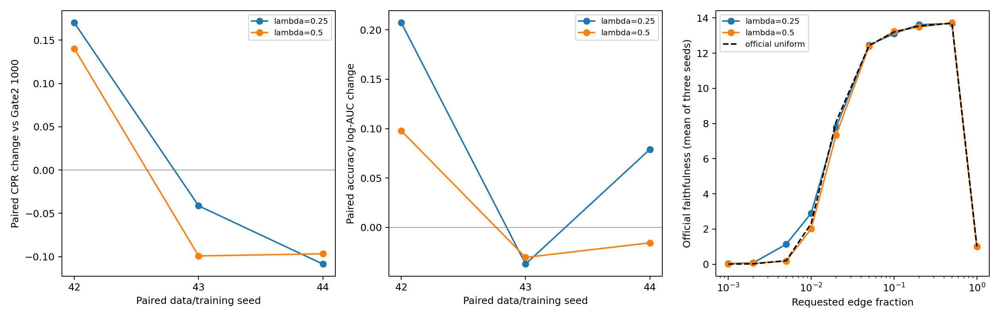

# Gate 3 CPR-aware sparsity sampling

Both mixtures failed the prespecified screening gates. Negative result: no confirmation, no added hyperparameters, no Gate 4.

Original Gate2 criteria SHA-256: `f200fc163bfb0e70b4790bde28ed3a6748bf9051c7d574ed7e23bda69cf0dbde`. Frozen sampling protocol SHA-256: `6ff6c0aed7cdfb8614bd16f022fcfbb8cdfb23d644691af8452a5dc4a9f9f808`.

## Protocol and invariants

Official trainer k_sampler hook only; edge patching, optimizer, mask differentiation and official MIB evaluation sources remain pinned and unmodified. This is a static CPR-aware mixture, not an online loss-adaptive method. N=128 paired discovery/training seeds 42/43/44; unchanged seed-42 validation cohort of 128 prompts. No public/private test or leaderboard access.

# Gate 3 sampling protocol — frozen before training

Frozen criteria SHA-256: `f200fc163bfb0e70b4790bde28ed3a6748bf9051c7d574ed7e23bda69cf0dbde`. Protocol SHA-256: `6ff6c0aed7cdfb8614bd16f022fcfbb8cdfb23d644691af8452a5dc4a9f9f808`.

**sampling**: lambda Uniform[1,N) + (1-lambda) sum_j q_j Uniform[L_j,H_j); q_j=w_j^1/sum(w_except_full); weights are linear CPR trapezoids.

**rounding**: c_j=int(p_j*N), positive floor matching the official evaluator; k remains floating, never rounded after jitter.

**jitter**: L=max(1,0.95*c); H=min(N-1,1.05*c); uniform over truncated interval, no clipping point masses.

**endpoint**: Full graph p=1 has fixed faithfulness 1, constant CPR contribution .25 and no ranking objective; exclude ONLY from grid training, renormalize .749 remaining mass. Evaluation grid unchanged. Uniform branch retains original near-full k<N behavior.

**rng**: Exactly one global CPU float32 torch.rand(1) per step, same consumption as official uniform. Inverse mixture CDF and category residual provide branch, grid index, jitter. Python row RNG untouched. No feedback/private RNG. Original checkpoint CPU/CUDA/Python/NumPy RNG restoration suffices.

**screen_rule**: Apply frozen primary numerical gates provisionally at 1000 vs matching 1000 baselines, OR frozen efficiency alternative vs 5000 baseline. This does not establish 5000 success. If none eligible stop. Rank eligible by mean paired relative CPR gain vs 1000; exact tie chooses lambda .5. No extra variants.

**confirmation**: Resume the one winner from step 1000 to 5000 for all three seeds; charge screen, restart/cache rebuilding and all other trials. Match frozen 5000 criteria without changes.

**memory**: Peak torch.cuda.max_memory_allocated, maximum across actual stages/attempts. Paired ratio of mean peaks, limit from original criteria.

**time**: CUDA-synchronized perf_counter. Screen training time/peak guards compare fresh uniform timing controls verified against Gate2; quality always Gate2. Confirmation training cost sums screen+continuation+donor-cache rebuilds against Gate2 measured 5000 training times; total costs additionally reported.

Static CPR-aware mixture; no online loss/validation adaptation. No edge-patching, optimizer, gradient or evaluator changes.


Three fresh uniform timing controls reproduced Gate2 score tensors bitwise, as well as row/k draws and official faithfulness/accuracy (numeric tolerance 1e-6 for faithfulness). Quality comparisons use the original Gate2 checkpoints; fresh controls provide matched cold-reference timing and memory. Baseline replay work is charged in research compute.

## 1000-step paired comparisons

| lambda | seed | cpr | baseline_cpr | cpr_delta | relative_cpr_gain | cmd | baseline_cmd | cmd_delta | accuracy_auc | baseline_accuracy_auc | accuracy_auc_delta |
| --- | --- | --- | --- | --- | --- | --- | --- | --- | --- | --- | --- |
| 0.2500 | 42 | 10.1177 | 9.9477 | 0.1700 | 0.0171 | 9.1228 | 8.9735 | 0.1492 | 0.8536 | 0.6465 | 0.2072 |
| 0.2500 | 43 | 10.2211 | 10.2624 | -0.0413 | -0.0040 | 9.2338 | 9.2735 | -0.0397 | 0.7312 | 0.7683 | -0.0371 |
| 0.2500 | 44 | 9.9979 | 10.1065 | -0.1086 | -0.0107 | 9.0038 | 9.1185 | -0.1146 | 0.8293 | 0.7503 | 0.0791 |
| 0.5000 | 42 | 10.0878 | 9.9477 | 0.1402 | 0.0141 | 9.0998 | 8.9735 | 0.1263 | 0.7443 | 0.6465 | 0.0978 |
| 0.5000 | 43 | 10.1632 | 10.2624 | -0.0992 | -0.0097 | 9.1753 | 9.2735 | -0.0982 | 0.7380 | 0.7683 | -0.0303 |
| 0.5000 | 44 | 10.0098 | 10.1065 | -0.0967 | -0.0096 | 9.0229 | 9.1185 | -0.0956 | 0.7347 | 0.7503 | -0.0156 |

Positive CPR changes are better for the published CPR objective. Positive CMD changes mean worse reproduction of full-model margins. Accuracy/log-AUC and the 0.5/1/2/5% compact guardrails are evaluated independently; amplification alone is not general fidelity improvement.

## Screening means and resource overhead

| lambda | cpr_delta | relative_cpr_gain | cmd_delta | accuracy_auc_delta | training_seconds | baseline_training_seconds | peak_allocated_mib | baseline_peak_allocated_mib | training_ratio | memory_ratio |
| --- | --- | --- | --- | --- | --- | --- | --- | --- | --- | --- |
| 0.2500 | 0.0067 | 0.0008 | -0.0017 | 0.0830 | 275.2722 | 273.0276 | 3906.0181 | 3906.0181 | 1.0082 | 1.0000 |
| 0.5000 | -0.0186 | -0.0017 | -0.0225 | 0.0173 | 276.4854 | 273.0276 | 3906.0181 | 3906.0181 | 1.0127 | 1.0000 |

## All frozen screening checks

```json
{
  "0.5": {
    "provisional_primary_1000": {
      "passed": false,
      "checks": {
        "cpr_gain": false,
        "positive_seeds": false,
        "cmd_guard": true,
        "training_time_guard": true,
        "memory_guard": true,
        "accuracy_auc_guard": true,
        "compact_accuracy_0.005": false,
        "compact_accuracy_0.01": true,
        "compact_accuracy_0.02": true,
        "compact_accuracy_0.05": true
      }
    },
    "efficiency_1000_vs_5000": {
      "passed": false,
      "checks": {
        "cpr_noninferiority": false,
        "cmd_noninferiority": true,
        "compute_saving": true,
        "accuracy_auc_guard": false,
        "compact_accuracy_0.005": false,
        "compact_accuracy_0.01": true,
        "compact_accuracy_0.02": true,
        "compact_accuracy_0.05": true
      }
    },
    "eligible": false,
    "mean_paired_relative_cpr_gain": -0.0017157307960069049
  },
  "0.25": {
    "provisional_primary_1000": {
      "passed": false,
      "checks": {
        "cpr_gain": false,
        "positive_seeds": false,
        "cmd_guard": true,
        "training_time_guard": true,
        "memory_guard": true,
        "accuracy_auc_guard": true,
        "compact_accuracy_0.005": true,
        "compact_accuracy_0.01": true,
        "compact_accuracy_0.02": true,
        "compact_accuracy_0.05": true
      }
    },
    "efficiency_1000_vs_5000": {
      "passed": false,
      "checks": {
        "cpr_noninferiority": false,
        "cmd_noninferiority": true,
        "compute_saving": true,
        "accuracy_auc_guard": false,
        "compact_accuracy_0.005": false,
        "compact_accuracy_0.01": true,
        "compact_accuracy_0.02": true,
        "compact_accuracy_0.05": true
      }
    },
    "eligible": false,
    "mean_paired_relative_cpr_gain": 0.0007738770529713014
  }
}
```

At 1000 steps the primary numerical thresholds are conservative provisional screening gates, not a claim of passing the frozen 5000-step criterion. The frozen alternative compares 1000-step candidates with 5000-step uniforms, charging sampling overhead. Winner selection uses only the frozen rule. Three paired seeds are descriptive, not statistical significance.

## Compact decisions

| lambda | seed | accuracy_delta_0.005 | accuracy_delta_0.01 | accuracy_delta_0.02 | accuracy_delta_0.05 |
| --- | --- | --- | --- | --- | --- |
| 0.2500 | 42 | 0.9375 | 0.8516 | 0.0000 | 0.0000 |
| 0.2500 | 43 | -0.2578 | -0.0703 | 0.0000 | 0.0000 |
| 0.2500 | 44 | 0.6719 | 0.0078 | 0.0000 | 0.0000 |
| 0.5000 | 42 | 0.1094 | 0.8203 | 0.0000 | 0.0000 |
| 0.5000 | 43 | -0.2266 | -0.0391 | 0.0000 | 0.0000 |
| 0.5000 | 44 | -0.1406 | 0.0078 | 0.0000 | 0.0000 |

Complete un-clipped faithfulness/accuracy curves and post-pruning edge counts are in faithfulness_curves.csv; per-job rankings, exact scores, all optimizer logs, k draws, example draws and gradients are retained.

## 5000-step confirmation

Not run: no screened winner.

## Compute

| job | lambda | seed | training_seconds | stage_seconds | peak_allocated_mib | forward_batches | example_forwards | backward_calls | optimizer_updates | launch_seconds |
| --- | --- | --- | --- | --- | --- | --- | --- | --- | --- | --- |
| lambda0.25_seed42 | 0.2500 | 42 | 273.2138 | 306.3148 | 3911.3560 | 1296 | 4200 | 1000 | 1000 | 320.8418 |
| lambda0.25_seed43 | 0.2500 | 43 | 274.7649 | 307.1714 | 3906.5015 | 1296 | 4200 | 1000 | 1000 | 321.4500 |
| lambda0.25_seed44 | 0.2500 | 44 | 277.8377 | 310.4598 | 3900.1968 | 1296 | 4200 | 1000 | 1000 | 325.0424 |
| lambda0.5_seed42 | 0.5000 | 42 | 275.1119 | 307.5231 | 3911.3560 | 1296 | 4200 | 1000 | 1000 | 323.5247 |
| lambda0.5_seed43 | 0.5000 | 43 | 275.6458 | 311.4902 | 3906.5015 | 1296 | 4200 | 1000 | 1000 | 327.6840 |
| lambda0.5_seed44 | 0.5000 | 44 | 278.6986 | 311.3874 | 3900.1968 | 1296 | 4200 | 1000 | 1000 | 327.8315 |
| uniform_seed42 | 1.0000 | 42 | 277.0086 | 321.1744 | 3911.3560 | 1296 | 4200 | 1000 | 1000 | 341.3348 |
| uniform_seed43 | 1.0000 | 43 | 263.6376 | 306.5798 | 3906.5015 | 1296 | 4200 | 1000 | 1000 | 323.5901 |
| uniform_seed44 | 1.0000 | 44 | 278.4367 | 311.2464 | 3900.1968 | 1296 | 4200 | 1000 | 1000 | 329.4143 |

Actual sum of job end-to-end timers: **49.012 min**; synchronized model/data/training/evaluation stages: **46.556 min**. Real root forward batches: **11,664**; example-forwards: **37,800**; optimizer updates/backwards: **9,000/9,000**. All baseline replays, both screen variants and continuation restarts are charged. CPU tests, protocol preparation and report rendering are additional overhead; report timing is recorded separately. Cached completed jobs execute no forwards. Model allocation peaks are torch.cuda.max_memory_allocated, not physical total GPU occupancy.

Confirmation training cost, if run, includes both the 1000-step prefix and actual continuation (with rebuilt donor cache); full-data Gate1 remains the unchanged reference. Gate2 5000-step training timers are used for confirmation, whose hardware/run-order timing variability must be kept in mind. Screen training/peak overhead uses contemporaneous bitwise-equivalent controls.

## Interpretation and stop condition

Leaderboard CPR and model fidelity are different outcomes: a CPR-specific success is labeled as such; general fidelity improvement additionally requires lower CMD. Any apparent success remains development-cohort evidence and requires the separately specified disjoint-validation check before a broader claim. No such check or later gate is launched here.



**No Gate 4. No leaderboard submission. No expansion beyond lambda 0.5 and 0.25.**

## Post-run artifact audit

Passed: 9 screen jobs, 0 confirmation jobs, six CPU tests, 1872 protected Gate 2 files unchanged, original criteria SHA `f200fc163bfb0e70b4790bde28ed3a6748bf9051c7d574ed7e23bda69cf0dbde`. All paired example draws and actual one-draw Torch RNG streams match Gate 2; logged k values match the frozen inverse CDF. Uniform scores are bitwise identical to Gate 2. All validation cohorts match; inference gradients are disabled. Real forwards/batches: 11,664; example-forwards: 37,800; updates: 9,000. This audit performed zero model forwards. See final_validation.json, sampling_distribution.csv and empirical_sampling_counts.csv.

### Frozen reference context on the identical 128-prompt cohort

| discovery_pool | seed | updates | cpr | cmd | accuracy_log_auc |
| --- | --- | --- | --- | --- | --- |
| 128 | 42 | 5000 | 10.2006 | 9.2129 | 0.7423 |
| 128 | 43 | 5000 | 10.2984 | 9.3020 | 0.8938 |
| 128 | 44 | 5000 | 10.2670 | 9.2707 | 0.8949 |
| 10000 | 42 | 5000 | 10.7255 | 9.7382 | 0.7383 |

The full-data Gate 1 ranking was already evaluated on this cohort in Gate 2; these values are reused, without retraining or new model calls. Gate 3 success gates compare with the paired N=128 baselines; this table preserves the official full-data reference as additional context. A development-cohort CPR gain is not a leaderboard submission or proof of better model fidelity.
