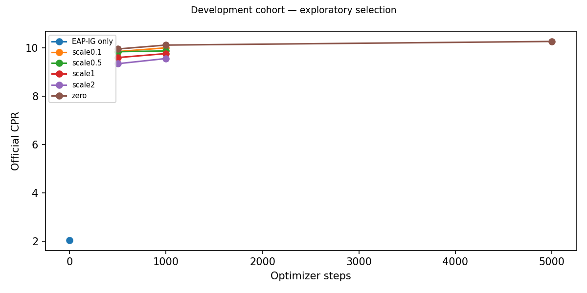
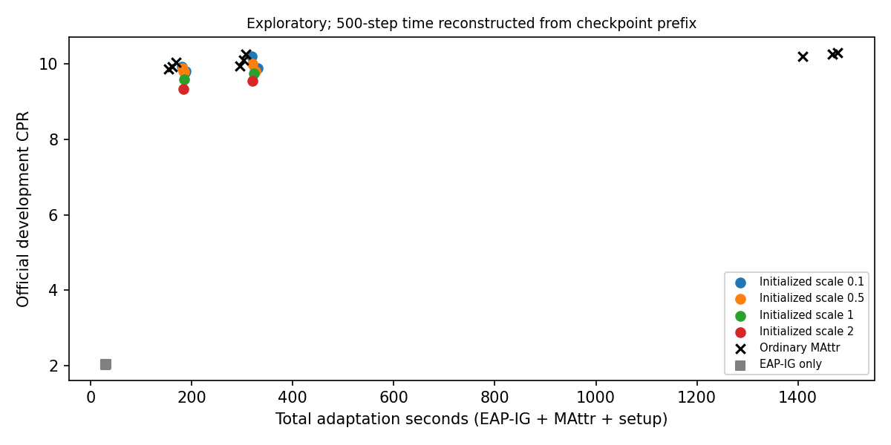
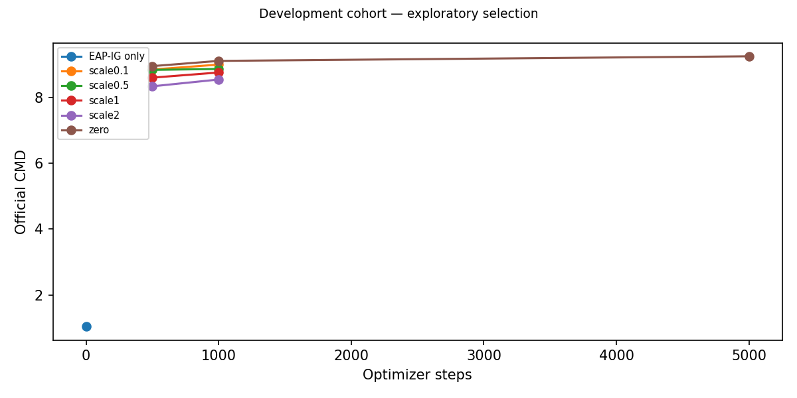
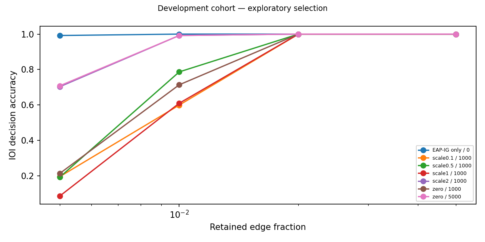
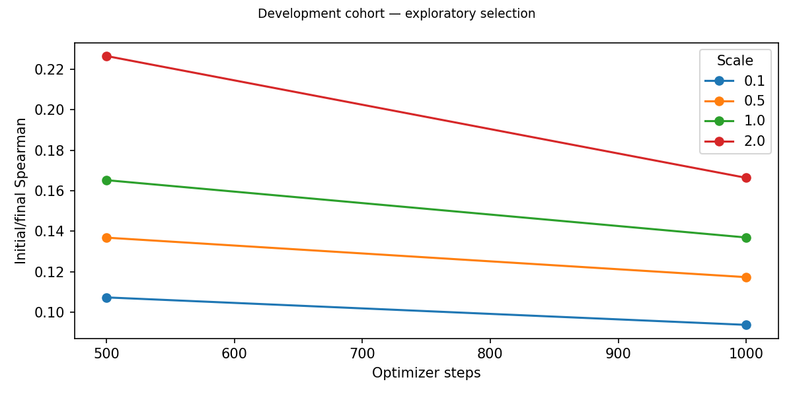
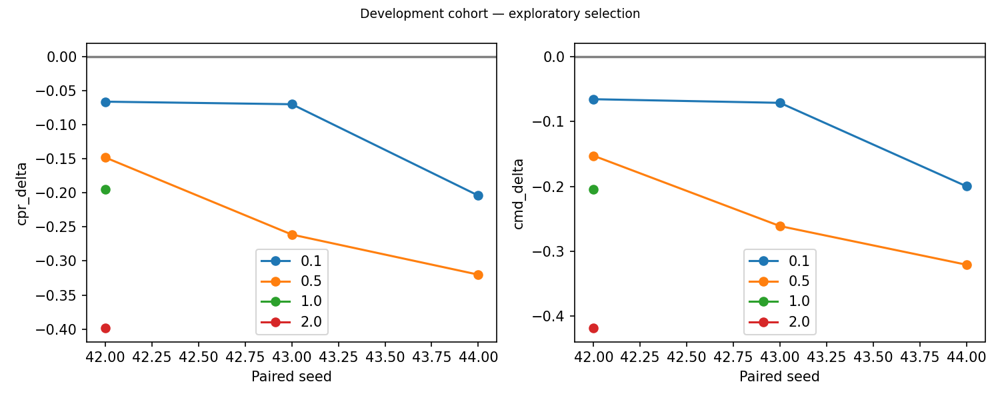

# Gate 4 EAP-IG initialization for MAttr

Negative result: neither prespecified paired screen passed. No 5,000-step confirmation, extra scales, Gate5, full-data follow-up or submission.

Frozen protocol SHA-256: `fc496f791166c7d422bdc3afbc873aa97da52c1cf3b7f9ed1f5489df1a155bb8`. Historical Gate3 criteria remain `f200fc163bfb0e70b4790bde28ed3a6748bf9051c7d574ed7e23bda69cf0dbde`. Parent commit `2be4d8752dd69907d5c25c87482ebaf2e12e651f`.

## Implementation and attribution audit

Official pinned EAP-IG inputs, five **left-endpoint** alphas 0/.2/.4/.6/.8, patching, signed negative-logit-difference loss, batch4. Official activation difference is corrupted minus clean; multiplication by the loss gradient gives estimated loss increase on corruption. Positive scores favor retention; no sign flipping or absolute values. Matrix logits column -1 is normalized to its positive flatten coordinate. Every one of 32,491 attention-q/k/v, MLP and logits edges is mapped bijectively and sentinel-tested. Rank initialization uses ascending average ranks centered in [-1,1]; ties remain equal. Only trainer-local Parameter construction changes; Adam, implicit mask derivatives, edge patches and evaluator are untouched. EAP model weights are frozen, with gradients propagated from interpolated embeddings. Model weights are never optimized.

The four-training-prompt smoke cost, training-only sign diagnostics and all scale/mask saturation/soft-mass/gradient checks are saved under smoke_seed42/. Attribution vectors and exact canonical mappings are under attribution_seed*/. Smoke used a prefix only and was never reused as a full128 attribution.

## Selection and evidence scope

Seed42 chooses at most two scales exploratorily by1000-step CPR, with lower scale breaking ties; these two must pass all paired-seed gates. Seed42 is reused, not an independent confirmation. No significance claim from three seeds. At most one winner continues, preserving full Adam/RNG state. Success requires mean paired relative CPR gain>=2%, positive differences in>=2 seeds, mean compact and log-AUC losses<=.02, CMD guard, <=10% total adaptation-time and peak-allocation overhead. Efficiency requires>=20% total adaptation saving, CPR loss<=1%, CMD increase<=.10 and accuracy losses<=.02 versus5000. A primary CPR gain is not general fidelity improvement unless CMD also decreases.

## Screening summary

| scale | seeds | mean_cpr_delta | mean_relative_cpr_gain | mean_cmd_delta | mean_accuracy_auc_delta | mean_time_ratio |
| --- | --- | --- | --- | --- | --- | --- |
| 0.1000 | 3 | -0.1134 | -0.0112 | -0.1122 | -0.0136 | 1.0774 |
| 0.5000 | 3 | -0.2432 | -0.0240 | -0.2448 | 0.0058 | 1.0739 |
| 1.0000 | 1 | -0.1946 | -0.0196 | -0.2044 | 0.0499 | 1.0952 |
| 2.0000 | 1 | -0.3986 | -0.0401 | -0.4184 | 0.1805 | 1.0845 |

## Per-seed matched-budget comparisons

| scale | seed | step | cpr | baseline_cpr | cpr_delta | relative_cpr_gain | cmd_delta | accuracy_auc_delta | time_ratio |
| --- | --- | --- | --- | --- | --- | --- | --- | --- | --- |
| 0.1000 | 42 | 1000 | 9.8815 | 9.9477 | -0.0662 | -0.0067 | -0.0657 | -0.0031 | 1.1193 |
| 0.1000 | 42 | 500 | 9.7654 | 9.9275 | -0.1622 | -0.0163 | -0.1608 | -0.0056 | 1.1614 |
| 0.1000 | 43 | 1000 | 10.1925 | 10.2624 | -0.0699 | -0.0068 | -0.0713 | 0.0109 | 1.0396 |
| 0.1000 | 43 | 500 | 9.9315 | 10.0343 | -0.1028 | -0.0102 | -0.1032 | -0.0020 | 1.0692 |
| 0.1000 | 44 | 1000 | 9.9025 | 10.1065 | -0.2040 | -0.0202 | -0.1998 | -0.0486 | 1.0732 |
| 0.1000 | 44 | 500 | 9.8151 | 9.8704 | -0.0552 | -0.0056 | -0.0474 | -0.0473 | 1.2201 |
| 0.5000 | 42 | 1000 | 9.7995 | 9.9477 | -0.1482 | -0.0149 | -0.1527 | 0.0306 | 1.1066 |
| 0.5000 | 42 | 500 | 9.7916 | 9.9275 | -0.1359 | -0.0137 | -0.1400 | 0.0274 | 1.1497 |
| 0.5000 | 43 | 1000 | 10.0012 | 10.2624 | -0.2613 | -0.0255 | -0.2611 | -0.0073 | 1.0438 |
| 0.5000 | 43 | 500 | 9.8927 | 10.0343 | -0.1416 | -0.0141 | -0.1385 | -0.0226 | 1.0743 |
| 0.5000 | 44 | 1000 | 9.7864 | 10.1065 | -0.3201 | -0.0317 | -0.3206 | -0.0059 | 1.0713 |
| 0.5000 | 44 | 500 | 9.8111 | 9.8704 | -0.0592 | -0.0060 | -0.0634 | 0.0321 | 1.1900 |
| 1.0000 | 42 | 1000 | 9.7530 | 9.9477 | -0.1946 | -0.0196 | -0.2044 | 0.0499 | 1.0952 |
| 1.0000 | 42 | 500 | 9.5881 | 9.9275 | -0.3395 | -0.0342 | -0.3419 | 0.0144 | 1.1480 |
| 2.0000 | 42 | 1000 | 9.5490 | 9.9477 | -0.3986 | -0.0401 | -0.4184 | 0.1805 | 1.0845 |
| 2.0000 | 42 | 500 | 9.3353 | 9.9275 | -0.5923 | -0.0597 | -0.6055 | 0.0855 | 1.1359 |

## Attribution-only control (zero MAttr updates)

| seed | cpr | cmd | accuracy_auc |
| --- | --- | --- | --- |
| 42 | 2.0303 | 1.0343 | 0.8903 |
| 43 | 2.0441 | 1.0480 | 0.8960 |
| 44 | 2.0255 | 1.0298 | 0.8783 |

Learned-initialization gains must be distinguished from what the EAP-IG ranking already achieves at step0. Quality/curves retain this control separately. Full10,000-example Gate1 remains the historical reference, not replaced by N128.

## Frozen decisions

```json
{
  "screen": {
    "winner": null,
    "results": {
      "0.1": {
        "primary_provisional": {
          "passed": false,
          "checks": {
            "cpr": false,
            "positive_seeds": false,
            "cmd": true,
            "compute": true,
            "memory": true,
            "accuracy_auc": true,
            "accuracy_0.005": true,
            "accuracy_0.01": false,
            "accuracy_0.02": true,
            "accuracy_0.05": true
          }
        },
        "efficiency": {
          "passed": false,
          "checks": {
            "cpr": false,
            "cmd": true,
            "compute": true,
            "accuracy_auc": false,
            "accuracy_0.005": false,
            "accuracy_0.01": false,
            "accuracy_0.02": true,
            "accuracy_0.05": true
          }
        },
        "mean_relative_cpr_gain": -0.011217030967736444
      },
      "0.5": {
        "primary_provisional": {
          "passed": false,
          "checks": {
            "cpr": false,
            "positive_seeds": false,
            "cmd": true,
            "compute": true,
            "memory": true,
            "accuracy_auc": true,
            "accuracy_0.005": false,
            "accuracy_0.01": true,
            "accuracy_0.02": true,
            "accuracy_0.05": true
          }
        },
        "efficiency": {
          "passed": false,
          "checks": {
            "cpr": false,
            "cmd": true,
            "compute": true,
            "accuracy_auc": false,
            "accuracy_0.005": false,
            "accuracy_0.01": false,
            "accuracy_0.02": true,
            "accuracy_0.05": true
          }
        },
        "mean_relative_cpr_gain": -0.024008279441660025
      }
    },
    "exploratory": true
  },
  "development_confirmation": null
}
```

## Actual research computation

| job | adaptation_seconds | training_seconds | evaluation_seconds | stage_seconds | peak_allocated_mib | cpu_rss_mib | forward_batches | example_forwards | backward_calls | optimizer_updates |
| --- | --- | --- | --- | --- | --- | --- | --- | --- | --- | --- |
| attribution_seed42 | 30.7905 | 0.0000 | 0.0000 | 28.5455 | 1237.4585 | 2952.7695 | 224 | 896 | 160 | 0 |
| attribution_seed43 | 29.5211 | 0.0000 | 0.0000 | 27.3177 | 1236.3335 | 2974.3125 | 224 | 896 | 160 | 0 |
| attribution_seed44 | 29.2248 | 0.0000 | 0.0000 | 27.0593 | 1270.8403 | 3004.5820 | 224 | 896 | 160 | 0 |
| compute_matched_seed42 | 8.6146 | 0.0000 | 28.8615 | 33.5589 | 2258.5508 | 2977.4609 | 168 | 3072 | 0 | 0 |
| compute_matched_seed43 | 8.3542 | 0.0000 | 29.5787 | 33.9954 | 2258.5508 | 2924.8945 | 168 | 3072 | 0 | 0 |
| compute_matched_seed44 | 8.4127 | 0.0000 | 29.4952 | 34.0202 | 2258.5508 | 2925.6914 | 168 | 3072 | 0 | 0 |
| eap_only_seed42 | 8.2835 | 0.0000 | 28.9425 | 32.8837 | 2258.5508 | 2938.6445 | 168 | 3072 | 0 | 0 |
| eap_only_seed43 | 8.7352 | 0.0000 | 29.3913 | 34.2735 | 2258.5508 | 2887.0352 | 168 | 3072 | 0 | 0 |
| eap_only_seed44 | 8.4067 | 0.0000 | 29.2188 | 33.8265 | 2258.5508 | 2894.1953 | 168 | 3072 | 0 | 0 |
| scale0.1_seed42 | 299.5402 | 292.0823 | 56.9192 | 354.1223 | 3911.3560 | 2986.4023 | 1464 | 7272 | 1000 | 1000 |
| scale0.1_seed43 | 288.7558 | 281.0706 | 56.2176 | 342.3322 | 3906.5015 | 2956.7695 | 1464 | 7272 | 1000 | 1000 |
| scale0.1_seed44 | 295.9177 | 288.0909 | 56.3971 | 349.7859 | 3900.1968 | 2990.1992 | 1464 | 7272 | 1000 | 1000 |
| scale0.5_seed42 | 295.8034 | 289.0758 | 56.1142 | 349.6918 | 3911.3560 | 2896.8789 | 1464 | 7272 | 1000 | 1000 |
| scale0.5_seed43 | 290.0333 | 282.4813 | 56.1122 | 343.8101 | 3906.5015 | 2996.0664 | 1464 | 7272 | 1000 | 1000 |
| scale0.5_seed44 | 295.3321 | 288.8586 | 56.8921 | 350.0602 | 3900.1968 | 2855.2617 | 1464 | 7272 | 1000 | 1000 |
| scale1_seed42 | 292.4470 | 284.5689 | 55.6347 | 345.2831 | 3911.3560 | 2963.5312 | 1464 | 7272 | 1000 | 1000 |
| scale2_seed42 | 289.2749 | 282.2039 | 56.3928 | 343.2360 | 3911.3560 | 2894.6719 | 1464 | 7272 | 1000 | 1000 |
| smoke_seed42 | 22.5598 | 0.0000 | 0.0000 | 20.4730 | 1073.0767 | 2941.8516 | 21 | 84 | 5 | 0 |

Summed instrumented stages: 51.405min; real forward batches 13,413; example-forwards 79,380; backward calls 8,485; MAttr updates 8,000. All attribution, pilot, rejected scales, continuation restarts and frozen control evaluations are charged. Peak CUDA allocation and sampled CPU RSS are measured per stage; allocator reservation differs from physical GPU occupancy.

Deployable adaptation cost includes one full128 EAP-IG job, initial model/data/setup and MAttr (including continuation cold restarts); validation evaluation is separate. Ordinary baseline setup uses the contemporaneous, bitwise Gate2-equivalent Gate3 replay, combined with the actual Gate2 checkpoint training timer. Hardware/run-order variability remains; these are measured times, not FLOP estimates. Pure CPU protocol/report analysis is additional research overhead. Initial1000 versus5000 comparisons are in efficiency_comparisons.csv. Nearest100-step ordinary checkpoints give a frozen, approximately time-matched control; actual timing mismatch is recorded, not hidden. No ordinary training is extended beyond the registered5000 budget.

## Approximate fair-compute ordinary reference

| scale | seed | initialized_step | baseline_step | initialized_adaptation_seconds | baseline_adaptation_seconds | absolute_time_mismatch_seconds | step | cpr | cmd | accuracy_auc | cohort |
| --- | --- | --- | --- | --- | --- | --- | --- | --- | --- | --- | --- |
| 0.1000 | 42 | 1000 | 1100 | 330.3307 | 324.6523 | 5.6784 | 1100 | 10.0294 | 9.0567 | 0.6410 | development |
| 0.1000 | 43 | 1000 | 1000 | 318.2770 | 306.1527 | 12.1243 | 1000 | 10.2624 | 9.2735 | 0.7683 | development |
| 0.1000 | 44 | 1000 | 1100 | 325.1425 | 333.7327 | 8.5902 | 1100 | 10.0606 | 9.0717 | 0.7621 | development |

## Plots













No Gate5, additional sweeps, full-data follow-up or leaderboard submission.

## Post-run artifact audit and attribution-only comparison

Passed five CPU tests and real CUDA artifact audit. 2232 historical files are unchanged, including Gate3 criteria SHA `f200fc163bfb0e70b4790bde28ed3a6748bf9051c7d574ed7e23bda69cf0dbde`. All 32,491 edges align, signed orientation agrees with the training-only patch test, the selected train/development manifests match Gate2, and every actual training row and uniform-k draw matches its paired baseline. No inference gradients were retained. The audit ran zero model forwards.

### Measured full128 EAP-IG cost (one per paired subset)

| seed | adaptation_seconds | training_seconds | evaluation_seconds | stage_seconds | peak_allocated_mib | cpu_rss_mib | forward_batches | example_forwards | backward_calls | optimizer_updates |
| --- | --- | --- | --- | --- | --- | --- | --- | --- | --- | --- |
| 42 | 30.7905 | 0.0000 | 0.0000 | 28.5455 | 1237.4585 | 2952.7695 | 224 | 896 | 160 | 0 |
| 43 | 29.5211 | 0.0000 | 0.0000 | 27.3177 | 1236.3335 | 2974.3125 | 224 | 896 | 160 | 0 |
| 44 | 29.2248 | 0.0000 | 0.0000 | 27.0593 | 1270.8403 | 3004.5820 | 224 | 896 | 160 | 0 |

### MAttr learning beyond its attribution-only starting ranking

| scale | step | cpr_delta_vs_eap | cmd_delta_vs_eap | accuracy_auc_delta_vs_eap |
| --- | --- | --- | --- | --- |
| 0.1000 | 500 | 7.8040 | 7.8216 | -0.2167 |
| 0.1000 | 1000 | 7.9588 | 7.9723 | -0.1802 |
| 0.5000 | 500 | 7.7985 | 7.8114 | -0.1862 |
| 0.5000 | 1000 | 7.8290 | 7.8397 | -0.1607 |
| 1.0000 | 500 | 7.5577 | 7.5777 | -0.2334 |
| 1.0000 | 1000 | 7.7227 | 7.7348 | -0.1939 |
| 2.0000 | 500 | 7.3049 | 7.3141 | -0.1622 |
| 2.0000 | 1000 | 7.5187 | 7.5209 | -0.0633 |

These are changes relative to EAP-IG alone, not ordinary zero-init MAttr; negative CPR differences cannot support attributing a gain to MAttr optimization. Cross-seed means for pilot-only scales contain only seed42; consult the per-seed table before comparing them. Compact accuracy is signed IOI margin>0, matching the official evaluator, rather than full-vocabulary top1 accuracy.

Summed actual research child-launch timers: **55.278min**, including interpreter/source checks and all registered attribution, training and frozen evaluations. The separately launched smoke process used **22.560s** after its source checks (its interpreter startup was not timed). CPU unit-test, implementation/protocol/report analysis time is additional. Official progress logs use calendar time and show WSL clock jumps; only synchronized monotonic perf_counter timers enter compute conclusions.

### Research decision

| scale | relative_cpr_gain | cmd_delta | accuracy_auc_delta | time_ratio | accuracy_delta_0.005 | accuracy_delta_0.01 | accuracy_delta_0.02 | accuracy_delta_0.05 |
| --- | --- | --- | --- | --- | --- | --- | --- | --- |
| 0.1000 | -0.0112 | -0.1122 | -0.0136 | 1.0774 | -0.0182 | -0.1146 | 0.0000 | 0.0000 |
| 0.5000 | -0.0240 | -0.2448 | 0.0058 | 1.0739 | -0.0208 | 0.0729 | 0.0000 | 0.0000 |

Timing-display correction: 500-step adaptation points use the measured checkpoint-prefix training timer plus the same run's fixed setup and EAP-IG cost. They were not separately launched 500-step processes; fixed setup includes the full run's postprocessing overhead. The frozen initial reporter used the complete1,000-step job time for these early display points; the published paired CSV/table and compute figure are corrected here. All 1,000-step screen times, metrics, frozen decisions and protocol/source snapshots are unchanged.

Neither registered screen passes leaderboard-quality or efficiency gates. Final initialized CPR at5,000 steps remains **untested**, because the stopping rule forbids confirmation after failure. Lower CMD indicates closer full-model margins at1,000 steps, while the compact-accuracy regressions prevent calling this an overall fidelity improvement. No disjoint confirmation cohort, extra scale, full-data follow-up, Gate5 or leaderboard was run. The small scale0.5 log-AUC gain, where present, is a secondary descriptive result and does not override the failed CPR/compact safeguards.
